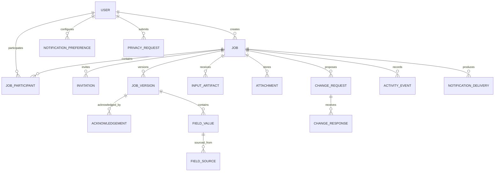
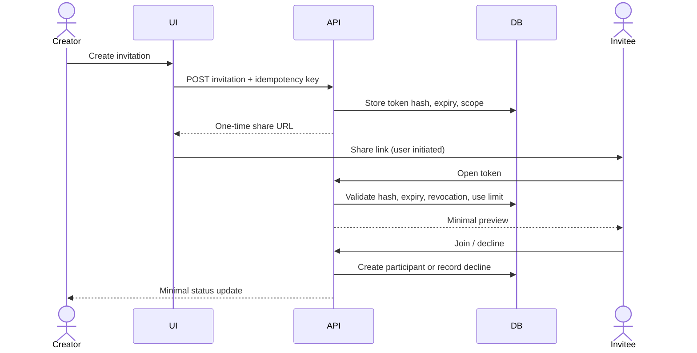
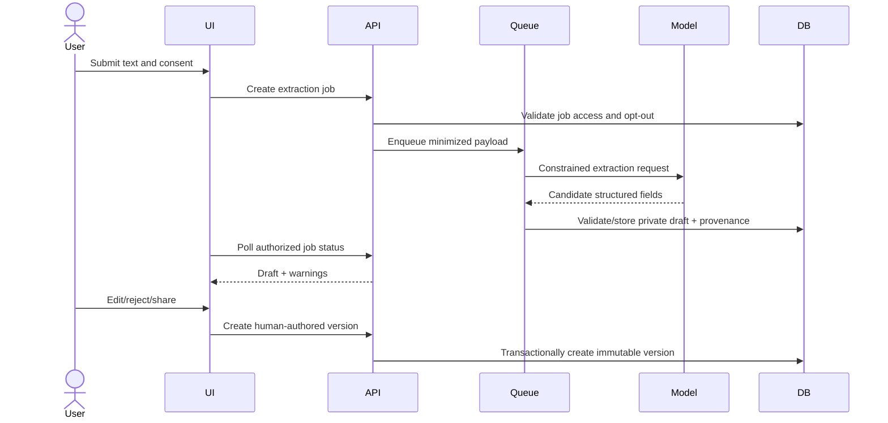

# nwa
nwa
# NaWeAgree — All-in-One Product Plan & Full Frontend Prototype Blueprint

**Status:** Consolidated planning bundle; concept validation, implementation, audits, and legal review remain outstanding.  
**Working product name:** NaWeAgree (availability not verified).  
**Date:** 20 October 2026.  
**Purpose:** One self-contained file combining the product plans and the actionable frontend prototype specification.

> This file consolidates the discipline plans into one reading/build document. It does not turn hypotheses into verified facts. Market evidence, user research, security audits, vendor selection, and qualified legal advice are still required. The frontend prototype is defined as a synthetic, local demo; it is not a production application.

## Contents

1. [Part 1 — Master product plan](#part-1) *(source: `NAWEAGREE_PRODUCT_MASTER_PLAN.md`)*
2. [Part 2 — Product discovery and detailed PRD](#part-2) *(source: `NAWEAGREE_PRODUCT_DISCOVERY_AND_PRD.md`)*
3. [Part 3 — Product rulebook and requirements](#part-3) *(source: `NAWEAGREE_PRODUCT_RULEBOOK_AND_REQUIREMENTS.md`)*
4. [Part 4 — UX, content, and accessibility specification](#part-4) *(source: `NAWEAGREE_UX_CONTENT_AND_ACCESSIBILITY_SPEC.md`)*
5. [Part 5 — Technical, security, privacy, and operations specification](#part-5) *(source: `NAWEAGREE_TECHNICAL_SECURITY_OPERATIONS_SPEC.md`)*
6. [Part 6 — Data, API, and implementation blueprint](#part-6) *(source: `NAWEAGREE_DATA_API_IMPLEMENTATION_BLUEPRINT.md`)*
7. [Part 7 — Quality, release, and security verification plan](#part-7) *(source: `NAWEAGREE_QUALITY_RELEASE_AND_SECURITY_PLAN.md`)*
8. [Part 8 — Research, GTM, and operations plan](#part-8) *(source: `NAWEAGREE_RESEARCH_GTM_AND_OPERATIONS_PLAN.md`)*
9. [Part 9 — Unconventional scenarios and product horizons](#part-9) *(source: `NAWEAGREE_UNCONVENTIONAL_SCENARIOS_AND_HORIZONS.md`)*
10. [Part 10 — Full frontend prototype build specification](#part-10) *(source: `NAWEAGREE_FRONTEND_PROTOTYPE_BUILD_SPEC.md`)*

---

## Part 1 — Master product plan

_Source document: `NAWEAGREE_PRODUCT_MASTER_PLAN.md`._

**Status:** Expanded planning baseline; discovery and market validation not yet completed  
**Version:** 1.0 · **Date:** 20 October 2026  
**Working name:** NaWeAgree (name, domain, and trademark availability not verified)  
**Product category:** Shared planning and change-tracking for custom work  
**Planning principle:** Broad product thesis, narrow first proof. The first pilot should validate one workflow deeply; it should not define the whole product as a tailor app.

### Single-file bundle

For one self-contained reading copy combining this plan, all discipline specifications, and the full frontend prototype build specification, see [`NAWEAGREE_ALL_PLANS_AND_FRONTEND_PROTOTYPE_BLUEPRINT.md`](./NAWEAGREE_ALL_PLANS_AND_FRONTEND_PROTOTYPE_BLUEPRINT.md).

### Companion specifications

This master plan is the decision overview. The following documents expand the work by discipline; they are planning artifacts, not proof that research, implementation, audits, or legal review have been completed.

- [Product discovery, expanded PRD, UX, research, prioritization, commercial, and support specification](./NAWEAGREE_PRODUCT_DISCOVERY_AND_PRD.md)
- [Detailed product rules, states, permissions, requirements, and acceptance criteria](./NAWEAGREE_PRODUCT_RULEBOOK_AND_REQUIREMENTS.md)
- [UX, screen-level textual wireframes, content, accessibility, and localization plan](./NAWEAGREE_UX_CONTENT_AND_ACCESSIBILITY_SPEC.md)
- [Technical architecture, data, API, AI, security, privacy, QA, and operations specification](./NAWEAGREE_TECHNICAL_SECURITY_OPERATIONS_SPEC.md)
- [Data dictionary, API contracts, diagrams, and implementation milestones](./NAWEAGREE_DATA_API_IMPLEMENTATION_BLUEPRINT.md)
- [Quality, security verification, test cases, and release gates](./NAWEAGREE_QUALITY_RELEASE_AND_SECURITY_PLAN.md)
- [Research execution, market sizing method, pilot, GTM, pricing, support, and shutdown plan](./NAWEAGREE_RESEARCH_GTM_AND_OPERATIONS_PLAN.md)
- [Unconventional scenarios, edge cases, societal impacts, and long-horizon options](./NAWEAGREE_UNCONVENTIONAL_SCENARIOS_AND_HORIZONS.md)

The plan intentionally separates **decisions**, **hypotheses**, and **work still to do**. The companion specifications make the current proposal testable, but they do not substitute for user research, implementation, security audits, market evidence, vendor review, or qualified legal advice. Do not turn a proposed target, market estimate method, persona, or risk rating into a factual claim without validation.

> This is a decision-ready planning baseline, not evidence that the market has been validated. Market size, competitor capabilities, language quality, willingness to pay, legal enforceability, and AI accuracy remain research questions. Do not present assumptions below as established facts.

---

## 1. Executive decision

### Product thesis

**NaWeAgree turns scattered conversations about custom work into a shared, editable plan that both the customer and service provider can understand, confirm, and update.**

People already arrange bespoke services through conversations, images, voice notes, calls, and payment messages. The intended product does not replace those relationships or force people into a marketplace. It helps the parties make the important details explicit, notice what is still unclear, and keep a reliable history when plans change.

### Problem statement

For a one-off or customized job, information can be spread across channels and expressed ambiguously. The customer and provider may each believe they agreed to a different scope, price, deadline, material, or revision. When a detail changes, the earlier agreement can become hard to find. The result may be rework, unexpected cost, delay, or damaged trust.

This problem statement is a **hypothesis to validate** with both sides of real jobs.

### Initial strategic choices

1. **Product is cross-category; first validation is vertical.** Potential workflows include tailoring, repairs, carpentry, printing, event services, catering, photography, and design. Start with whichever category gives access to real users and a testable job cycle—not because the platform is limited to that trade.
2. **The core unit is a job, not a marketplace listing.** A customer and provider create or join a private job room.
3. **AI drafts; people decide.** AI extracts details, identifies ambiguity, and summarizes changes. It never silently creates obligations, resolves disputes, declares fraud, or decides who is right.
4. **Confirmation is not a legal guarantee.** The product records that each party reviewed and acknowledged a version. Legal status and terms require qualified legal review before any claim of enforceability.
5. **No payments or public ratings in MVP.** Payment receipts, private milestones, and feedback may be explored later, with consent and safeguards.

### Elevator pitch

> **NaWeAgree helps customers and service providers get on the same page about custom work. It turns the details in their conversation into a shared plan, flags what is unclear, and makes later changes visible to both sides.**

### Product principles

- Start from users’ existing behavior; do not require perfect forms or accounting language.
- Make uncertainty visible; never invent missing terms.
- Keep a human confirmation step for every material AI-generated change.
- Show the source for extracted facts where possible.
- Give both parties equal visibility and agency.
- Minimize collection and retention of private conversations and documents.
- Optimize for mobile, low bandwidth, interrupted sessions, and plain language.
- Never use an AI confidence score as a proxy for trustworthiness or character.

---

## 2. Discovery, market, and competitive hypotheses

### Hypotheses to test

| ID | Hypothesis | Evidence to collect | Disconfirming signal |
|---|---|---|---|
| H1 | Customers and providers often lose or misremember job details shared across chats, calls, and images. | Separate interviews with both parties; ask about the last completed and last problematic job. | Users can reliably retrieve and agree on details without meaningful effort or harm. |
| H2 | A jointly visible job summary is useful before work starts. | Test a clickable prototype with a real, recent job. | Either party sees it as unnecessary paperwork or a tool for blaming the other. |
| H3 | Change history is more valuable than a generic AI chat assistant. | Observe reactions to a real change request and version comparison. | Users mainly need discovery, payments, logistics, or another job entirely. |
| H4 | Providers will invite customers into a job room if setup takes little effort. | Measure provider setup and customer join completion in a pilot. | Providers perceive it as extra unpaid administration. |
| H5 | Natural-language and voice input can reduce form friction. | Usability tests with actual accents, devices, noisy settings, and consented examples. | Transcription/extraction errors exceed users’ tolerance or structured forms are faster. |
| H6 | The product can be useful without processing payments or making legal claims. | Test whether the shared brief and change log resolve a real coordination need. | Users only value the product if it moves money or provides formal dispute resolution. |

### Discovery plan

Conduct a small, qualitative discovery round before building a full product. Recruit **both customers and providers** in at least two different custom-work categories if access allows. Ask participants to walk through a recent job using artifacts they are comfortable sharing. Do not ask only, “Would you use this?” Observe how they currently agree on scope, revisions, dates, and costs.

Record consent, anonymize research notes, avoid collecting unnecessary customer chats or financial data, and let participants withdraw. Do not publish participant stories or screenshots without separate permission.

Suggested questions:
- Tell me about the last custom job you ordered / completed. How did it begin?
- Where did the key details live? What was difficult to find later?
- What changed after work began? How did both people know?
- What do you do when a detail is missing or disputed?
- At what point would a shared summary help—and when would it feel like a burden?
- What information would you not want this app to store?
- What would make you trust or distrust an AI-generated summary?

### Competitive and substitute landscape

No competitor claims have been verified for this plan. Research substitutes, not just apps explicitly branded as competitors.

| Substitute/category | User benefit today | Question for research | NaWeAgree opportunity to test |
|---|---|---|---|
| WhatsApp/Telegram conversations | Familiar communication, media, voice notes | Can users find and agree on the latest version? | Convert conversation fragments into a shared brief and change history. |
| Calls and in-person agreements | Fast and personal | How are verbal decisions remembered or confirmed? | Lightweight written recap after a call. |
| Paper notebooks / receipts | Low cost, familiar, usable offline | Who has the record and can the other party inspect it? | Shared, readable job record with attachments. |
| General project/task tools | Tasks, timelines, collaboration | Are they too complex for a one-off local service job? | Small, job-specific plan rather than a full work-management suite. |
| Invoicing/accounting tools | Quotes, bills, transaction records | Do they cover scope ambiguity and revisions? | Focus on the agreement before and during delivery. |
| Service marketplaces | Discovery, booking, sometimes payments/reviews | Do users want a marketplace or only coordination with someone already chosen? | Remain provider-neutral; integrate or expand only if discovery is validated. |

**Research deliverable:** competitor/substitute feature matrix with dated source links, pricing, market availability, privacy model, and hands-on test notes. Do not fill it with guessed feature checkmarks.

### Market sizing method (no invented numbers)

Use a bottom-up model after selecting initial geographies and categories:
- **TAM:** estimated number of Nigerian customer-provider pairs arranging eligible custom jobs annually × realistically addressable annual revenue per active pair.
- **SAM:** subset reachable in selected service categories, locations, device/connectivity conditions, and distribution channels.
- **SOM:** obtainable active pairs under a defined time, budget, and acquisition model.

Validate category counts and pricing with credible published data or primary research. Show assumptions, ranges, and sources; do not imply that a broad population figure is the addressable market.

---

## 3. Users, roles, and jobs to be done

### Primary actors

1. **Customer / commissioner** — describes the desired outcome, shares references, reviews scope, approves changes, and needs clarity about price and timing.
2. **Provider / maker** — clarifies feasibility, materials, quote, milestones, and delivery; needs fewer misunderstandings without spending excessive time on administration.
3. **Collaborator (later)** — a helper or colleague who needs limited access to a job.
4. **Support / safety operator** — responds to access, abuse, privacy, and account issues; cannot secretly edit agreements.
5. **Platform administrator** — manages system configuration and support access under audited, least-privilege controls.

A person may be a customer on one job and a provider on another. Avoid fixed identities that stigmatize or lock users into one role.

### Candidate segments for validation

- Tailors and garment customers
- Home repair, carpentry, and fabrication providers
- Printing and branding shops with custom orders
- Event, catering, decor, and photography providers
- Independent designers and other bespoke service professionals

Do not claim all these segments share identical workflows. Validate them separately and use configurable templates only where their requirements genuinely overlap.

### Jobs to be done

- “When I describe something custom, help us capture what we mean before work starts.”
- “When we have agreed something in chat, help us make a clear shared record without retyping everything.”
- “When a detail changes, show both of us what changed and ask us to acknowledge it.”
- “When a key detail is missing, help us ask the right question before it causes a problem.”
- “When I return to a job later, show me the latest confirmed version and what is still pending.”

### Current-to-future journey

| Stage | Current-state friction (hypothesis) | NaWeAgree experience | Success signal |
|---|---|---|---|
| Request | Request arrives in a mixture of text, calls, images, and voice | Start a job from a link or simple job form; add references | Both parties understand how to begin |
| Clarification | Important details are buried or assumed | Draft brief lists known, missing, and conflicting details | Users resolve meaningful gaps before approval |
| Quote / scope | Price may not state what is included | Shared fields distinguish scope, price, exclusions, and timing | Fewer unresolved assumptions at confirmation |
| Confirmation | Parties may refer to different messages | Each party reviews the same version and acknowledges it | Both confirmations recorded for that version |
| Work in progress | Status is unclear; updates are scattered | Simple stages, dated notes, and optional evidence | Users can identify next action and current status |
| Change | Revision can create extra work or unexpected cost | Change request, before/after diff, revised terms, re-confirmation | No material change is silently applied |
| Completion | Delivery and approval may be ambiguous | Completion note and optional handover record | Job closed with an accessible final summary |
| Aftercare | Follow-up can be lost | Optional warranty/care note or follow-up reminder (later) | Useful repeat use without intrusive nudges |

---

## 4. Scope, roadmap, and prioritization

### MVP: prove the shared-plan loop

**Must have**
- Mobile-first web experience; no app-store install required for pilot.
- Create a job and invite the other party using a private link.
- Role-neutral job room with participant identity and access controls.
- Create/edit a structured brief with configurable job type and fields.
- Add text and reference images; show the source of each extracted detail where available.
- AI-assisted draft extraction from pasted text or a supplied transcript; safe manual entry fallback.
- Explicit “known / needs clarification / conflicting” states.
- Human edit and confirmation by each party; confirmation tied to a specific version.
- Change request that creates a new version and readable before/after diff.
- Simple status, activity timeline, and notification preferences.
- Delete/export request process and basic support/contact route.

**Should have, if quality permits**
- Voice-note transcription through a vetted provider, with explicit consent and text review.
- Share-sheet or copy/paste intake that does not require a messaging-platform integration.
- Low-bandwidth interface and draft persistence.
- English-first, plain-language copy; one additional language only after qualified review and user testing.

**Could have after validation**
- More job templates, provider-created reusable templates, milestone evidence, calendar reminders, receipt attachments, optional completion record, carefully designed customer/provider feedback.
- Additional Nigerian languages and offline capture/sync.
- Integrations with messaging platforms only through approved APIs and a clear consent model.

**Won’t have in MVP**
- Marketplace discovery, rankings, public reviews, or “verified provider” claims.
- Escrow, lending, credit scoring, payment initiation, or automated proof-of-payment judgments.
- AI arbitration, dispute verdicts, legal enforceability claims, or automatic contract formation.
- Automatic outreach to a user’s contacts or importing private chats without a deliberate user action.
- Broad business accounting, inventory, CRM, invoicing, or general-purpose project management.
- AI-generated prices, deadlines, measurements, or promises presented as facts.

### MoSCoW decision record

| Priority | Capability | Rationale |
|---|---|---|
| Must | Shared brief, mutual version confirmation, change diff | Directly proves the core value proposition. |
| Must | Manual editing and clear uncertainty | Prevents AI from becoming an unreviewable source of truth. |
| Must | Private invite and role-based access | Jobs involve private details and two-party collaboration. |
| Should | Voice input | Promising accessibility and friction benefit, but quality must be demonstrated. |
| Should | Attachments and source links | Keeps references connected to the relevant detail. |
| Could | Milestones, reminders, localization | Useful expansions after observing a real workflow. |
| Won’t (MVP) | Marketplace, payment rails, credit/risk scores | High scope, trust, legal, and safety burden unrelated to first proof. |

### Roadmap horizons

Timing is indicative and dependent on discovery, team capacity, and pilot evidence—not a delivery commitment.

- **H0 — Challenge/demo slice:** one seeded job, one draft extraction, one ambiguity, two confirmations, one visible change. Explain mock data and AI limitations honestly.
- **H1 — Private pilot:** real job rooms, secure invitations, audit trail, feedback and deletion support; test with a small cohort recruited through direct relationships.
- **H2 — Workflow fit:** improve templates and language/accessibility, repeat-use flows, reminders, optional milestones, and provider onboarding based on observed behavior.
- **H3 — Scale options:** integrations, selected new verticals, monetization tests, analytics and operational capacity; proceed only when retention and trust evidence support expansion.

### One-day challenge demonstration

For the challenge on **Wednesday, 21 October 2026**, keep the demonstrator to one coherent path. It can use clearly labeled sample data and simulated extraction if live AI is unreliable. Do not represent simulated messages as real research.

1. Show a messy but realistic request (consented or fictional).
2. Generate a draft job card with source text and one uncertainty.
3. Have the user resolve that uncertainty.
4. Show both participants acknowledging the same version.
5. Change one requirement; show a diff and require re-confirmation.

Success is a judge understanding the problem, seeing the value, and being able to complete the flow—not the number of screens or AI features.

---

## 5. Product requirements and acceptance criteria

### Epics

- **E1: Job room and invitation** — start a private shared workspace with explicit participants.
- **E2: Brief and extraction** — turn natural-language inputs into a reviewable structured plan.
- **E3: Confirmation and versioning** — record acknowledgements against immutable versions.
- **E4: Changes and activity** — request, compare, and confirm material changes.
- **E5: Notifications and accessibility** — help users notice relevant events without coercive messaging.
- **E6: Privacy, safety, and account controls** — manage access, retention, export, and deletion.
- **E7: Operations and measurement** — support, monitor, and improve the service without collecting unnecessary content.

### Representative user stories and acceptance criteria

**Create a shared job**
- As a customer or provider, I can create a job and invite the other participant so we can work from the same record.
- Given a valid invitation, when the recipient opens it, then they can see who invited them and what access they will receive before joining.
- Invalid, expired, revoked, or already-used single-use links must fail safely and explain how to request a new one.

**Review AI extraction**
- As a participant, I can inspect and correct a draft before it becomes part of the shared confirmed brief.
- Given ambiguous input, when the AI cannot determine a field reliably, then it marks it as unknown or asks a question rather than inventing a value.
- Each extracted field should link to its input source when feasible; edits must be attributable to the person making them.
- AI output is always a draft. It cannot confirm a job or change an approved version by itself.

**Confirm a version**
- As either participant, I can acknowledge the version I reviewed.
- Given a confirmed version, when a material field changes, then the system creates a new version and marks prior acknowledgements as applying only to the earlier version.
- The UI must show which participant has and has not acknowledged the current version. No party can impersonate the other.

**Manage a change**
- As a participant, I can propose a change and explain why it is needed.
- Given a proposed change, when the other participant opens it, then they can see the old value, proposed value, related fields, and status before acknowledging.
- A change remains pending until the required participants acknowledge it; it must not silently overwrite a confirmed brief.

**Remove access / leave a job**
- A participant can request account or job deletion, report unwanted content, and revoke an invitation they control where appropriate.
- Removal must not create a false impression that an already-shared record has been erased from another participant’s device. Explain retention limits plainly.

### State model

`draft → clarification_needed → ready_for_review → partially_confirmed → confirmed → in_progress → completion_review → completed`

A change to a material term after confirmation creates a new **draft version** and returns the job to `partially_confirmed` or `ready_for_review` as appropriate. Jobs may also become `cancelled` or `archived`. Avoid one opaque “approved” flag for the whole job.

Material fields should be configurable by job template, but changes to scope, cost, due date, delivery, or specifications should normally require renewed acknowledgement. Define exact policy after user testing and legal review.

---

## 6. UX, information architecture, and content

### Information architecture

- Landing / explanation
- Create or join a job
- Job room
  - Overview / current confirmed brief
  - Questions and unresolved details
  - Changes and version history
  - Activity / milestones
  - Attachments
  - Participants and access
- Notification preferences
- Help, report a problem, privacy, account/data controls

### Core screens

1. **Entry:** what the product does, privacy summary, create/join action.
2. **Create job:** job type, short description, invite participant.
3. **Draft brief:** editable fields, source references, confidence/unknown states, clarification prompts.
4. **Shared job room:** current version, status, next action, participant acknowledgements.
5. **Change review:** side-by-side or inline before/after diff, reason, accept/ask-question actions.
6. **History:** chronologically ordered, human-readable events and version snapshots.
7. **Access and privacy:** participants, invite revocation, data export/deletion route.

### UX and design requirements

- Mobile-first layout with large touch targets and legible text.
- Meet WCAG 2.2 AA as a target; test keyboard access, screen readers, contrast, zoom, motion reduction, and error recovery.
- Clear visual distinction among confirmed facts, user-entered draft values, AI suggestions, and unknowns.
- Do not use color alone for status. Show labels/icons and accessible status text.
- Autosave drafts with explicit sync state; prevent silent loss on weak connections.
- Friendly, non-accusatory wording. Avoid “you failed to agree”; prefer “This detail still needs confirmation.”
- Avoid culturally stereotyped illustrations or assuming literacy, gender, device quality, or trade.

### Copy / localization principles

- Plain English first; concise sentences, no unnecessary legal or accounting terms.
- Local language and Nigerian Pidgin options require human translation, community review, and usability testing—not unreviewed machine translation for contractual details.
- Support names, dates, amounts, and units as entered; show currency explicitly when a currency is known.
- Never silently normalize an ambiguous date, quantity, measurement, or amount.
- Every notification should state what happened, what action is needed, and how to stop non-essential messages.

### Example UI copy

- AI label: **“Draft suggestion — check before sharing.”**
- Missing field: **“We couldn’t tell where delivery will happen. Add a location or mark it as not decided.”**
- Change notice: **“Delivery date changed from 24 October to 27 October. This version needs both people to review it.”**
- Confirmation: **“I’ve reviewed this version”** rather than “I sign this legal contract.”

---

## 7. Technical architecture and data design

### Architecture recommendation

Start as a responsive web app/PWA with a modular monolith. Keep AI and notification providers behind interfaces so the product can change vendors. Avoid microservices until scale or team structure requires them.

**If implemented in the current repository:** the existing React/Next.js, TypeScript, Cloudflare Workers/Hono, D1, R2, and Vercel stack is a plausible fit. Reuse established auth, validation, logging, and deployment conventions after confirming that tenant and job-level authorization meet this app’s requirements. This plan does not authorize mixing NaWeAgree data into CEA Academy production data. Prefer a separate schema/database and explicit product boundary.

### Logical component diagram

```text
Mobile browser / PWA
  ├─ Job room UI, local draft cache, accessible controls
  └─ HTTPS API
       ├─ Identity + session / invitation service
       ├─ Job, version, confirmation, attachment services
       ├─ Notification queue/provider adapter
       ├─ AI extraction adapter (optional, review-first)
       ├─ Audit and privacy operations
       └─ Relational database + private object storage
```

### Suggested data entities

- `User` — minimal profile, locale, contact verification state.
- `Job` — opaque ID, creator, category/template, status, timestamps, retention state.
- `JobParticipant` — job, user or invited contact, role, access state, joined/removed timestamps.
- `JobVersion` — immutable version number, structured brief, author, created timestamp, predecessor.
- `FieldSource` — version/field, source type, source reference, extraction metadata where needed.
- `Acknowledgement` — participant, version, action, timestamp; never mutable into another person’s consent.
- `ChangeRequest` — proposed changes, reason, status, participants’ responses, resulting version.
- `Attachment` — private object key, media type, size, uploader, access scope, retention/deletion state.
- `ActivityEvent` — actor, action, resource, timestamp, minimal metadata; avoid storing full sensitive content in logs.
- `NotificationPreference` / `NotificationDelivery` — channel, consent, status, retry and suppression information.
- `SupportReport` — reporter, issue category, restricted access, resolution state, retention policy.

Use opaque IDs, foreign keys, tenant/job scoping on every read and write, and indexes for participant job lists, job timeline, and pending confirmations. Store money as integer minor units with explicit currency; store timestamps in UTC and render local time clearly. Measurements should preserve the user’s original unit and representation.

### API outline (illustrative, not final OpenAPI)

- `POST /v1/jobs` — create draft job.
- `GET /v1/jobs/:jobId` — fetch permitted job and current version.
- `POST /v1/jobs/:jobId/invitations` — create/revoke invitation.
- `POST /v1/jobs/:jobId/inputs` — add text/transcript/reference input.
- `POST /v1/jobs/:jobId/drafts/extract` — request AI draft extraction.
- `POST /v1/jobs/:jobId/versions` — create edited version.
- `POST /v1/jobs/:jobId/versions/:versionId/acknowledgements` — acknowledge current version.
- `POST /v1/jobs/:jobId/changes` — propose change.
- `GET /v1/jobs/:jobId/activity` — fetch authorized event history.
- `POST /v1/privacy/export` and `POST /v1/privacy/deletion-requests` — privacy requests.

Validate request/response schemas server-side. Apply rate limits to invitations, AI calls, uploads, and authentication. Use idempotency keys where duplicate submissions could create repeated versions or notifications.

### AI behavior and controls

**Appropriate AI tasks**
- Extract candidate fields from user-submitted text or a consented transcript.
- Classify a field as present, absent, or ambiguous.
- Draft a neutral clarification question.
- Summarize a change between two human-authored versions.

**Not appropriate for autonomous AI decisions**
- Confirming terms, setting prices/deadlines, estimating measurements, approving payment, judging work quality, assigning blame, assessing trustworthiness, or resolving disputes.

**Required controls**
- Structured, schema-validated output; reject malformed or unsupported fields.
- Preserve original input and show the user the draft before shared publication.
- Confidence and uncertainty must be field-level where technically meaningful; avoid false precision.
- Never treat content in an attachment as system instructions. Defend against prompt injection and malicious files.
- Keep deterministic calculations in application code.
- Log model/version and non-sensitive operational metadata; do not log raw conversation content by default.
- Establish provider retention, training-use, subprocessors, region, and deletion terms before production use.
- Offer manual entry and graceful failure when AI, transcription, or network is unavailable.
- Evaluate extraction on consented, diverse examples; publish known limitations internally and in UX.

### Offline, sync, and media

MVP may support local draft persistence and retry rather than full offline collaboration. Use clear `saved locally / syncing / synced / failed` status. Avoid conflicting silent overwrites; use optimistic concurrency/version checks. Restrict uploads by MIME type and size, scan where supported, strip unnecessary metadata such as photo geolocation unless deliberately needed, and serve private attachments only through short-lived authorized access.

---

## 8. Security, privacy, legal, and trust

### Data classification

- **Account data:** name/display name, login/contact address, locale.
- **Job content:** scope, price, deadlines, specifications, messages/transcripts, images.
- **Potentially sensitive content:** home/work addresses, measurements, faces, payment evidence, customer details, voice recordings.
- **Operational data:** security logs, delivery status, error diagnostics.

Collect the minimum needed. Do not request contacts access, bank credentials, government ID, or location tracking for the MVP.

### Security baseline

- TLS in transit; encryption at rest for database and object storage.
- Server-side authorization on every job, attachment, invitation, and export operation.
- Least privilege for staff; audited, time-limited support access.
- Secure session cookies, CSRF protections where relevant, strong secret management, and safe account recovery.
- Expiring, revocable, high-entropy invitation tokens; do not expose private job content in link previews.
- Content Security Policy, secure headers, dependency scanning, input validation, output encoding, upload controls, rate limiting, and abuse monitoring.
- Backups encrypted and restore-tested; deletion and backup-retention implications documented.
- Threat-model STRIDE cases: invitation leakage, account takeover, cross-job data access, malicious attachments, forged acknowledgements, AI prompt injection, notification abuse, insider access, and denial of service.

### Privacy and governance

- Provide clear notice before collecting or processing voice, photos, or AI inputs.
- Obtain affirmative consent for recording/transcription; do not record calls by default.
- Explain what is shared with the other participant and what is private to the account.
- Support access, correction, export, and deletion workflows subject to applicable law and limited retention obligations.
- Set retention periods by data type; do not keep raw voice after transcription unless a user-visible need is validated.
- Assess obligations under applicable Nigerian data-protection law and any other relevant jurisdiction with qualified counsel before launch. This document is not legal advice.
- Complete a privacy impact assessment before handling real user conversations at scale; maintain vendor data-processing agreements.
- Never reuse private job contents to train models without separate, informed, revocable permission and legal review.

### Safety and abuse

- Blocking/reporting should prevent further invitations or contact through the product, without deleting another participant’s lawful record automatically.
- Provide a way to report coercive, abusive, or fraudulent use; establish a documented review and escalation process.
- Do not market the product as guaranteeing fair outcomes, preventing fraud, or providing a legal contract.
- Create a policy for requests to access or remove another party’s job content; do not expose one participant’s private account data to the other.

---

## 9. Analytics, metrics, and experiments

### North Star metric (candidate)

**Weekly jointly-confirmed active jobs:** number of distinct jobs in a week where at least two authorized participants acknowledge the same current version and the job has meaningful activity in the period.

This is a candidate, not a validated metric. Pair it with quality and harm metrics so the product does not optimize for unnecessary confirmations.

### Funnel

1. Job created
2. Participant invited
3. Participant joins
4. Draft brief created
5. Required ambiguity resolved or explicitly deferred
6. Both participants review current version
7. Current version acknowledged by both
8. Change proposed (when applicable)
9. Job completed or cancelled
10. User returns for another job

### Event dictionary (initial)

| Event | Minimal properties | Avoid collecting |
|---|---|---|
| `job_created` | template/category, actor role, source channel | Job description text |
| `invite_sent` | delivery channel, success/failure | Invite recipient’s address in analytics |
| `invite_joined` | time-to-join bucket | Token or full URL |
| `brief_draft_created` | input type, AI/manual, latency bucket | Raw prompt or transcription |
| `clarification_resolved` | field category, resolution method | Field value |
| `version_acknowledged` | version number, actor role, elapsed-time bucket | Private content |
| `change_proposed` | field category, status | Before/after text in analytics |
| `job_completed` | elapsed-time bucket, template | Customer/provider identity |
| `privacy_request_submitted` | request type, status | Request contents beyond operational need |

Use aggregate analytics and short retention. Provide opt-out where appropriate. Keep product analytics separate from security audit logs.

### Candidate KPIs and guardrails

- Activation: share of created jobs where invited participant joins.
- Core value: share of eligible jobs that reach mutual confirmation of a current version.
- Time to clarity: time from job creation to resolution of required open details.
- Change clarity: share of material changes acknowledged by both parties.
- Repeat use: providers/customers who start another job in a defined cohort window.
- Usability: successful task completion, time-on-task, and accessibility issues.
- Trust guardrails: AI correction rate, wrong-field severity, invitation complaints, unauthorized-access incidents, deletion-request completion, coercion reports, notification opt-outs, and support burden.

Set numeric targets only after a baseline pilot. No vanity targets based on downloads or generated AI text.

### Experiment backlog

- Does “start from a conversation” outperform a blank form without reducing user understanding?
- Is a structured template or AI-generated draft faster for each category?
- Do users prefer link invitations, QR code, or a shared device flow?
- Does a side-by-side diff make changes easier to understand than a timeline entry?
- Which reminder timing is helpful rather than pressuring?
- Is voice input actually faster and more accurate for each user group and language?

Run experiments with consent, small samples, and qualitative explanation; do not A/B test material terms or hide privacy/security controls.

---

## 10. Quality assurance and testing

### Test levels

- **Unit:** state transitions, field validation, permissions, version diff, currency/date formatting, retention rules.
- **Integration:** invitation lifecycle, job isolation, uploads, notifications, AI adapter failure, deletion/export.
- **End-to-end:** create job → invite second participant → clarify → confirm → propose change → re-confirm → complete.
- **Accessibility:** keyboard-only, screen reader, zoom/reflow, contrast, reduced motion, form errors.
- **Security:** IDOR/cross-tenant access, replayed invitations, forged acknowledgement, CSRF/XSS, upload abuse, rate limits, account recovery.
- **AI evaluation:** extraction correctness, ambiguity recall, unsupported inference rate, demographic/accent/language variation where supported, prompt injection, refusal/fallback behavior.
- **Resilience:** offline interruption, duplicate submit, slow model, timeout, notification failure, stale version conflict, backup restore.

### Critical edge-case matrix

- Both parties edit at once; one edits an older version.
- Participant changes phone/email or loses account access.
- Invite forwarded to the wrong person, expires, is revoked, or is opened twice.
- A participant refuses or never acknowledges a change.
- User enters conflicting dates, ranges, units, currencies, or “ASAP.”
- Attachment is blurry, corrupt, oversized, unsupported, or contains sensitive information.
- AI cannot identify which person made a statement or which price is current.
- Job has more than two participants or one participant represents a business.
- One participant blocks/reports the other; job record remains access-controlled.
- User requests deletion while the other participant still needs their own record.
- Poor connectivity causes repeated requests or stale local data.
- Provider uses a shared phone or assists a user with consent.

### Release gates

- No known cross-job data leakage or unauthorized acknowledgement path.
- Core journey works on supported mobile browsers and keyboard/screen reader paths.
- Failed AI calls never prevent manual job creation or confirmation.
- Privacy notice, retention schedule, support process, and data deletion flow are published and tested.
- Restore from backup is demonstrated before production use.
- No unresolved critical/high security issue; model limitations and demo-mode behavior are disclosed.

---

## 11. Operations, DevOps, and incident response

### Environments and delivery

- Separate local, staging, and production environments with distinct data and secrets.
- CI: typecheck, lint, unit/integration tests, dependency/security scan, build, migration check.
- Staging uses synthetic data only; never copy production conversations into lower environments.
- Infrastructure configuration and database migrations are versioned and reviewed.
- Use feature flags for AI extraction, voice transcription, and new templates; maintain a manual fallback.
- Deploy progressively where possible, with a tested rollback path and compatibility-aware database migrations.

### Observability

- Structured logs with request IDs and actor/job IDs only in pseudonymous form.
- Never log raw job content, authentication tokens, signed URLs, or full invitation links.
- Monitor request errors, latency, database health, queue/notification failures, AI timeouts/cost, upload failures, and authorization denials.
- Alerts should be actionable and route to a named owner; define quiet hours and escalation policy before a public launch.

### Incident runbooks (minimum)

1. **Suspected cross-job data exposure:** disable affected route/feature, preserve security logs, contain, assess scope, notify leadership/counsel, follow applicable notification obligations, communicate transparently, and document remediation.
2. **AI produces a harmful or materially false summary:** disable extraction or affected model/template, preserve minimal diagnostics, notify affected users where appropriate, correct records with human review, and update evaluation tests.
3. **Invitation compromise:** revoke tokens, force re-invitation, inspect access logs, notify affected participants as appropriate.
4. **Data loss/service outage:** fail over/restore from tested backup, provide status updates, reconcile writes, document recovery time and loss.
5. **Abuse/coercion report:** restrict unsafe contact paths, follow an escalation policy, avoid making unsupported legal judgments, preserve only necessary evidence.

Define RTO/RPO and availability targets only after infrastructure choices and user expectations are known. Do not claim an SLA before the team can support one.

---

## 12. Go-to-market, pricing, and customer support

### Initial go-to-market hypothesis

- Recruit providers through trusted local networks, trade communities, training organizations, and referrals.
- Invite customers through providers’ existing workflow rather than requiring marketplace discovery.
- Lead with “clear shared plan and visible changes,” not “AI,” “legal protection,” or “fraud prevention.”
- Pilot with a small, intentionally diverse group of providers and customers; record usability and trust findings.
- Use a landing page with a real explanation, privacy summary, sample job flow, and transparent beta status.

### Pricing hypotheses to test (not decisions)

- Free for early pilot, with a later provider subscription for reusable templates and job history.
- Free customer access; provider pays only if repeat-use value is demonstrated.
- Paid team plan for small service businesses if collaborators and job volume justify it.

Avoid charging per customer invitation or making data export/deletion a paid feature. Do not forecast revenue until willingness-to-pay interviews and observed repeat use support it.

### Onboarding and retention

- First job creation should be completable without a tutorial.
- Offer a sample job to explore without exposing real data.
- Explain what the invitation does before it is sent.
- Show one next action at a time; do not spam reminders.
- Encourage completion and repeat use only when useful; allow notification pause and opt-out.

### Support model

- In-product help and report issue.
- Canned response categories: invite trouble, incorrect AI draft, access concern, change/acknowledgement question, deletion/export, abuse/safety.
- Escalate privacy/security issues to a named responsible person; ordinary support staff cannot access job content by default.
- Track time to acknowledge and resolve, reopen rate, and user-reported outcome.
- Publish a plain-language help center before broad launch.

---

## 13. Legal, policy, and administration checklist

Before a public beta, obtain appropriate review for:
- Product name, domain, and trademark availability.
- Terms of service and acceptable-use policy.
- Privacy notice and data-processing/vendor terms.
- Applicable Nigerian and cross-border data-protection obligations.
- Consent and retention rules for voice recordings, transcripts, and uploads.
- Consumer-protection and electronic-record/acknowledgement claims.
- Intellectual property rights for uploaded reference images and generated summaries.
- Open-source license inventory and attribution.
- Support access, evidence preservation, and deletion policy.

Do not publish a claim that NaWeAgree is a legal contract, guarantees work quality, or prevents disputes until qualified counsel has reviewed the exact product and jurisdiction.

---

## 14. Risk register

| Risk | Likelihood / impact (initial judgment) | Mitigation / trigger |
|---|---|---|
| Product feels like extra paperwork | Medium / High | Co-design with both sides; time the flow; allow simple starts and reusable templates. |
| Provider is perceived as using the app to pressure customers | Medium / High | Equal visibility, neutral language, no one-sided scores, easy questions and decline paths. |
| AI invents or misattributes a term | Medium / High | Draft-only, source links, field validation, correction UX, evaluation, manual fallback. |
| One party treats acknowledgement as legal protection | Medium / High | Clear product language and legal review; no unsupported enforceability claims. |
| Sensitive chats/images leak | Low-to-medium / Critical | Data minimization, private object storage, authorization tests, short retention, incident runbook. |
| Category workflows diverge | High / Medium | Start with one pilot template; test second category before building generalized rules. |
| Low repeat use for one-off customers | High / Medium | Provider-led reuse hypothesis; test repeat providers and referral loops. |
| Messaging API/platform dependence | Medium / Medium | Begin with manual sharing and links; use approved APIs only after validation. |
| Low connectivity or shared devices | Medium / Medium | PWA, draft persistence, accessible sign-out, clear sync status, test on low-end devices. |
| Language/accent performance inequity | Medium / High | Do not promise unsupported languages; test diverse speakers; manual correction; disclose limits. |
| Scope expands into payments/marketplace/disputes | High / High | Enforce explicit non-goals and quarterly scope review. |
| Name conflicts or cultural misfit | Unknown / Medium | Test name with users; check domain, social handles, and trademark before launch. |

Risk ratings are preliminary and must be revisited after discovery and threat modeling.

---

## 15. Team responsibilities and decision rights

A small team can combine roles, but ownership must be explicit:

- **Product lead:** discovery, product decisions, scope, metrics, roadmap, prioritization.
- **Research/design:** interviews, journey validation, content, accessibility, usability tests.
- **Engineering lead:** architecture, data model, API, code quality, release safety.
- **AI/data lead:** extraction schema, evaluation set, vendor review, model monitoring and fallback.
- **Security/privacy owner:** threat model, access controls, retention, incident readiness, privacy review.
- **QA/reliability owner:** test matrix, release gates, regression and device coverage.
- **Go-to-market/customer success:** recruitment, onboarding, support scripts, feedback loop, pricing tests.
- **Legal/accounting advisers (as needed):** qualified review; not replaced by an AI-generated plan.

For a hackathon team, the same person may hold several roles. Keep an explicit owner for product decisions, data protection, and final demo truthfulness.

---

## 16. Open decisions and validation backlog

1. Which first workflow has accessible, willing users and a complete job cycle to observe?
2. What is the minimum useful shared brief in that workflow?
3. Which fields count as material changes and require renewed acknowledgement?
4. Should the provider, customer, or either party be able to create a job?
5. What identity verification is proportionate without collecting excessive personal data?
6. Which languages are necessary for the first pilot, and can they be tested by qualified speakers?
7. Are voice recordings needed, or is user-provided text/transcript sufficient initially?
8. What must the other participant see, and what can remain private to the author?
9. How long should job content and attachments be retained, and what do users expect after deletion?
10. Which messaging integrations, if any, have a validated user need and compliant technical route?
11. What pricing model is acceptable to repeat providers without excluding customers?
12. What evidence would justify expanding from the first workflow to another category?

### Decision log

| Date | Decision | Reason / evidence | Revisit trigger |
|---|---|---|---|
| 2026-10-20 | Broad custom-work thesis; narrow first validation | Keeps the core problem general without building every vertical at once | Discovery shows categories do not share the same core workflow |
| 2026-10-20 | No payments, credit scoring, public ratings, or AI arbitration in MVP | Reduces scope and trust/privacy/legal risk | Validated need plus appropriate safeguards and expert review |
| 2026-10-20 | Confirmation applies to immutable versions | Prevents ambiguity about what each person acknowledged | Usability or legal review suggests a safer model |

---

## 17. Definition of a successful first pilot

The pilot is successful if real customers and providers can use the product to make a job’s important details clearer, both can identify the current version, and a change can be understood without relying on the AI as an authority. Success also requires that users understand what is private/shared, can correct the system, and can leave or request deletion without coercion.

A pilot is **not** successful merely because users create accounts, the AI generates fluent text, or a demo looks polished. Stop or redesign if users perceive the tool as one party’s enforcement mechanism, if critical AI errors are common, or if safe handling of job content cannot be supported.

## 18. Immediate next actions

1. Validate the core problem with both customers and providers; choose the first workflow based on access and observed pain.
2. Sketch one mobile flow and test it before implementing a broad feature set.
3. Define the first job template and material-change rules with users.
4. Build the challenge demo as a transparent, narrow slice; label mock data and simulated behavior.
5. Decide data boundaries, access controls, retention, and AI vendor before using real job content.
6. After the event, turn interview and demo feedback into a revised PRD, competitor research matrix, and pilot scope.

---

## Part 2 — Product discovery and detailed PRD

_Source document: `NAWEAGREE_PRODUCT_DISCOVERY_AND_PRD.md`._

**Companion to:** [`NAWEAGREE_PRODUCT_MASTER_PLAN.md`](./NAWEAGREE_PRODUCT_MASTER_PLAN.md)  
**Status:** Planning baseline; assumptions remain unvalidated. This specification is not a record of research already completed.

---

## 1. Product definition and strategic boundary

### 1.1 The product in one sentence

NaWeAgree is a private, shared job workspace that helps the people commissioning and delivering custom work convert dispersed details into an understandable plan, acknowledge the same version, and handle changes transparently.

### 1.2 The product is / is not

| It is | It is not (unless future evidence and safeguards justify a change) |
|---|---|
| A coordination layer for people who already found one another | A provider marketplace or ranking engine |
| A structured record of what participants entered and acknowledged | A court, mediator, guarantor, lawyer, or source of legal advice |
| A draft-and-review workflow for messy information | An autonomous decision-maker or “AI judge” |
| A version and change history | A surveillance or worker-performance scoring system |
| A tool that can work with manual input | Dependent on AI, a specific model vendor, or a messaging API |
| A product for multiple job categories over time | A promise that all trades use the same workflow |

### 1.3 The value exchange

**Customer value:** less need to remember or search for scattered details; clearer view of scope, price, exclusions, dates, revisions, and current status.

**Provider value:** clearer requests, fewer repeated clarification messages, less risk of unnoticed scope change, and reusable job templates—without forcing the provider to expose private business information.

**Shared value:** both can inspect the same current version and see how it changed.

**Platform value hypothesis:** repeat use by providers and referrals from completed jobs may support sustainable acquisition. This needs cohort evidence before financial forecasts.

### 1.4 Theory of change

If a participant can quickly capture a request, if both parties can correct the draft, and if material changes are versioned and acknowledged, then some misunderstandings may be identified earlier. Earlier clarity may reduce rework and make handoffs easier. This is a hypothesis, not a guaranteed outcome; measure user-reported and observed outcomes and watch for harms such as added bureaucracy or one-sided pressure.

### 1.5 Product portfolio boundaries

Potential future modules must be separately justified:
- **Discovery:** finding providers (marketplace) — a separate trust and moderation problem.
- **Money movement:** payments/escrow — a separate financial, regulatory, operational, and dispute problem.
- **Reputation:** reviews/verification — a separate evidence, fairness, moderation, and defamation risk.
- **Work execution:** scheduling, inventory, staff management, accounting — a broader business-software problem.
- **Dispute resolution:** mediation, evidence submission, outcomes — a sensitive, expert-led service.

Do not let adjacent features enter the roadmap solely because they make a pitch sound larger.

---

## 2. Discovery operations and research artifacts

### 2.1 Research questions by discipline

**Product / service design**
- What is the smallest common unit of a custom job across observed categories?
- What information must be understood before work starts, and what can remain open?
- When is “acknowledgement” useful, and when does it feel coercive or overly formal?
- Which changes are material to each party, and who decides?

**Behavioral research**
- Do people remember details differently, or are the details simply never explicit?
- Which social norms make asking for written confirmation easy or awkward?
- Does a neutral prompt reduce face-threatening disagreement, or make the interaction feel distrustful?
- Who has the power to insist that the other person uses a new tool?

**Technical research**
- What devices, browsers, connectivity, data plans, and shared-device patterns occur in the target pilot?
- Does voice input improve speed and accuracy relative to a short form?
- What AI extraction errors are tolerable, and which are unacceptable?

**Commercial research**
- Who receives repeat value: customer, independent provider, small team, or intermediary?
- What task or cost would a provider pay to reduce?
- Does use happen per job, weekly, seasonally, or only after a dispute?

**Trust / legal / safety research**
- Which records do users expect to be private, shared, exportable, or deletable?
- Could the app be used to pressure a weaker party to acknowledge one-sided terms?
- What user expectations are created by timestamps, “confirmed” badges, or version history?
- Which jurisdiction, consumer-protection, privacy, and electronic-record issues need counsel?

### 2.2 Research protocol

1. Define a research question and a decision it could change.
2. Recruit customer and provider participants independently; do not let one participant speak for the other.
3. Explain that the concept is being tested, not sold; participation is voluntary and does not affect access to services.
4. Obtain specific permission before recording audio/video, viewing chat history, retaining artifacts, or quoting a participant.
5. Prefer participant-led reconstruction and redacted examples over collecting full private chat exports.
6. Separate observed behavior, participant statements, researcher interpretation, and open questions in notes.
7. Debrief participants, allow correction/withdrawal according to the agreed protocol, and delete source recordings on a defined schedule.
8. Synthesize both confirming and disconfirming findings; update the decision log.

### 2.3 Interview guide — customer

- Think of the last custom service or made-to-order item you requested. How did you choose the provider?
- What did you say first? What information did the provider ask for?
- Which things were agreed by message, call, image, or face-to-face?
- Did anything change? How was the change communicated and priced?
- What did you expect to receive? What did the provider think they were delivering?
- How did you know the latest instruction was the current one?
- What information would you hesitate to enter into a shared app?
- Would you rather create a summary, review a provider’s summary, or not use a summary? Why?
- What would make a confirmation button feel safe versus pressuring?
- What would be a reason to stop using the product?

### 2.4 Interview guide — provider

- Walk through a recent job from initial request to handover.
- Where do you store measurements/specifications, reference images, quotes, and changes?
- Which kinds of ambiguity cause rework or difficult conversations?
- How do you decide what to ask before quoting or starting?
- What does your current process do better than a digital tool might?
- Would a job card reduce effort or add an administrative task? Which fields are essential?
- What should be private business information versus shared job information?
- What if the customer refuses the app or does not confirm?
- What do you want to retain after a job is complete?
- What are the limits of what you would trust AI to draft?

### 2.5 Observation and synthesis artifacts

Create and maintain:
- Research plan, recruitment criteria, consent form, interview guide, session notes, artifact inventory, anonymization key held separately, and deletion log.
- Evidence ledger: claim, source, date, participant type, confidence, contradictory evidence, and product decision affected.
- Current-state service blueprint, future-state blueprint, task analysis, pain-point severity map, and opportunity tree.
- Persona/job cards only after patterns recur; distinguish synthesized research personas from fictional demo characters.
- Research repository with access controls, retention limits, and participant withdrawal tracking.
- Competitor and substitute matrix with dated, source-linked observations; no unverified claims.
- Assumption register with owner, confidence, impact, and validation method.

### 2.6 Research quality and bias controls

- Do not recruit only digitally confident founders or friends of the team.
- Include people who abandon, refuse, or cannot finish the prototype.
- Test with providers and customers separately before bringing them into joint sessions.
- Avoid leading prompts such as “Would an AI agreement app help?”
- Compensate fairly where budget allows; do not make payment conditional on positive feedback.
- Do not infer national behavior from a few interviews or one city.
- Distinguish lack of awareness from lack of need; distinguish polite interest from actual adoption.
- Translate and back-check research materials where language requires it; do not use machine translation as the sole research instrument.

---

## 3. Segmentation, personas, and service blueprint

### 3.1 Segmentation dimensions

Potentially meaningful dimensions to validate:
- Job frequency: one-off consumer, repeat consumer, repeat provider, team provider.
- Job ambiguity: fully specified, reference-led, exploratory, evolving.
- Price structure: fixed, quote-based, staged, estimate plus additions.
- Work duration: same-day, multi-day, multi-week, seasonal.
- Delivery mode: in-person, collection, remote, on-site.
- Digital access: personal smartphone, shared phone, intermittent data, desktop-assisted.
- Relationship: first-time parties, repeat pair, referral, family/community relationship.
- Risk exposure: low-value reversible task versus high-cost, time-sensitive, safety-critical work.

Do not turn these into sensitive user scores. Use them to ensure templates and research coverage.

### 3.2 Proto-persona cards (hypotheses, not validated personas)

**Customer: “needs help expressing the outcome”**
- May have a visual reference but lack trade vocabulary.
- Needs provider questions and a readable summary.
- Failure mode: AI turns inspiration into a specification that the customer never approved.

**Provider: “needs a viable brief without more admin”**
- May receive requests in several formats and need to clarify feasibility and scope.
- Needs control over quote, exclusions, and what is not yet agreed.
- Failure mode: product creates a one-sided record or makes the provider appear to promise a date/price prematurely.

**Repeat provider: “needs a lightweight operating memory”**
- May reuse a workflow or common questions.
- Needs private reusable templates but must not accidentally expose one customer’s data to another.
- Failure mode: template leaks personal details or is treated as guaranteed fit.

**Helper / delegate: “needs bounded participation”**
- May help capture details or coordinate delivery.
- Needs explicit access scope and a clear record of who entered/confirmed what.
- Failure mode: ambiguous authority to bind another person.

**Accessibility or low-connectivity user**
- May depend on voice, large text, assisted use, a shared device, or delayed sync.
- Needs equivalent control and a clear understanding of what was shared.
- Failure mode: the person providing assistance is mistaken for the decision-maker.

### 3.3 Service blueprint

| Layer | Before job | Briefing | Delivery | Change | Closeout |
|---|---|---|---|---|---|
| User action | Find/choose provider | Describe, clarify, review | Share updates, inspect progress | Request/review change | Accept, question, or leave feedback |
| Frontstage UI | Entry/link, explanation | Draft card, questions | Status, milestones, attachments | Diff, confirmation | Summary, export, archive |
| AI/service action | None or guided template | Extract candidate fields | Optional neutral summary | Compare human-authored versions | Optional recap |
| Backstage system | Identity/invite | Save draft/version | Access checks/notifications | Version, acknowledgements | Retention/export/deletion |
| Human support | Help with access | Help correct AI output | Resolve technical issue | Handle abuse/privacy report | Support data request |
| Failure recovery | Invite resend | Manual edit | Retry/queue offline | Revert to prior version without erasing history | Export or close job |

---

## 4. Detailed product requirements (functional and quality)

### 4.1 Job setup and identity

- A job may be created by either party or from a provider’s reusable template.
- A participant may use a display name; contact verification strength should be proportionate and clearly represented.
- A private invitation must specify the sender, job name/summary that is safe to reveal, access requested, and expiry.
- Invite recipient should be able to preview the product and decline without providing more data than necessary.
- Support invitation rotation, revocation, resend, expiry, and wrong-recipient reporting.
- Do not disclose the entire job title or sensitive preview content in SMS, push, email subject, or link-preview metadata by default.

### 4.2 Job brief

- Fields are grouped as outcome, scope, specifications, materials/inputs, price, exclusions, timing, delivery, revisions, and open questions.
- Templates define optional and required fields by category, with a way to mark a field “not applicable” or “not decided.”
- Each value has an author/source and updated time; AI-suggested values are visually distinct until edited/confirmed.
- Users can preserve original wording alongside normalized presentation.
- Support multiple line items, quantities, options, ranges, conditional terms, and “estimate only” labels without forcing arithmetic assumptions.
- Currency and unit are explicit. Do not compare amounts or convert measurements silently.
- The parties can add custom fields without making the shared card unreadable.

### 4.3 Clarification loop

- The system proposes questions neutrally, one at a time or in a grouped review.
- A participant may answer, mark “not decided,” reject the premise, or ask the other person.
- Clarification responses are attached to the relevant field and version.
- Open questions cannot be visually represented as agreed terms.
- The product should permit proceeding with clearly acknowledged unresolved items if users choose, without pretending they were settled.

### 4.4 Confirmation and change

- Acknowledgement is voluntary, attributable, time-stamped, and attached to an immutable version hash/identifier.
- Users can review/download the exact content before acknowledging.
- A confirmation records an action, not proof that the participant understood, freely consented, or is legally bound.
- Withdraw/revoke behavior must be explicit: a participant can signal that they no longer stand by a prior acknowledgement, but the historical event is preserved and a new version or status is created.
- Change requests have proposer, rationale, affected fields, status, responses, and resolution version.
- Support partial acceptance by field only if the product can explain clearly what remains in force; otherwise require a single decision on the proposed version.
- A rejected change leaves the earlier version visible as the last mutually acknowledged version.

### 4.5 Status, milestones, completion

- Status changes are attributable and visible; no silent automatic status changes based solely on time or AI inference.
- Custom milestone names and due dates may be optional; distinguish target dates from commitments.
- Progress evidence is optional and scoped to the job; never require location tracking or continuous photo surveillance.
- Completion should allow each party to state “completed,” “needs follow-up,” or “not completed,” rather than force false consensus.
- A job can be paused, cancelled, abandoned, or archived with a reason category that is private unless the user chooses to share it.

### 4.6 Search, export, and portability

- Search only within jobs the user can access; make search terms and indexing privacy explicit.
- Export a readable, accessible job record with timestamps, authorship, version history, attachments list, and caveats about what acknowledgement means.
- Export format should be human-readable (PDF or HTML) plus machine-readable structured data where practical.
- Exports must not include secret tokens, internal support notes, or another user’s private account metadata.
- Define whether exports include deleted/withdrawn content and explain this clearly.

### 4.7 Non-functional requirements

Targets are to be set after technical validation; do not claim them before measurement.
- **Availability:** graceful degradation and manual fallback; distinguish product uptime from AI-vendor uptime.
- **Performance:** prioritize first useful render, saved draft, and current brief; measure on low-end devices and constrained networks.
- **Scalability:** support pagination and asynchronous media/AI work; no need for premature microservices.
- **Maintainability:** typed schemas, migrations, versioned API contracts, test fixtures, feature flags, vendor adapters.
- **Portability:** user data export, database backups, provider-independent AI interface, no critical workflow dependent on one vendor.
- **Accessibility:** WCAG 2.2 AA goal with manual testing in addition to automated scans.
- **Localization:** locale-aware labels and user-entered values; no hidden assumptions about date, decimal, currency, measurement, or names.

---

## 5. Feature prioritization framework

### 5.1 Scoring rubric

Score each proposed feature against evidence, not enthusiasm:
- User harm/pain severity (1–5)
- Frequency in validated target segment (1–5)
- Contribution to shared-plan core loop (1–5)
- Evidence strength (0–5, where 0 means untested)
- Build and maintenance cost (1–5)
- Privacy/security/legal risk (1–5)
- Operational/support burden (1–5)
- Reversibility of the decision (1–5)

Use score as discussion aid, not an automatic ranking. A high-risk feature may require expert review even if its adoption potential is high.

### 5.2 Kano and opportunity review

For each workflow, identify:
- Basic expectations (e.g., current information is correct and private).
- Performance improvements (faster setup, easier retrieval, fewer repeated clarifications).
- Delighters worth testing (clear change diff, source-linked draft, multilingual voice capture).
- Features that may delight one side but disadvantage the other (one-sided reports, provider/customer scores).

Do not label a feature a “delighter” until both sides have been tested.

### 5.3 Product experiments

Every experiment card records: hypothesis, user segment, intervention, control/comparison, method, sample constraints, success/guardrail metrics, privacy review, duration, result, and resulting decision. For low sample sizes, report observations and uncertainty; do not claim statistical significance.

---

## 6. Information architecture and interaction inventory

### 6.1 Navigation model

- **Home:** active jobs awaiting my action, recent jobs, create/join.
- **Job room:** overview, brief, open questions, changes, activity, attachments, participants.
- **Templates:** private saved formats and starter templates.
- **Notifications:** invitations, questions, changes, reminders.
- **Account:** identity/contact settings, language, privacy, exports, deletion, help.

Provider and customer views should use the same underlying record, with role-specific actions rather than separate contradictory versions.

### 6.2 Screen-state matrix

For each screen define: first load, loading, empty, partial, offline, stale, error, success, permission denied, expired invite, deleted item, conflict, reduced-motion, large-text, screen-reader, and narrow-viewport states.

### 6.3 Interaction and microcopy rules

- Never use an ambiguous single green “approved” badge without naming the version.
- Confirmation button should state exactly what action is being acknowledged.
- A destructive action must explain scope, reversibility, and impact on other participants.
- Use undo for local reversible edits; use a new version rather than erasure for shared history.
- Confirm before sending an external notification; show recipient/channel.
- Provide a no-AI path at every point where an AI feature is offered.
- Error messages should include a safe next step and not expose sensitive system detail.

### 6.4 Content inventory

Before release, write and review:
- Landing explanation; terms and privacy summaries; invitation email/SMS/WhatsApp-share text; consent prompts; AI limitations; empty states; field labels and help; clarification questions; confirmation copy; change/rejection copy; retry/offline copy; deletion/export confirmations; abuse/report acknowledgements; notification templates; help articles; onboarding; demo-data disclosure; status page; release notes.

---

## 7. Growth and commercial strategy detail

### 7.1 Adoption loops to test

- Provider invites customer to a job → customer experiences value → customer later requests a job from another provider using the product.
- Provider reuses a private template → setup effort falls → provider invites more customers.
- A completed job creates a useful, exportable record → participant returns for follow-up or repeat work.

These are hypotheses. Avoid forcing contact uploads, unsolicited invitations, or public sharing to create growth.

### 7.2 Channel experiments

Evaluate direct provider recruitment, trade associations, training organizations, community referrals, search content, partner tools, and business-support programs. For each channel measure qualified activation and support cost, not only clicks. Do not imply partnerships before they exist.

### 7.3 Pricing research

- Conduct price-sensitivity interviews after users have experienced a real workflow.
- Test provider subscription, limited free tier, team plan, and pay-per-active-job only if fair and transparent.
- Account for AI, storage, notification, support, payment, taxes, and acquisition costs.
- Avoid pricing incentives that reward creating unnecessary confirmations or storing more user content.
- Never gate export, access, correction, or deletion behind payment.

### 7.4 Launch readiness assets

- Product one-pager and demo script.
- Product screenshots using fictional data or separately consented examples.
- Privacy FAQ and plain-language AI explanation.
- Accessible landing page, contact route, status/known-issues page.
- Beta invitation, consent and feedback form.
- Support macros and escalation contact.
- A truthful changelog and known limitations statement.

---

## 8. Customer support and service recovery detail

### 8.1 Support categories and urgency

- **P0 security/privacy:** suspected unauthorized access, leaked invite, exposed attachment, account compromise.
- **P1 harmful AI/consent:** materially false extracted term, impersonation, coercive use, unsafe interaction.
- **P2 core workflow:** cannot join, confirm, change, export, or recover a draft.
- **P3 general:** how-to, feature request, template question.

Define response objectives after staffing is known; do not advertise response times the team cannot meet.

### 8.2 Support access safeguards

- Support begins with metadata and user-provided description; content access requires a documented need and, where appropriate, user permission.
- Use time-limited, audited elevated access; show when support accessed job content if feasible.
- Never alter a participant’s brief or acknowledgement as support. Support can disable access or flag content under policy, with an audit record.
- Keep support notes separate from shared job content.

### 8.3 Recovery and retention

- Explain the distinction between deleting one’s account, leaving a job, deleting an attachment, and deleting a record visible to another participant.
- Give users an export opportunity before deletion where feasible.
- Support lost-device/account recovery without allowing a support agent to impersonate a participant.
- Document backup retention, legal holds, and the time it takes for data to age out of backups.

---

## 9. Product governance and decision cadence

- Weekly during pilot: review user friction, AI corrections, unresolved incidents, and product changes.
- Monthly: review funnel, repeat use, trust/accessibility guardrails, cost, support themes, and open assumptions.
- Quarterly or at major expansion: review category boundaries, retention, legal assessment, vendor dependencies, and whether the product should continue, pivot, or stop.
- Any change to acknowledgement semantics, AI autonomy, data sharing, payments, reputation, or dispute handling requires explicit product, security/privacy, and legal review.
- Maintain a decision log with alternatives considered, evidence, dissent, owner, date, and reversal condition.

---

## 10. Research and product artifacts checklist

| Artifact | Owner | State | Completion standard |
|---|---|---|---|
| Product vision / positioning | Product | Draft | User-tested language; no unsupported outcome claim |
| Assumption register | Product/research | Open | Hypothesis, confidence, evidence, owner, test |
| Research plan and consent | Research/privacy | Open | Reviewed, minimal collection, withdrawal path |
| Interview synthesis | Research | Not started | Customer/provider views, counterexamples, quotes permissioned |
| Current/future journey | Design | Draft | Based on observed work, with failure paths |
| Competitor/substitute matrix | Product | Not started | Dated source links and hands-on notes |
| Bottom-up market model | Product/finance | Not started | Sourced inputs, ranges, explicit exclusions |
| PRD and acceptance criteria | Product/engineering | Draft | Testable requirements tied to validated needs |
| Prioritization / roadmap | Product/team | Draft | Evidence, cost, risk, and non-goals included |
| IA and flows | Design | Draft | Happy, sad, edge, offline, and accessibility paths |
| Copy/localization deck | Content/localization | Open | Human-reviewed language, glossary, context notes |
| Prototype/usability report | Design/research | Not started | Tasks, completion, confusion, failures, revisions |
| Pricing/GTM hypotheses | GTM/product | Open | Experiments, not fabricated forecasts |
| Support guide | Customer success | Open | Triage, templates, escalation, privacy boundary |
| Legal review pack | Legal/product | Not started | Product claims, data flows, terms, consent, retention |

“Not started” and “open” are intentional. They must not be presented as completed work.

---

## Part 3 — Product rulebook and requirements

_Source document: `NAWEAGREE_PRODUCT_RULEBOOK_AND_REQUIREMENTS.md`._

**Companion to:** [`NAWEAGREE_PRODUCT_MASTER_PLAN.md`](./NAWEAGREE_PRODUCT_MASTER_PLAN.md)  
**Status:** Proposed requirements for validation and implementation planning; not a record of user/legal validation.  
**Purpose:** Turn the concept into explicit product rules that can be designed, implemented, and tested without silently inventing agreements.

---

## 1. Canonical terminology

| Term | Meaning | Avoid confusing it with |
|---|---|---|
| Job | A private workspace for one piece of custom work | A public marketplace listing or contract |
| Participant | A person with a defined role in one job | A permanent customer/provider identity |
| Brief | The structured description of the work and its current details | A legally complete specification |
| Draft | Content not yet approved as the shared current version | A confirmed commitment |
| Version | An immutable snapshot of the shared brief | A mutable document silently rewritten in place |
| Acknowledgement | An authenticated participant’s recorded action on a specific version | Proof of understanding, truth, free consent, or legal enforceability |
| Open detail | A field not yet decided or sufficiently clear | An empty field that the app should guess |
| Change request | A proposal to alter an existing version | An applied change or mutual acceptance |
| Template | A configurable field set and guidance for a job category | A comprehensive industry standard or legal form |
| Source | A user-entered statement or attachment that supports a proposed field | Independent verification of that statement |

Use these terms consistently in user-facing copy, API contracts, event names, and support responses.

---

## 2. Product invariants (must not be violated)

1. No AI output can publish, confirm, acknowledge, or materially update a shared version without a human action.
2. An acknowledgement is bound to one immutable version and authenticated participant.
3. Silence, read receipt, timer expiry, message delivery, or failure to object is never treated as consent.
4. A rejected or pending change does not erase the last mutually acknowledged version.
5. A participant’s identity cannot be supplied by another participant in a request body.
6. A private draft or note is never included in the other participant’s view, shared AI context, notification, export, or analytics unless explicitly and deliberately shared.
7. User-entered values and original phrases are preserved when normalization might change meaning.
8. The product never infers a price, date, quantity, measurement, quality, identity, consent, trustworthiness, liability, or dispute outcome as fact.
9. A user can refuse the app and use a manual path; the app does not penalize non-use.
10. A job record is not described as a legally enforceable contract unless qualified legal review approves the exact claim and workflow for the relevant jurisdiction.
11. Support and administrators cannot edit participant acknowledgements or quietly rewrite history.
12. No MVP feature publicly ranks, scores, verifies, or labels participants.

Any proposal to change an invariant requires an ADR, abuse review, privacy/security review, and, where relevant, legal advice.

---

## 3. Job field specification

### 3.1 Field lifecycle

Every field value has:
- `field_key` from a template or user-defined namespace.
- `value_raw` exactly as entered or extracted, where retention is justified.
- `value_display` only if a safe, user-reviewed normalization is available.
- `unit_or_currency` where applicable.
- `status`: `unknown`, `draft`, `needs_clarification`, `conflicting`, `not_applicable`, `proposed`, or `confirmed_in_version`.
- `author_id`, `created_at`, `updated_at`.
- `source_ref` and optional span/image region when available.
- `visibility`: `private_to_author` or `shared_job`.
- `sensitivity_class` and retention rule where needed.

A field is not “confirmed” merely because the AI populated it. Confirmation is a participant action on the containing version.

### 3.2 Core field groups

| Group | Candidate fields | Default rule |
|---|---|---|
| Outcome | Desired result, item/service, intended use | User-authored; preserve references separately |
| Scope | Included work, quantity, deliverables, exclusions | Explicitly distinguish included from not included/unknown |
| Specifications | Size, dimensions, material, color, model, quality, platform | Preserve unit and original phrase; never infer from an inspiration image |
| Inputs | Materials or assets provided by customer/provider, access required | Record who supplies what and by when if known |
| Price | Amount/range/estimate, currency, payment milestones, conditional costs | Never compute a new total unless line-item rules are explicit and code-calculated |
| Timing | Start target, due date, milestones, dependency | Distinguish target, estimate, and confirmed date |
| Delivery/access | Collection, delivery location, onsite access, handover method | Minimize sensitive address exposure; allow landmark/private detail where needed |
| Revisions | Number/type of revisions, approval points | Do not create a default limit without user confirmation |
| Open questions | Unresolved details, who should answer, optional due date | Cannot be shown as agreed |
| Completion | Delivered, inspected, needs follow-up, cancelled, paused | Separate each participant’s statement where they disagree |
| Aftercare | Warranty/care/maintenance note if explicitly provided | No implied guarantee or provider obligation |

### 3.3 Requiredness policy

Avoid a universal “all fields required” form. Each template defines:
- `required_before_review`: minimum details needed to present a draft to the other party.
- `required_before_mutual_confirmation`: fields the participants choose to settle before acknowledging the version.
- `can_remain_open`: fields that can be deferred if explicitly marked not decided.
- `not_applicable_allowed`: fields irrelevant to the job.
- `material_on_change`: whether changes to this field invalidate prior acknowledgement and require new review.

The app may recommend that a field be clarified; only the user can decide whether to proceed with it open. The UI must prominently show unresolved material questions.

### 3.4 Data examples (illustrative)

**Ambiguous date:**
- Original phrase: “before month end”
- Normalized date: none
- Status: `needs_clarification`
- UI: “What specific date should we use? You can also mark timing as not decided.”

**Price estimate:**
- Value: `120000` minor units or preserved text, depending on currency/unit model
- Kind: `estimate`
- Currency: explicit or unknown
- Condition: “if additional materials are needed”
- Status: draft until participant review

**Reference image:**
- Attachment type: `inspiration_reference`
- It is not a confirmed specification.
- AI cannot extract a promised dimension, material, or exact outcome solely from appearance.

---

## 4. Job states and transition rules

### 4.1 States

- `draft`: creator is preparing private content.
- `invited`: one or more invitations are active; participant has not necessarily joined.
- `clarification_needed`: at least one important field is open/conflicting; review may continue.
- `ready_for_review`: author has prepared a shareable version; no requirement that every detail be settled.
- `partially_acknowledged`: some, but not all, required participants acknowledged the current version.
- `mutually_acknowledged`: all required participants acknowledged that version; do not equate this with legal validity.
- `in_progress`: participants or authorized actor mark work underway.
- `completion_review`: delivery or completion has been reported by at least one participant.
- `completed`: completion status is recorded; participants may still differ about satisfaction.
- `paused`: work temporarily stopped; reason may be private or shared by choice.
- `cancelled`: work will not proceed or has ended early.
- `archived`: hidden from default active list; record remains under retention policy.

### 4.2 Transition table

| Current | Event | Next | Actor / rule |
|---|---|---|---|
| draft | Invite participant | invited | Creator; invitation is not confirmation |
| draft/invited | Share draft for review | clarification_needed or ready_for_review | Authorized participant; create immutable version |
| clarification_needed | Resolve or defer open questions | ready_for_review | Human edit; preserve unresolved items explicitly |
| ready_for_review | First required acknowledgement | partially_acknowledged | Authenticated participant acknowledges exact version |
| ready_for_review/partially_acknowledged | All required acknowledgements | mutually_acknowledged | Server checks exact current version and required participants |
| mutually_acknowledged | Mark work started | in_progress | Authorized participant; event is attributable |
| mutually_acknowledged/in_progress | Material change proposed | ready_for_review or partially_acknowledged | Create successor draft/version; old version remains history |
| in_progress | Report delivery/completion | completion_review | Any authorized participant may report their view |
| completion_review | Both report completion or explicit closeout policy met | completed | Preserve separate responses if disagreement remains |
| Any active | Pause | paused | Any participant may request pause; status copy is neutral |
| paused | Resume | prior appropriate state or review state | Recheck whether current version is still accepted |
| Any non-archived | Cancel | cancelled | Record actor and optional reason; do not infer other party’s consent |
| completed/cancelled | Archive | archived | Authorized participant; does not bypass retention/deletion policy |

Invalid transitions return a safe error with current state and action path. Never auto-transition a job to confirmed or completed based on time.

### 4.3 Material-change behavior

Default candidate material fields: outcome/scope, quantity, key specifications, price, exclusions, due date, delivery arrangement, revision conditions, and any explicitly flagged field. A job template can suggest additional material fields, but users must see the rule.

For a material change:
1. Create a proposed change against the latest mutually acknowledged version.
2. Show old value, proposed value, proposer, reason, and related open questions.
3. Notify other participants with minimal private information.
4. Permit accept, reject, ask a question, or leave pending.
5. If accepted by all required participants, create a new mutually acknowledged version.
6. If rejected, preserve prior version as last mutually acknowledged; show the rejected proposal in history according to participant visibility rules.
7. If a user retracts their acknowledgement, record a new event; do not erase the original acknowledgement.

No automatic acceptance through timeout. No one participant can edit another participant’s response.

---

## 5. Role and permission rules

### 5.1 MVP roles

- `creator`: creates the job; not automatically entitled to decide for other participants.
- `participant`: can view shared job state, contribute according to job policy, and acknowledge as self.
- `invited`: can see minimal invitation preview, not private job content.
- `support`: limited operational metadata; content access only via approved, audited, time-bound process.
- `administrator`: system operations; no routine job-content access.

### 5.2 Permission matrix

| Action | Creator | Active participant | Invited | Support | Admin |
|---|---:|---:|---:|---:|---:|
| View shared brief/current version | Yes | Yes | No (preview only) | No by default | No by default |
| View own private draft | Yes, own | Yes, own | No | No | No |
| Edit shared draft | If policy allows | If policy allows | No | No | No |
| Create version/change request | Yes | Yes | No | No | No |
| Acknowledge version | Self only | Self only | No | Never | Never |
| Invite other participant | Configurable | Configurable | No | No | No |
| Revoke invitation | Creator/issuer | Issuer if allowed | No | Incident-only | No routine use |
| Upload/view shared attachment | If authorized | If authorized | No | No by default | No by default |
| Export job | Own permitted record | Own permitted record | No | Only with approved purpose | No routine use |
| Delete own account/request data | Yes | Yes | N/A | Process request | Process request |
| Change another person’s role | No, unless explicit org delegation | No | No | No | No routine use |

For a future organization/team feature, add an explicit organization authority model; do not reuse creator role as organizational legal authority.

---

## 6. Feature requirements and IDs

### 6.1 Job creation
- **FR-JOB-001:** A user can start a job with a title, category, and optional initial description.
- **FR-JOB-002:** A job may be created from a category template or a blank form.
- **FR-JOB-003:** User can save a private draft without inviting another participant.
- **FR-JOB-004:** User can invite another participant through an expiring, revocable private link.
- **FR-JOB-005:** Invitation preview reveals no more than approved minimal information before joining.

### 6.2 Brief and source inputs
- **FR-BRF-001:** User can manually create/edit field values.
- **FR-BRF-002:** Each field supports unknown/not decided/not applicable states where allowed.
- **FR-BRF-003:** AI suggestions are marked as drafts and link to the source where feasible.
- **FR-BRF-004:** User can correct or reject each suggestion independently.
- **FR-BRF-005:** Original input remains distinguishable from normalized output.
- **FR-BRF-006:** Conflicting inputs are shown as alternatives, never silently resolved.

### 6.3 Versioning and confirmation
- **FR-VER-001:** Sharing a reviewable brief creates an immutable version.
- **FR-VER-002:** Acknowledgement records the authenticated user and version ID.
- **FR-VER-003:** Changing material content creates a successor version.
- **FR-VER-004:** UI displays acknowledgement status for the exact current version.
- **FR-VER-005:** Older acknowledgements remain tied to their original version.
- **FR-VER-006:** Read receipt, elapsed time, and notification delivery do not acknowledge terms.

### 6.4 Changes and questions
- **FR-CHG-001:** A participant can propose a change with a reason and affected fields.
- **FR-CHG-002:** Other participants can accept, reject, ask a question, or leave pending.
- **FR-CHG-003:** A change comparison displays the prior and proposed values in accessible text.
- **FR-CHG-004:** Rejected/pending changes do not overwrite the last mutually acknowledged version.
- **FR-CHG-005:** User can mark unresolved fields not decided and continue if policy permits.

### 6.5 Status and closeout
- **FR-STS-001:** Participants can record their status view with actor and timestamp.
- **FR-STS-002:** Delivery and acceptance are separate statements.
- **FR-STS-003:** One party can report completion while the other reports follow-up needed; preserve both.
- **FR-STS-004:** Pause/cancel/abandon actions do not infer agreement from the other participant.

### 6.6 Privacy and account
- **FR-PRV-001:** User can review active sessions and sign out.
- **FR-PRV-002:** User can request export, correction, or deletion through a documented path.
- **FR-PRV-003:** User can control optional notification channels and non-essential reminders.
- **FR-PRV-004:** User can report abuse, privacy, or security concerns.
- **FR-PRV-005:** User can opt out of AI processing and complete the core workflow manually.

### 6.7 System quality requirements
- **NFR-SEC:** Server-side job-level authorization on every data access.
- **NFR-PRIV:** Minimize data collection and avoid raw content in analytics/logs.
- **NFR-A11Y:** Target WCAG 2.2 AA; manual and assistive-technology testing required.
- **NFR-REL:** AI/vendor outage does not block manual brief creation or review.
- **NFR-PERF:** Establish measurable performance budgets from representative device/network baselines before public claims.
- **NFR-PORT:** Users can export their data in readable form; provider APIs are replaceable.
- **NFR-LOC:** Preserve original user input; no silent locale-dependent interpretation.

---

## 7. Acceptance criteria in Given/When/Then form

### AI extraction
- **Given** a user submits a phrase with a vague date, **when** extraction runs, **then** the field is `needs_clarification` and no specific date is invented.
- **Given** source text contains two conflicting prices, **when** extraction runs, **then** both candidate values and their source references are shown as conflicting.
- **Given** an AI service times out, **when** the user returns to the job, **then** manual editing remains available and no partial shared version exists.
- **Given** a user edits an AI-suggested value, **when** the version is created, **then** the human edit is recorded as the author of the final field value.

### Version and acknowledgement
- **Given** version 4 has been acknowledged by both participants, **when** the due date is changed, **then** version 4 remains immutable and version 5 is pending review.
- **Given** one participant acknowledged version 5, **when** the second has not responded, **then** the system shows partial acknowledgement and does not imply mutual confirmation.
- **Given** the recipient opened an invitation but did not acknowledge, **when** time passes, **then** no acceptance or job-state transition is generated.

### Access and privacy
- **Given** user A is not a participant in job B, **when** A requests B’s job, version, or attachment, **then** no private content is disclosed.
- **Given** an invite is revoked, **when** its token is redeemed later, **then** access is denied without revealing private job details.
- **Given** a user opts out of AI, **when** they create a brief, **then** their text is not sent to the model provider.

### Change rejection / conflict
- **Given** a proposed change is rejected, **when** the job is viewed, **then** the last mutually acknowledged version remains clearly identified.
- **Given** two participants edit from the same stale version, **when** the second save arrives, **then** the system detects conflict and asks the user to review rather than silently overwriting.

---

## 8. Workflow decision tables

### 8.1 Unknown / conflict / not applicable

| User action | System result | Shared state? |
|---|---|---|
| “I don’t know yet” | Field status `unknown` or `not_decided` | Only if participant shares the version |
| “This does not apply” | `not_applicable`, preserved in version | Yes after review |
| Enter alternative value | New draft field value | No until shared in version |
| Two values disagree | `conflicting`; show both and sources | Visible only after shared version; no winner selected |
| Remove value | New version/event; preserve history | No silent erasure from acknowledged record |

### 8.2 Acknowledgement actions

| Action | Meaning | Effect on version |
|---|---|---|
| “I’ve reviewed this version” | Participant reports review | Add acknowledgement for exact version |
| “I have a question” | Participant needs clarification | No acknowledgement; open question |
| “I don’t agree” | Participant rejects current proposal | No acknowledgement; preserve prior confirmed version |
| “I need more time” | Participant defers | No acknowledgement; no timed escalation by default |
| “I want to withdraw my earlier acknowledgement” | Participant records later change of position | Append withdrawal event; historical record remains |

Do not label “reviewed” as “accepted” unless UX/legal review chooses that word deliberately and explains its meaning.

---

## 9. Scope acceptance checklist

A product release is in scope only if it:
- Helps capture or clarify a shared custom-work plan.
- Preserves participant control and makes uncertainty visible.
- Has a manual path and is safe when AI is wrong/unavailable.
- Has explicit data purpose, access, retention, and test coverage.
- Does not introduce a new marketplace, financial, legal, scoring, or high-risk domain without a separate approved plan.

Use this rule in backlog grooming. “Would be cool” and “judges like AI” are not sufficient justifications.

---

## Part 4 — UX, content, and accessibility specification

_Source document: `NAWEAGREE_UX_CONTENT_AND_ACCESSIBILITY_SPEC.md`._

**Companion to:** [`NAWEAGREE_PRODUCT_MASTER_PLAN.md`](./NAWEAGREE_PRODUCT_MASTER_PLAN.md) and [`NAWEAGREE_PRODUCT_RULEBOOK_AND_REQUIREMENTS.md`](./NAWEAGREE_PRODUCT_RULEBOOK_AND_REQUIREMENTS.md)  
**Status:** Textual wireframe and interaction plan; visual design and user validation remain outstanding.

---

## 1. Experience principles

1. **Show the shared truth and its limits.** Distinguish user statement, AI draft, unresolved detail, and acknowledged version.
2. **Keep the product neutral.** Avoid blaming one side or nudging the less powerful participant to accept.
3. **Minimize cognitive load.** One primary action per screen; progressive disclosure for detail.
4. **Design for interrupted mobile use.** Save drafts, show sync state, and make recovery obvious.
5. **Do not make AI the hero.** Users should understand the workflow without knowing or trusting a model.
6. **Support no-AI, no-audio, and low-connectivity paths.** Core use must remain available.
7. **Make consent actionable.** Before sharing a draft, state who will see it; before confirming, state which version is being acknowledged.
8. **Accessible by default.** Keyboard, screen-reader, magnification, language, motor, hearing, cognition, low vision, and low-bandwidth needs are part of the core design.

---

## 2. Product map and navigation

### Public / signed-out
- Product explainer
- Create a job (sign-in or lightweight onboarding decision to validate)
- Join invitation (safe preview and identity confirmation)
- Privacy and AI explanation
- Help / report an issue

### Signed-in
- **Home**
  - Needs my review
  - Active jobs
  - Recent jobs
  - Create job
- **Job room**
  - Overview
  - Shared brief
  - Questions
  - Changes
  - Activity/history
  - Attachments
  - Participants/access
- **Templates** (later; private by default)
- **Notifications**
- **Account and privacy**
  - Contact and session settings
  - Language/accessibility preferences
  - Notification controls
  - Export/deletion requests
  - Help and safety reporting

Avoid separate “customer portal” and “provider portal” in MVP. One shared record can show role-appropriate actions while keeping the underlying information consistent.

---

## 3. Core user flows

### 3.1 Create and invite a participant

1. Entry → choose **Start a job**.
2. Select a starter template or **Start blank**; explain that template is optional guidance.
3. Enter short title and intended outcome; save private draft.
4. Add or skip details; show save state.
5. Review invitation preview: recipient, access, data visible after joining, expiry.
6. Send link using available share channel; do not access contacts automatically.
7. Invitation landing page explains who invited them, what they will see, and how to decline.
8. Participant joins or declines; creator sees status without public shaming.

**Failure paths:** expired/revoked link, wrong recipient, unsupported browser, no account method, no network, user declines, sender mistypes destination.

### 3.2 Turn a request into a draft brief

1. Choose manual form, paste text, or (if available) consented voice-to-text.
2. Before AI processing, disclose the data transfer and allow manual path.
3. Processing state names what is happening; never show false progress.
4. Results are grouped: **Suggested details**, **Needs clarification**, **Conflicting details**, **Not detected**.
5. Each suggestion shows source phrase and edit/reject action.
6. User reviews all changes, then selects **Share this draft for review**.
7. A preview explains exactly which participant will see it.

### 3.3 Review and acknowledge a version

1. Invitee opens job room and sees current version number/date.
2. Summary first; detail is expandable but searchable/readable.
3. Open details are visually distinct and not styled as agreed.
4. Participant chooses **I’ve reviewed this version**, **I have a question**, **I don’t agree**, or **I need more time**.
5. Confirmation screen repeats the version and meaning of the action.
6. After action, display acknowledgement status and next step without implying legal force.

### 3.4 Propose and resolve a change

1. Participant selects **Propose a change** on a field or starts a general request.
2. Enters proposed value and reason; the original remains visible.
3. System creates a draft comparison; any AI summary is optional and labeled.
4. Other participant sees old value, new proposal, reason, unresolved consequences, and actions.
5. They may accept, reject, ask a question, or defer.
6. If all required parties accept, new version becomes current. If not, prior confirmed version remains current.

### 3.5 Pause, cancel, complete, or leave

- Pause and cancellation require an explicit actor and optional reason; avoid coercive required explanations.
- Completion supports each participant’s separate view: delivered, received, needs follow-up, or not complete.
- Leaving a job explains what access ends and what remains in the other participant’s record.
- Archive is distinct from deletion.

---

## 4. Textual wireframes and screen specifications

### Screen 01 — Product entry

**Purpose:** establish value and privacy before asking for data.

```text
[NaWeAgree]
Make the details of custom work clear to everyone involved.
Turn a request into a shared plan. See what is still open and what changes.
[Start a job] [Join a job]

AI is optional. You review every suggested detail before sharing it.
[How privacy works] [Get help]
```

**States:** default, slow network, service unavailable, accessible text zoom, user returns with saved draft.  
**Do not:** claim “protects you legally,” “prevents disputes,” or “guarantees fair work.”

### Screen 02 — Create job

```text
Start a job
[Choose a category]  [Start blank]
What are you trying to get done? [short text]
[Save draft]

You can add details later. Nothing is shared until you choose to share it.
```

Category selection must be skippable. Avoid requiring provider profile setup to create a job.

### Screen 03 — Add details

```text
Job: [title]
Outcome       [Add detail]
Scope         [Add detail]
Price         [Not decided] [Add detail]
Timing        [Not decided] [Add detail]
References    [Add image or file]
Open questions [0]

[Add details myself] [Draft from text/voice (AI optional)]
[Save privately] [Preview sharing]
```

### Screen 04 — AI input consent and processing

```text
Create a draft from text
We will send the text you provide to [provider/service] to suggest job details.
You can review and correct every suggestion. AI can be wrong.
[Continue with AI] [Enter details myself] [Privacy details]
```

Vendor naming and exact processing description are implementation-dependent; do not ship generic untrue wording. Processing can be canceled. Do not retain raw voice by default without a justified choice.

### Screen 05 — Draft review

```text
Draft suggestion — check before sharing

OUTCOME              [value]         Source: “...phrase...”   [Edit] [Remove]
PRICE                Needs clarity   Source: “...phrase...”   [Resolve]
DELIVERY DATE        Conflicting     [Show both statements]
REFERENCE IMAGE      Inspiration only; not a confirmed specification

[Save privately] [Review share preview]
```

Use plain-language confidence states instead of unsupported numerical percentages. Source snippets should be minimized and accessible.

### Screen 06 — Share preview

```text
You are about to share this draft with [participant name/contact preview].
They can see: [summary of shared fields/attachments]
They cannot see: your private notes or unsent draft.
This is a draft, not a confirmed version.
[Go back] [Share for review]
```

### Screen 07 — Job room overview

```text
[Job title]                  [Current version: 3]
Status: Waiting for [participant] to review this version
Last updated: [date/time, local zone]

What we have agreed (version 2)
[Open current draft version 3]

Needs clarity: [two fields]
Next step: [Review change / Answer question / Wait]

[Brief] [Questions] [Changes] [History] [Files] [People]
```

Avoid wording that frames non-response as fault. Provide notification controls and dismissible reminders.

### Screen 08 — Version review

- Header: version number, author, timestamp, draft/confirmed status.
- Short summary followed by grouped fields.
- Each open/conflicting field has a text label and explanation.
- Actions: review, question, disagree, need time.
- “Review” confirmation names the version and does not claim legal enforceability.

### Screen 09 — Change comparison

```text
Change proposed by [participant]
Reason: [participant-entered reason]

DELIVERY DATE
Previous version: 24 October (mutually acknowledged)
Proposed: 27 October
Status: Waiting for both participants to review the new version

[Ask a question] [Reject proposal] [Review and acknowledge]
```

Ensure comparison is available as linear text, not color-only side-by-side markup.

### Screen 10 — Activity/history

Chronological activity entries with actor, action, version reference, and time. Distinguish system event from participant-authored statement. Never use unqualified “verified” labels.

### Screen 11 — Invitation acceptance

Show inviter identity, minimal job title, requested access, and what joining means. Options: join, ask sender, decline, report suspicious link. A decline must not expose additional private job details.

### Screen 12 — Privacy and account

Show active sessions, notification choices, AI opt-out, export/deletion route, privacy notice, and support. Explain account deletion versus job archive and other participants’ independent copies.

---

## 5. UI states and recovery matrix

Every screen should define at least these states:

| State | Required behavior |
|---|---|
| Loading | Skeleton or concise status; no misleading available actions |
| Empty | Explain what belongs here and one next action |
| Error | Safe message, request ID where useful, retry or alternate path |
| Offline | Show last sync time and whether changes are local only |
| Conflict/stale | Preserve local text, show server version, require explicit reconciliation |
| Permission denied | Do not reveal protected data; explain how to request access |
| Expired invite | Explain expiry without revealing job content; offer new invite request |
| AI unavailable | Manual entry remains possible |
| Upload scanning | Show pending status; do not claim attachment is available to others |
| Deletion pending | Explain scope and expected process without a false completion claim |
| Screen reader | Announce status changes, errors, and successful save without focus traps |
| Reduced motion | No essential content depends on animation |

---

## 6. Content design and copy matrix

### 6.1 Tone

- Neutral, collaborative, plain language.
- “This detail still needs a decision” instead of “You failed to agree.”
- “Suggested from your text” instead of “AI verified.”
- “Acknowledged version 3” instead of “Contract signed.”
- Do not assume one participant is buyer, one is seller, or one has more authority.

### 6.2 Key copy deck

| Context | Suggested copy |
|---|---|
| AI label | “Draft suggestion — check before sharing.” |
| Low confidence / ambiguity | “We couldn’t tell what this means yet. Edit it, ask a question, or leave it undecided.” |
| Conflicting values | “We found two different details. Choose one only if you’re sure; otherwise ask the other person.” |
| Not decided | “This is not decided yet.” |
| Share draft | “Share this draft for review. It is not confirmed.” |
| Review action | “I’ve reviewed version [N]. This records my action on this version; it does not verify facts or replace legal advice.” |
| Question | “Ask a question before reviewing this version.” |
| Change | “A new version is proposed. The previous version remains the last mutually acknowledged version until this one is reviewed.” |
| Offline | “Saved on this device; not shared yet. Reconnect to sync.” |
| No AI consent | “Continue without AI and enter the details yourself.” |
| Invite expired | “This invitation has expired. Ask the sender to share a new one.” |
| Deletion caveat | “Deleting your account may not remove records another participant already received or exported. See what will be deleted.” |
| Safety | “You can pause or leave this job. You do not have to acknowledge a version to keep using the app.” |

Legal copy must be reviewed before launch. Short interface copy is not a substitute for full disclosures.

### 6.3 Notification copy examples

Use minimal content by default:
- “You have a new NaWeAgree invitation. Open the app to review it.”
- “There is a question waiting in a job you joined.”
- “A new version is ready for your review.”

Do not include sensitive job details, price, address, or dispute text in lock-screen messages without explicit preference and risk review. Notifications cannot say “they agreed” until server state verifies the exact version and all required participants.

---

## 7. Design system and visual direction

### 7.1 Semantic tokens (values to be selected and contrast-tested)

Define tokens for:
- Text: primary, secondary, inverse, disabled.
- Surface: page, raised, interactive, disabled.
- Status: draft, open question, conflict, pending, acknowledged, completed, error.
- Focus ring, link, border, divider, overlay.
- Spacing scale, typography scale, line length, radius, elevation, motion duration.

Colors are not assigned final hex values until brand direction and contrast tests exist. Every status includes text/icon and does not rely on hue alone.

### 7.2 Component inventory

- Primary/secondary/tertiary/destructive buttons; icon buttons with labels.
- Text input, multiline, amount/currency, date, unit, file upload, voice capture (later).
- Status badge, open-question panel, AI draft/source panel, field editor.
- Version header, change diff, acknowledgement panel, activity item.
- Invite preview, participant list, consent dialog, notification preference row.
- Toast/inline error, offline/sync banner, empty state, modal/sheet.
- Accessible confirmation and destructive-action dialogs.

Each component spec includes keyboard behavior, focus order, screen-reader name/description, error state, loading state, and mobile layout.

### 7.3 Responsive behavior

- Design narrow mobile first; no essential action should require hover.
- Use content-driven breakpoints and test 320 CSS-pixel width, zoom/reflow, landscape, and large font.
- Change comparison stacks vertically on narrow screens.
- Keep persistent action controls visible without obscuring content or screen-reader focus.
- Test with browser text scaling and system accessibility settings.

---

## 8. Accessibility and inclusive design plan

### 8.1 WCAG-oriented requirements

Target WCAG 2.2 AA, subject to audit:
- Keyboard access and visible focus for all controls.
- Logical headings, landmarks, labels, instructions, and programmatic relationships.
- Text/background contrast and non-color status indicators.
- Reflow/zoom without loss of content or function.
- Accessible name/role/value and live announcements for status changes.
- Avoid time limits; provide extensions or removal if unavoidable.
- Reduced-motion support and no flashing content.
- Touch targets sized and spaced for motor access.
- Error identification and correction suggestions in text.
- Accessible authentication and recovery; no memory puzzles or inaccessible CAPTCHA without alternatives.

### 8.2 Manual testing protocol

Test the core job flow using:
- Keyboard only.
- At least one common desktop screen reader and mobile screen reader, selected based on pilot devices.
- 200% and 400% zoom/reflow where applicable.
- Large system text, high contrast, reduced motion, and monochrome display.
- Voice control/switch access where participants are available.
- Captions/transcripts for audio; user-controlled playback.

Automated audits are necessary but insufficient. Recruit disabled users or accessibility specialists for paid testing where possible.

### 8.3 Low literacy and cognitive accessibility

- Use short sentences and one concept per prompt.
- Provide examples that are clearly examples, not prefilled commitments.
- Offer read-aloud mode and a concise “what changes when you confirm?” explanation.
- Avoid double negatives and legalistic words.
- Preserve field-level progress and allow users to return without losing work.
- Make “not decided” a legitimate option, not a failure state.

---

## 9. Localization and language operations

- Start with a human-reviewed English experience; support language preference in the data model from the beginning.
- Select additional languages based on real pilot users, not assumed demographics.
- Maintain a glossary for agreement terms, payment concepts, units, date phrases, revision, estimate, and acknowledgement.
- Use qualified translators and in-context review by speakers familiar with the relevant trade.
- Back-translate critical copy or compare meaning with an independent reviewer.
- Keep original source wording visible alongside translation where appropriate.
- Mark machine-generated transcripts/translations as such; users can edit.
- Test dialect, code-switching, accents, noise, and negation with consented examples.
- Do not promise language support until it passes field-specific evaluation and accessibility review.

### Translation inventory

Maintain rows for: source string, context, character limit, gender/plural handling, criticality, legal review, translator, reviewer, status, date, and known ambiguity. Critical strings include acknowledgement, price, deadline, exclusion, cancellation, privacy, and consent.

---

## 10. Usability evaluation plan

### Tasks
1. Start a private job without knowing trade terminology.
2. Invite another participant and explain what the invite exposes.
3. Correct a wrong AI-suggested field.
4. Find an unresolved question and mark it not decided.
5. Review the current version and explain what the acknowledgement means.
6. Propose a date change and identify which version is still current.
7. Find the last mutually acknowledged version.
8. Turn off notifications and AI processing.
9. Request an export or account deletion.
10. Recover from a disconnected network without believing a local draft is shared.

### Observe
- Completion without moderator help.
- Misunderstood labels or status.
- Time to first useful action and points of hesitation.
- Whether participant understands current vs prior version.
- Whether participant can decline/ask questions without pressure.
- Accessibility barriers and translation confusion.
- User-reported trust, control, usefulness, and discomfort.

Do not conclude success from participant politeness or a high preference rating alone. Use observed behavior, counterexamples, and follow-up after real use.

---

## 11. UX artifact register

| Artifact | State | Owner | Exit criterion |
|---|---|---|---|
| Sitemap | Draft in this document | Product/design | Tested against validated user tasks |
| Core user flows | Draft in this document | Design | Happy, failure, offline, and accessibility paths prototyped |
| Low-fidelity wireframes | Not created | Design | Core flows represented on target mobile viewport |
| Clickable prototype | Not created | Design | Usability-tested with both sides of a job |
| Design tokens | Proposed, not selected | Design | Brand direction and contrast verified |
| Component library | Inventory listed | Design/engineering | Keyboard and screen-reader behavior documented |
| UX content deck | Initial examples in this document | Content/design | All states, notifications, privacy copy reviewed |
| Localization glossary | Not created | Localization | Qualified review for chosen language(s) |
| Accessibility audit | Not started | Accessibility owner | Manual audit and remediation evidence |
| Design QA checklist | Not started | Design/QA | Every implemented screen checked against spec |

---

## Part 5 — Technical, security, privacy, and operations specification

_Source document: `NAWEAGREE_TECHNICAL_SECURITY_OPERATIONS_SPEC.md`._

**Companion to:** [`NAWEAGREE_PRODUCT_MASTER_PLAN.md`](./NAWEAGREE_PRODUCT_MASTER_PLAN.md)  
**Status:** Proposed design, not an implementation or security certification. Validate vendor, jurisdiction, and infrastructure details before handling real user data.

---

## 1. Architecture decision record

### ADR-001 — Start with a modular monolith and responsive web app

**Decision:** Build one responsive web/PWA client and one API-backed modular monolith with clear domain boundaries.  
**Reason:** The product’s principal risk is workflow and trust validation, not extreme scale. A single deployable backend is easier to secure, test, observe, and change.  
**Alternatives:** native apps; serverless functions per domain; microservices; messaging bot first.  
**Revisit when:** validated usage, device capabilities, offline requirements, independent team ownership, or platform constraints justify a different shape.

### ADR-002 — Human-confirmed, immutable shared versions

**Decision:** Every acknowledgement references an immutable version identifier. New material edits create a new version; earlier acknowledgement remains historical and is not rewritten.  
**Reason:** Prevent ambiguity about which content participants saw.  
**Trade-off:** More version data and UI complexity; mitigate through readable diffs and compaction/retention rules that preserve required records.

### ADR-003 — AI is an adapter, not a domain authority

**Decision:** The API treats model output as untrusted draft data. The domain layer validates, stores provenance, and requires user review.  
**Reason:** Models can be wrong, change, fail, or be unavailable. The core job workflow must continue without them.

### ADR-004 — Separate product data boundary

**Decision:** If implemented alongside the existing CEA Academy platform, NaWeAgree must have explicit product isolation: separate logical database/schema at minimum, distinct authorization boundary, secrets/configuration, retention policy, and monitoring. Separate account system or database may be preferable depending on threat model and ownership.  
**Reason:** Prevent unrelated institutional data and user roles from becoming implicitly visible to customers/providers.

---

## 2. System context and trust boundaries

### 2.1 Context diagram

```text
Customer browser/PWA ──┐
                        ├── HTTPS API ── Application services ── Relational DB
Provider browser/PWA ───┘                     │                  ├─ private object storage
                                              │                  ├─ audit/event store
                                              │                  └─ queue/outbox
                                              ├── AI/transcription provider (optional)
                                              ├── email/SMS/push provider (optional)
                                              └── support/admin console (restricted)
```

### 2.2 Trust zones

- **Untrusted client:** all form data, uploaded files, local storage, and client claims are untrusted.
- **Application boundary:** authentication, validation, authorization, rate limiting, domain invariants.
- **Persistent data boundary:** database and object storage contain sensitive job content; database access is least-privilege.
- **AI vendor boundary:** only explicitly selected and minimized inputs may leave the application; vendor terms and retention must be reviewed.
- **Notification boundary:** notifications may transit third-party systems and lock screens; include minimal content.
- **Support boundary:** support tools should not grant broad access to raw job content by default.
- **Analytics boundary:** aggregate metadata only; do not copy private content into analytics.

### 2.3 Data-flow review

For each field/attachment, record: source, purpose, collection point, transformation, storage, recipients, vendor exposure, retention, deletion, export, and lawful basis/consent as assessed by counsel. Maintain a data-flow map whenever a new integration or AI feature is added.

---

## 3. Detailed data model

The schema below is logical guidance; final physical schema depends on database and migration conventions.

### 3.1 Entities and invariants

**UserAccount**
- `id` opaque identifier
- `created_at`, `updated_at`, `deleted_at` (where applicable)
- display name and verified contact handles separated from public profile data
- locale/time zone preferences; no mandatory demographic fields
- account state: active, locked, deletion_pending, deleted
- Do not store passwords in application records unless using a reviewed password system; prefer vetted identity/session design.

**Job**
- `id`, `creator_user_id`, `category_key`, optional `template_version`
- `status`, `created_at`, `updated_at`, `completed_at`, `archived_at`
- `currency_code` only when set by a user; never inferred silently
- `current_version_id`, `last_mutation_version` for concurrency
- retention/deletion state and optional human-readable title
- Invariant: only active participants or explicitly authorized processors can access content.

**JobParticipant**
- `id`, `job_id`, optional `user_id`, invite state, role label, access scope
- `invited_at`, `joined_at`, `revoked_at`, `left_at`
- role is job-scoped and does not imply a global identity category
- Invariant: removed users cannot retrieve fresh data; cached/exported data cannot be remotely erased and this limitation must be explained.

**Invitation**
- Store token hash, not raw token; bind token to job, inviter, intended contact when appropriate, expiry, one-time/reusable policy, revocation, and use count.
- Never place sensitive content or PII in the token itself.
- Rate-limit creation and redemption; detect brute force without exposing whether an email/phone exists.

**JobVersion**
- `id`, `job_id`, monotonic version number, predecessor, author, created time, schema version, structured content, content digest.
- Immutable after creation; corrections create a successor.
- Digest supports integrity checks, not proof of legal validity or user understanding.
- Avoid exposing internal serialization details as the only human-readable record.

**JobField / FieldProvenance**
- Field key, user-entered value, normalized display form, author, source input, status (`draft`, `open`, `conflicting`, `confirmed`, `not_applicable`), optional unit/currency, and timestamps.
- Store raw value separately from normalized value when normalization could alter meaning.
- Keep provenance minimal and access-controlled; source excerpt may itself contain sensitive content.

**InputArtifact**
- User-submitted text, transcript, or structured input; source type, consent state, processing status, retention expiry.
- Raw audio should be a separate, opt-in artifact with short retention; default to deleting after successful transcription if no validated need exists.
- Do not persist third-party chat exports by default.

**Attachment**
- Opaque object key, uploader, job/version scope, MIME type verified server-side, file size, checksum, upload/scan state, capture metadata policy, retention and deletion state.
- Private access via authorization or short-lived signed URL; no public bucket or predictable object path.

**Acknowledgement**
- `id`, `job_id`, `version_id`, `participant_id`, action, timestamp, client metadata minimized, revocation/supersession event reference if applicable.
- Unique constraint to prevent duplicate action per participant/version where appropriate; preserve history of corrections.
- Invariant: acknowledgement actor comes from authenticated server session, never request body identity.

**ChangeRequest**
- `id`, job, base version, proposed version, proposer, reason, affected fields, status, resolution, created/updated timestamps.
- Status transitions validated server-side; rejected change does not overwrite the last mutually acknowledged version.

**ActivityEvent**
- Append-only event type, actor, resource, timestamp, request/correlation ID, minimal metadata.
- Separate security audit logs from the user-visible timeline; never include secrets or raw content in logs.

**Notification**
- Purpose, channel, recipient, consent/preference snapshot, minimal template parameters, delivery result, retry state, idempotency key, suppression reason.
- Never send sensitive job details in lock-screen text by default.

**PrivacyRequest / SupportCase**
- Separate restricted workflow for access, correction, export, deletion, abuse, and security reports.
- Keep support notes distinct from job records; record access to sensitive content.

### 3.2 Data integrity rules

- Use transactions for version creation plus current-version update plus outbox event.
- Use optimistic concurrency control: client submits expected current version; server returns conflict if stale.
- Enforce referential integrity and job scoping at the database/query boundary where possible and again in service authorization.
- Use idempotency keys on create/acknowledge/change endpoints to avoid duplicate effects on retry.
- Currency amounts use integer minor units plus explicit currency, while preserving entered text if interpretation is uncertain.
- Dates: store unambiguous date/time and user-entered phrase; do not turn “next Friday” into a binding date without user confirmation.
- Units: store value + unit + original string; conversions must be explicit and reversible.
- Preserve locale-independent canonical storage; format for display using participant preferences without changing the underlying agreed value.

### 3.3 Retention/deletion matrix (policy must be approved)

| Data | Proposed default principle | Required decision |
|---|---|---|
| Raw voice | Do not retain after transcript unless user chooses otherwise and purpose is clear | Exact deletion timing, vendor copies, retry window |
| Draft inputs | Retain only while needed to complete draft or trace provenance | When to purge abandoned drafts |
| Confirmed versions | Retain while job active; offer export and a clear post-close retention period | Legal/consumer needs and participant expectations |
| Attachments | Retain with job only as long as necessary; user-visible deletion | Whether prior versions retain attachment references |
| Security logs | Keep minimum data for security purpose with limited access | Retention schedule and legal requirements |
| Analytics | Aggregate/pseudonymize, short retention | Opt-out and vendor processing terms |
| Backups | Defined expiry and restore controls | How deletion propagates through backup lifecycle |

Do not promise immediate physical deletion if data remains in backups; describe the process accurately.

---

## 4. API and application contract

### 4.1 API principles

- Version public APIs (`/v1`) and validate all input/output schemas.
- Authenticate once at the edge; authorize every object access in the domain service.
- Use consistent problem responses with machine-readable code, safe human message, request ID, and optional field errors.
- Never reveal whether another user or job exists in an unauthorized response.
- Apply per-user, per-IP, and per-job rate limits appropriate to action.
- Use pagination/cursors for timelines and job lists; avoid unbounded attachment or history responses.
- Require CSRF defenses for cookie-authenticated unsafe methods; configure CORS narrowly.
- Do not allow client-supplied participant IDs to determine actor identity.

### 4.2 Endpoint catalogue (expanded proposal)

**Identity/session**
- `POST /v1/auth/start` — start sign-in or magic-link challenge.
- `POST /v1/auth/verify` — validate one-time challenge; rate-limit and prevent enumeration.
- `POST /v1/auth/refresh`, `POST /v1/auth/logout` — rotate/revoke sessions.
- `GET /v1/me`, `PATCH /v1/me/preferences` — minimal profile and preferences.

**Jobs and participants**
- `POST /v1/jobs`, `GET /v1/jobs?cursor=…`, `GET /v1/jobs/:id`.
- `PATCH /v1/jobs/:id` — non-versioned metadata only; material brief changes require new version.
- `POST /v1/jobs/:id/invitations`, `DELETE /v1/jobs/:id/invitations/:inviteId`.
- `POST /v1/invitations/:token/redeem`, `POST /v1/jobs/:id/participants/:participantId/leave`.

**Inputs and AI drafts**
- `POST /v1/jobs/:id/inputs` — manual text/transcript plus source and consent metadata.
- `POST /v1/jobs/:id/attachments/upload-intent` then direct private upload, followed by completion/scan check.
- `POST /v1/jobs/:id/extraction-jobs` — asynchronous draft request; return job ID/status, not block the entire UX.
- `GET /v1/extraction-jobs/:id` — authorized result with draft, warnings, and provenance.
- `DELETE /v1/inputs/:id` — delete input subject to version/source retention rules.

**Versions and clarification**
- `POST /v1/jobs/:id/versions` — create a new immutable version with expected base version.
- `GET /v1/jobs/:id/versions/:versionId`, `GET /v1/jobs/:id/versions?cursor=…`.
- `POST /v1/jobs/:id/questions`, `POST /v1/questions/:id/responses`.
- `POST /v1/jobs/:id/versions/:versionId/acknowledgements` — acknowledge exact version.
- `POST /v1/jobs/:id/acknowledgements/:id/withdrawal` — record later withdrawal/retraction as new event, never erase original.

**Changes and closeout**
- `POST /v1/jobs/:id/change-requests`, `GET /v1/jobs/:id/change-requests/:changeId`.
- `POST /v1/change-requests/:id/responses` — accept, reject, ask question; enforce allowed transitions.
- `POST /v1/jobs/:id/closeout` — participant-specific completion statement.
- `GET /v1/jobs/:id/activity?cursor=…`, `GET /v1/jobs/:id/export`.

**Privacy/support**
- `POST /v1/privacy-requests`, `GET /v1/privacy-requests/:id`.
- `POST /v1/support-reports` — carefully limit included content and restrict staff access.

### 4.3 API error taxonomy

- `UNAUTHENTICATED`, `FORBIDDEN`, `NOT_FOUND_OR_NOT_VISIBLE`, `INVITATION_EXPIRED`, `INVITATION_REVOKED`, `VALIDATION_FAILED`, `VERSION_CONFLICT`, `STATE_TRANSITION_INVALID`, `RATE_LIMITED`, `UPLOAD_REJECTED`, `AI_UNAVAILABLE`, `SYNC_REQUIRED`, `PRIVACY_REQUEST_PENDING`, `INTERNAL_ERROR`.

User-facing copy must not expose internal stack, vendor response, token validity clues, or other participant information.

### 4.4 Webhooks and background work

If notifications or AI are asynchronous:
- Use an outbox or durable queue pattern so committed state and scheduled work do not diverge.
- Verify provider webhooks using signatures, timestamp windows, and replay protection.
- Make handlers idempotent; store provider event IDs and process status.
- Retry transient failures with bounded exponential backoff and dead-letter monitoring.
- Do not place raw user content in queue metadata or error messages.
- Provide user-visible delivery state only where useful; do not claim the recipient read or understood an SMS/email.

---

## 5. AI, transcription, and evaluation specification

### 5.1 Data contract for extraction

Proposed output schema for each candidate field:

```json
{
  "field_key": "delivery_date",
  "candidate_value": null,
  "original_phrase": "sometime before month end",
  "status": "ambiguous",
  "source_ref": "input_opaque_id",
  "source_span": {"start": 84, "end": 112},
  "clarification_question": "What specific date should we use?",
  "warnings": ["relative_or_non-specific_date"]
}
```

The exact schema is versioned, validated, and constrained to allowed field keys. The model may return `unknown`/`ambiguous`; it must not be forced to fill every field. Do not show a raw numerical confidence score unless calibrated and user-tested; qualitative states are generally safer.

### 5.2 AI processing pipeline

1. Verify that the actor is authorized to submit the input to the job.
2. Explain whether the input will be sent to a third-party model/transcription service.
3. Minimize input to the necessary excerpt/attachment; remove unrelated conversation context.
4. Screen file type/size and handle prompt-injection content as data, never instructions.
5. Run model with constrained schema and task-specific system instructions.
6. Validate output, source references, allowed fields, and supported claims.
7. Reject fabricated source spans or values not grounded in input.
8. Store the output as a private draft; show a review UI and edit path.
9. Publish into a shared version only after human action.
10. Retain only necessary input/output and provenance under the retention policy.

### 5.3 Model selection criteria

Evaluate vendors/models on:
- Supported language/accent performance using consented representative samples.
- Extraction accuracy by field and error severity, not generic benchmark scores.
- Ability to return structured outputs and abstain.
- Data retention, training use, subprocessors, region, security documentation, deletion, and DPA terms.
- Latency and cost under realistic payload sizes.
- Availability, version stability, and change-notice policy.
- Accessibility and understandable failure modes.
- Vendor portability and fallback options.

No vendor is selected in this plan. Do not process real participant data until review is complete.

### 5.4 Evaluation set and metrics

Build a consented, anonymized evaluation corpus with human-reviewed references. Include:
- Short and long requests; multiple participants’ statements; corrections; quotes; approximations.
- Conflicting prices/dates, negation, conditional terms, “not included,” options, and revisions.
- Typos, code-switching, colloquial English/Pidgin and supported languages.
- Noisy speech, overlapping speakers, low-quality images, and cropped documents if those modalities are supported.
- Adversarial instructions embedded in quoted text or uploaded images.
- Data that must be ignored (unrelated personal details, account numbers, private side conversation).

Report exact-match and semantic field accuracy, false certainty rate, ambiguity detection recall, unsupported inference rate, misattribution rate, correction frequency, task completion, and error severity. Segment only when sample sizes and privacy permit; do not infer demographic performance from tiny samples.

### 5.5 AI stop conditions

Disable or roll back a model/template when:
- It fabricates a high-impact price, date, specification, or obligation.
- It attributes a statement to the wrong participant.
- It repeatedly fails to mark ambiguity.
- A language/accent group experiences material systematic failures.
- Vendor terms change in a way that violates the privacy/security design.
- Cost/latency prevents basic product use.

Manual entry remains available. AI failure must not corrupt confirmed versions.

### 5.6 Human factors

- Do not use anthropomorphic language that implies the AI listened like a person or verified truth.
- Put review at the point of consequence, not behind a settings toggle.
- Display uncertainty near the affected field, not only in a global disclaimer.
- Preserve source context so users can catch negation and misattribution.
- Avoid automation bias from green checkmarks; use neutral draft labels.
- Make correction easy and feed corrections into evaluation only with consent and privacy review.

---

## 6. Identity, access, and security model

### 6.1 Authentication options

Evaluate password + magic link, passkeys, or one-time codes for target users. Do not assume email is accessible or that phone possession guarantees identity. Use step-up verification for sensitive account changes or data export when justified. Design account recovery to avoid support impersonation.

### 6.2 Authorization matrix (initial)

| Action | Creator | Other active participant | Invited/non-joined | Support | Admin |
|---|---:|---:|---:|---:|---:|
| View shared current brief | Yes | Yes | Preview only if explicitly configured | No by default | No by default |
| View private draft | Author only | No | No | No | No |
| Edit shared draft | Per job policy | Per job policy | No | No | No |
| Create change request | Yes | Yes | No | No | No |
| Acknowledge version | Self only | Self only | No | Never | Never |
| Invite participant | Configurable | Configurable | No | No | No |
| Revoke own invite | Yes | If created/authorized | No | Limited incident action | No routine use |
| View/export job | Active participant | Active participant | No | Only time-limited, justified, audited access | No routine use |
| Alter user acknowledgement | Never | Never | Never | Never | Never |
| Disable abusive account | N/A | N/A | N/A | Policy-based, audited | Policy-based, audited |

Final rules depend on research. Server-side enforcement is mandatory; client hiding is not security.

### 6.3 STRIDE threat model

| Threat | Example | Control | Test/evidence |
|---|---|---|---|
| Spoofing | Attacker redeems leaked invite or impersonates participant | High-entropy expiring token; account/session controls; clear invite identity | Replay, brute-force, wrong-recipient tests |
| Tampering | Client changes acknowledged terms or actor ID | Immutable server-created versions; actor from session; audit events | Attempt direct API mutation and forged identity |
| Repudiation | Participant disputes which version was acknowledged | Immutable version, timestamp, actor, exportable record, neutral semantics | Reconstruct event sequence from logs and user export |
| Information disclosure | IDOR exposes another job or attachment | Job-level authorization and private object access | Automated cross-tenant test matrix |
| Denial of service | Invite, upload, or AI endpoint abuse | Quotas, file limits, rate limiting, circuit breaker | Load/abuse testing and alert validation |
| Elevation of privilege | Support/admin account browses all jobs | Least privilege, time-bound access, audit, MFA/step-up | Access review and support tooling test |
| Prompt injection | Uploaded text directs model to expose/alter data | Treat input as untrusted data; isolate context; constrained output | Red-team prompt and document corpus |
| Notification leakage | Sensitive price appears on lock screen | Minimal notification template; preference and preview controls | Device notification review |

### 6.4 OWASP-oriented controls

Apply relevant OWASP ASVS and API Security guidance: access control, secure session handling, input validation, output encoding, SSRF-safe URL handling, secure file upload, rate limits, dependency management, secret handling, cryptography, security logging, and safe error behavior. Maintain a versioned security checklist, not a one-time audit.

---

## 7. Privacy impact and compliance workplan

### 7.1 Data protection tasks

- Identify controller/processor roles and purposes with counsel.
- Map personal data and special/sensitive content, including voice, images, addresses, and measurements.
- Determine lawful basis/consent requirements by use and jurisdiction.
- Provide notice at collection and at AI/vendor transfer points.
- Define data subject access, correction, objection, deletion, portability, and complaint workflows as applicable.
- Maintain processing records, vendor/subprocessor inventory, retention schedule, incident procedure, and access logs.
- Assess cross-border transfers and vendor processing locations.
- Conduct DPIA/PIA where risk warrants; document residual risk and mitigations.
- Ensure minors are not targeted or invited without appropriate policy and legal review; define an age policy before public launch.

### 7.2 Privacy-by-design checklist

- Can the feature work without collecting this data?
- Can it work with a user-entered summary rather than raw conversation/audio?
- Can a field be private until explicitly shared?
- Does a notification reveal something on a shared device?
- Can the participant see and revoke access?
- Is data retained longer than the user expects?
- Does deletion affect another participant’s independent copy or record?
- Can analytics answer the question without content?
- Could a small group infer identity from an “anonymous” metric?
- Is there a safe mode for a person using an abusive/shared device?

### 7.3 Privacy threat cases

- Abusive partner/employer monitors a shared device or notification history.
- Provider uses the tool to collect a customer’s home address unnecessarily.
- User attaches a payment screenshot containing account details.
- Researcher or support agent accesses job content without a need.
- A participant requests erasure after the other participant exported the record.
- Model vendor retains inputs despite product deletion.
- Analytics event names or metadata reveal a sensitive category or relationship.

---

## 8. Reliability, performance, and offline behavior

### 8.1 Degraded modes

| Dependency failure | User-visible behavior | Data safety rule |
|---|---|---|
| AI vendor unavailable | Manual form and retry later | Do not create partial/incorrect shared version |
| Transcription unavailable | Enter text or paste a transcript | Do not imply audio was processed |
| Network lost during draft | Save local draft if safe; show unsynced status | Never show unsynced data as shared/confirmed |
| Notification provider failure | Show event in app; retry safely | No duplicate action or false “delivered” claim |
| Attachment scan pending | Show pending review; block unsafe sharing until policy permits | Never expose unscanned file publicly |
| Database unavailable | Read cached data only if privacy-safe; disable writes clearly | Avoid stale confirmation or duplicate submissions |

### 8.2 Offline/sync rules

- Local cache contains only jobs explicitly opened by the user; encrypt where platform capabilities allow and clear on logout/shared-device mode.
- Mark every local mutation as pending until server acknowledgement.
- Use idempotent requests and server version checks on reconnection.
- On conflict, show a safe merge/review path; never choose a winner silently for material fields.
- Do not cache signed URLs or sensitive attachments longer than needed.
- Provide a “shared device”/quick sign-out option and explain local data removal.

### 8.3 Performance test plan

Measure on target low/mid-tier devices and constrained mobile data:
- Initial entry and job room load.
- Text-only brief render and save.
- Large job history pagination.
- Attachment upload and retry behavior.
- AI draft latency separately from core app latency.
- Memory/battery use for voice capture if implemented.

Set numeric budgets after collecting a baseline on representative devices and networks. Optimize for usable completion, not a synthetic score alone.

---

## 9. QA, verification, and release engineering

### 9.1 Test pyramid and ownership

- Unit tests for pure field/state/security rules.
- Integration tests against a disposable database and fake providers.
- Contract tests for AI, SMS/email, object storage, and webhook boundaries.
- Browser E2E tests for two separate users and sessions.
- Manual usability/accessibility and real-device tests.
- Security review and targeted penetration test before broad launch.

### 9.2 Traceability matrix

Every requirement maps to: owner, API/UI location, test IDs, analytics event (if appropriate), privacy/security control, and release gate. Critical requirements (no unauthorized access, no AI auto-confirm, version-bound acknowledgements, safe deletion) must have automated negative tests.

### 9.3 Test data policy

- Use synthetic or consented, anonymized data.
- Never use production job content as a developer fixture.
- Generate edge cases with fictional names/addresses and fabricated amounts.
- Keep model evaluation data access limited; avoid putting private user artifacts into general test tools.
- Purge temporary data after test runs and verify teardown.

### 9.4 Release pipeline

1. Pull request: typecheck, lint, unit tests, dependency and secret scan.
2. Build and migration validation; inspect generated API/schema changes.
3. Integration and E2E in isolated environment.
4. Security/privacy change checklist, including data-flow impact.
5. Deploy to staging with synthetic data; run smoke and accessibility checks.
6. Canary/limited beta flag; monitor errors, AI corrections, support, and privacy guardrails.
7. Promote or roll back; document release notes and known issues.
8. Post-release review for high-risk changes.

Database migrations should be backward-compatible during rolling deployment; use expand/migrate/contract for destructive schema changes.

---

## 10. Observability, SRE, and incident runbooks

### 10.1 Service indicators

- API success/latency by route class (without content).
- Authentication and invitation success/failure.
- Version conflict and duplicate prevention rate.
- AI provider latency, schema rejection, timeout, and cost.
- Upload scan/failure rates.
- Notification delivery outcome, unsubscribe, and complaint rate.
- Privacy request age and completion.
- Cross-job authorization denials and suspicious invitation activity.

Define SLIs/SLOs after traffic patterns and team coverage are known. Keep AI availability out of the core app availability metric if manual workflow remains healthy; report both.

### 10.2 Incident roles

- Incident commander: coordinates scope, impact, and updates.
- Technical lead: containment, evidence, recovery.
- Privacy/security lead: data impact, access logs, legal notification assessment.
- Communications owner: clear user-facing updates.
- Product/customer support owner: affected-user support and remediation.

Small teams may combine roles, but one person must not silently perform every role without an incident record.

### 10.3 Runbook — suspected personal-data exposure

1. Declare incident; preserve relevant security logs without copying more content than needed.
2. Disable or restrict affected endpoint, invitation flow, attachment access, or vendor integration.
3. Determine affected data, participants, duration, access evidence, and whether exposure is confirmed or suspected.
4. Revoke sessions/invitations/signed links as appropriate; rotate compromised secrets.
5. Engage privacy/legal owner and assess applicable notification obligations and deadlines.
6. Prepare accurate, non-speculative communication and user support route.
7. Recover service only after authorization tests and root-cause verification.
8. Record timeline, decisions, evidence handling, remediation, and follow-up actions.

### 10.4 Runbook — wrong AI extraction

1. Preserve minimal relevant model/version metadata and user report.
2. Determine whether the wrong value remained a private draft or entered a shared version.
3. If draft only, correct it and fix the evaluation case; if shared, notify participants and create a clear corrective version without deleting history.
4. Disable the affected field/model/locale if the error is systemic or high-impact.
5. Review source attribution, prompt, parser, UI affordance, and potential automation bias.
6. Resume only after targeted regression tests and user-facing limitation review.

### 10.5 Runbook — invitation/account compromise

- Revoke invitation/session; assess whether other jobs are exposed.
- Require re-authentication or recovery through independent control where available.
- Notify affected participant without including sensitive content in insecure channels.
- Review rate limits, token handling, device sharing, and account recovery.
- Never make the support agent the new owner of a participant identity.

### 10.6 Backup and recovery

- Define RPO/RTO only after platform and budget decisions.
- Encrypt backups; restrict restore access; test restoration at a regular, documented cadence.
- Verify restored data respects current deletion/retention policy, or define the safe reconciliation process.
- Maintain runbook for schema version compatibility, queue replay, attachment integrity, and user-facing status communication.
- Backups are not a substitute for user export or privacy deletion processes.

---

## 11. Cost, capacity, vendor, and portability planning

### 11.1 Cost model inputs

Track cost per active job and per successful shared-plan loop across:
- Compute, database, object storage, backup, CDN/bandwidth.
- AI extraction/transcription tokens/minutes and retries.
- SMS/email/WhatsApp official API fees if later adopted.
- Monitoring, security scanning, support tooling, and legal review.
- Human support, moderation, onboarding, and research.
- Payment processing only if a future separately reviewed product module exists.

No unit economics or margin claim should be published until actual usage and vendor prices are measured.

### 11.2 Vendor register

For each vendor document: purpose, data fields sent, processing region, subprocessors, retention, training use, deletion mechanism, security controls, DPA, incident contact, exit path, cost model, quota, and substitute. Reassess on contract/model changes.

### 11.3 Portability and exit

- Export user data in a readable format.
- Keep data model and prompts versioned and documented.
- Maintain a manual path if AI or messaging vendor is removed.
- Avoid storing critical business state solely in vendor metadata.
- Test migration of attachments, IDs, and version history before selecting long-term infrastructure.
- Maintain a shutdown plan: user notice, export window, account closure, vendor deletion, backup expiry, and support contact.

---

## 12. Security testing and red-team scenarios

Test with fictional accounts/jobs:
- Change `jobId`, `attachmentId`, `versionId`, participant ID, and cursor to test object-level authorization.
- Replay an acknowledged version request and retry after network timeout.
- Redeem invitation after revocation, expiry, forwarding, or brute-force attempts.
- Submit a forged acknowledgement for another participant.
- Upload HTML, SVG, polyglot, oversized, malformed, executable, and decompression-bomb files within safe controlled tests.
- Inject prompt instructions in quoted messages, image OCR text, filenames, and metadata.
- Attempt to retrieve private content through link previews, search, logs, analytics, cache, backups, or support tools.
- Abuse reminders to harass a participant; test blocking and notification controls.
- Test account enumeration, magic-link flooding, reset loops, and credential stuffing defenses.
- Test data export under partial access and deletion while another participant remains.

Red-team findings should be tracked by severity, exploitability, affected data, owner, remediation, and retest evidence. Do not call a product “secure” based only on a checklist.

---

## 13. Operational checklists

### Pre-pilot go/no-go
- [ ] Data map and privacy notice match actual implementation.
- [ ] Consent is explicit for audio, transcription, and third-party AI processing.
- [ ] Job/attachment authorization tests cover cross-user and cross-job access.
- [ ] Invitation lifecycle and account recovery are reviewed.
- [ ] AI output cannot publish or acknowledge a version automatically.
- [ ] Manual workflow works when AI/network/vendor fails.
- [ ] Data retention, export, deletion, backup expiry, and support access are documented.
- [ ] Incident owner and contact path are known.
- [ ] Beta users can report a concern and leave without penalty.
- [ ] Synthetic demo data is not confused with pilot data.

### Pre-public-launch go/no-go
- [ ] Product and market claims are substantiated and reviewed.
- [ ] Applicable legal/privacy review is complete; terms and privacy notice published.
- [ ] DPIA/PIA and vendor DPAs are completed where required.
- [ ] Accessibility and supported-device tests pass.
- [ ] Monitoring, alerting, backup restore, rollback, and incident drills are tested.
- [ ] Support staffing, abuse escalation, and privacy request process are operational.
- [ ] AI evaluation meets approved release thresholds for every supported task/language.
- [ ] Costs, quotas, and vendor exit plan are known.
- [ ] Status page, known limitations, and user communication templates are ready.

---

## 14. Technical decision log template

| ADR | Date | Decision | Alternatives | Evidence | Risks/trade-offs | Owner | Revisit trigger |
|---|---|---|---|---|---|---|---|
| ADR-___ | YYYY-MM-DD |  |  |  |  |  |  |

Every substantial change to auth, data retention, AI vendor, acknowledgement semantics, external integrations, analytics, or tenancy should have an ADR and security/privacy review.

---

## Part 6 — Data, API, and implementation blueprint

_Source document: `NAWEAGREE_DATA_API_IMPLEMENTATION_BLUEPRINT.md`._

**Companion to:** [`NAWEAGREE_PRODUCT_MASTER_PLAN.md`](./NAWEAGREE_PRODUCT_MASTER_PLAN.md), [`NAWEAGREE_PRODUCT_RULEBOOK_AND_REQUIREMENTS.md`](./NAWEAGREE_PRODUCT_RULEBOOK_AND_REQUIREMENTS.md), and [`NAWEAGREE_TECHNICAL_SECURITY_OPERATIONS_SPEC.md`](./NAWEAGREE_TECHNICAL_SECURITY_OPERATIONS_SPEC.md)  
**Status:** Proposed implementation blueprint. Not a deployed schema or approved vendor design.

---

## 1. Technical boundary and implementation assumptions

- Responsive web/PWA client; server-owned authorization and business state.
- Modular monolith API; relational database; private object storage; optional queue for AI and notifications.
- AI/transcription, email/SMS, object storage, and analytics are adapters behind application-owned interfaces.
- If built in the current repository, reuse its TypeScript/Next.js/Cloudflare Workers/Hono/D1 patterns only after confirming database/product isolation, auth, CORS, migrations, and tenant boundaries. Do not put NaWeAgree records into the academy’s operational tables by default.
- Local development and demos use synthetic data. No vendor secrets or real user content in source control.

### Explicit decisions still required

- Dedicated database vs separate database/schema in an existing account.
- Authentication method and whether invitation recipients need accounts.
- Data residency/transfer, AI vendor, transcription vendor, notification channels.
- Exact retention periods and legal holds.
- Offline cache and PWA service-worker scope.

---

## 2. Domain relationship diagram



This diagram is conceptual. A physical model may embed structured version fields in JSON while retaining indexes and normalized event/participant tables. Evaluate query patterns and migration costs before choosing.

---

## 3. Reference data dictionary

### 3.1 `users`

| Field | Type/constraint | Notes |
|---|---|---|
| `id` | opaque primary key | Never expose sequential database IDs |
| `created_at`, `updated_at` | UTC timestamps | Server generated |
| `display_name` | bounded string | User controlled; escape at rendering |
| `contact_handle` | encrypted or provider-managed reference | Minimize and separate from analytics |
| `contact_verified_at` | nullable timestamp | Means channel control was checked, not real-world identity |
| `locale`, `timezone` | nullable strings | Preference; never silently changes stored terms |
| `account_status` | enum | active, locked, deletion_pending, deleted |
| `ai_opt_out` | boolean | Do not send user input to AI when opted out |

### 3.2 `jobs`

| Field | Type/constraint | Notes |
|---|---|---|
| `id` | opaque primary key | Random, non-guessable |
| `creator_user_id` | FK users | Creator is not automatically legal representative |
| `category_key` | bounded enum/string | Use `custom` when unknown |
| `template_version` | nullable string | Immutable template reference |
| `title` | bounded text | Avoid sensitive detail in notification preview |
| `status` | enum | See Rulebook state machine |
| `current_version_id` | nullable FK | Must belong to this job |
| `currency_code` | nullable ISO-style code | Explicit only; validate supported set |
| `created_at`, `updated_at` | UTC timestamps | Server generated |
| `archived_at`, `closed_at` | nullable timestamps | Not equivalent to deletion |
| `retention_state` | enum | active, scheduled, deletion_pending, retained_by_policy |

### 3.3 `job_participants`

- `id`, `job_id`, nullable `user_id`, `role_key`, `participation_state`, `invitation_id`, `joined_at`, `left_at`, `revoked_at`, `created_at`.
- Unique constraints should prevent the same account from joining twice unintentionally.
- A participant’s job role is scoped to that job. Organization-level roles are out of MVP.
- `participation_state`: invited, active, declined, left, revoked, blocked, removed_by_policy.

### 3.4 `invitations`

- `id`, `job_id`, `inviter_user_id`, `intended_contact_hash` (optional), `token_hash`, `created_at`, `expires_at`, `revoked_at`, `used_at`, `max_uses`, `use_count`, `status`.
- Store only a salted/cryptographic token hash; show raw token once in delivery URL.
- If intended contact is stored, define retention and access; do not expose it in event analytics.
- Enforce expiry, revocation, use limits, and rate limit in a transaction.

### 3.5 `job_versions`

- `id`, `job_id`, `version_number`, `parent_version_id`, `author_participant_id`, `schema_version`, `content_json`, `content_digest`, `created_at`, `reason`, `status`.
- Unique `(job_id, version_number)`.
- Immutable after insert; enforce in application and database permissions/triggers where feasible.
- Keep version content human-readable and exportable; digest is an integrity aid, not proof of truth.

### 3.6 `acknowledgements`

- `id`, `job_id`, `version_id`, `participant_id`, `action`, `created_at`, `withdrawal_of_id` nullable, `client_context` minimized.
- Unique active acknowledgement per `(version_id, participant_id, action)` as appropriate.
- `action`: reviewed, question, disagree, need_time, withdrawn; never accept actor identity from client body.
- A withdrawal is a new event; do not update the historical acknowledgement row into disappearance.

### 3.7 `change_requests` and `change_responses`

**Change request:** `id`, `job_id`, `base_version_id`, `proposed_version_id`, `proposer_participant_id`, `reason`, `status`, timestamps.  
**Response:** `id`, `change_request_id`, `participant_id`, `response`, `comment`, `created_at`.

Enforce allowed status transitions server-side. Rejection does not delete proposed content; it remains visible only to users allowed by job policy and retention rules.

### 3.8 `input_artifacts`, `field_sources`, and `attachments`

- Inputs identify manual text, pasted transcript, or consented audio; store purpose, consent, processing vendor/version, expiry, and deletion state.
- Sources refer to input ID plus field key and optional offsets; minimize text excerpts.
- Attachments store private object key, uploader, job/version scope, size, MIME verification result, scan status, checksum, metadata-stripping state, created/deleted timestamps.
- Never expose raw storage keys. Generate short-lived authorized download URL after server-side permission check.

### 3.9 `activity_events`, `notification_deliveries`, `privacy_requests`

- User-facing activity is a curated subset; security logs are a separate restricted system.
- Event metadata must not include message body, raw price, address, token, or audio by default.
- Notifications include template/version, recipient, purpose, channel, preference snapshot, idempotency key, attempt status, suppression reason.
- Privacy request stores request type, scope, verification status, owner, due/target date only after legal review, completion evidence, and communication status.

---

## 4. Database integrity and migration plan

### 4.1 Constraints

- Foreign keys enforce job/version/participant relationships.
- Add uniqueness on version number, token hash, and idempotency key within appropriate scope.
- Use CHECK constraints for enums, positive version numbers, valid statuses, file size ceiling, and permitted currency codes where possible.
- Ensure `current_version_id` belongs to same job via transaction/service invariant or composite FK strategy.
- Index `job_participants(user_id, participation_state)`, `job_versions(job_id, version_number)`, `activity_events(job_id, created_at)`, `invitations(token_hash)`, and privacy/support workflow state.
- Add indexes only based on query patterns and performance testing; avoid indexing sensitive raw fields.

### 4.2 Migration sequence

1. Identity/user linkage and feature flags.
2. Jobs, participants, invitation lifecycle.
3. Immutable versions and field schema.
4. Acknowledgements and change requests.
5. Attachments and input artifacts.
6. Activity and notification outbox.
7. Privacy requests/export/delete states.
8. Retention jobs and audit controls.

Use expand → backfill → dual-read/write if needed → verify → contract. Destructive schema changes require backup/restore test and rollback plan.

### 4.3 Deletion behavior

Deletion is a workflow, not a single SQL delete. For each request:
1. Verify requester and scope.
2. Identify data owned solely by requester vs shared job records vs another participant’s record.
3. Apply approved legal/retention policy.
4. Remove/replace identifiers where appropriate; preserve shared integrity only where justified.
5. Queue object-store deletion and vendor deletion requests where applicable.
6. Track backup expiry and communicate limitations.
7. Record minimal completion evidence without retaining deleted content.

---

## 5. API contract conventions

### 5.1 Common rules

- JSON over HTTPS; explicit API version.
- Request ID returned in every response.
- Authenticated identity is derived from session/token, never from body `user_id`.
- Object authorization is performed on each request.
- `If-Match` or `expected_version_id` used for version-sensitive mutations.
- Idempotency key required on operations that can duplicate invitations, versions, acknowledgements, uploads, or notifications.
- Pagination cursor opaque, scoped to user/job, and expiring where practical.
- Rate limits by user, IP, and sensitive resource/action.
- Error response format:

```json
{
  "error": {
    "code": "VERSION_CONFLICT",
    "message": "This job changed since you opened it. Review the latest version before saving.",
    "request_id": "opaque-request-id",
    "field_errors": []
  }
}
```

Never return stack traces, secrets, vendor prompts, internal database IDs, or unauthorized object existence clues.

### 5.2 Create job — request/response example

`POST /v1/jobs`

```json
{
  "title": "Custom work request",
  "category_key": "custom",
  "template_version": null,
  "initial_fields": [
    {
      "field_key": "outcome",
      "value_raw": "I need a wooden shelf made for the shop",
      "status": "draft"
    }
  ],
  "idempotency_key": "client-generated-random-value"
}
```

Response (illustrative):

```json
{
  "job": {
    "id": "opaque-job-id",
    "status": "draft",
    "current_version_id": null,
    "created_at": "2026-10-20T12:00:00Z"
  }
}
```

Server validates title length, category/template compatibility, field keys, and participant authorization. No AI is invoked implicitly by job creation.

### 5.3 Create invitation

`POST /v1/jobs/{job_id}/invitations`

```json
{
  "channel": "share_link",
  "expires_in_seconds": 604800,
  "intended_contact": null,
  "idempotency_key": "random-value"
}
```

Response includes one-time raw invite URL only to authorized creator for delivery; persisted record contains token hash only. Do not log response body.

### 5.4 Create extraction draft

`POST /v1/jobs/{job_id}/extraction-jobs`

```json
{
  "input_id": "opaque-input-id",
  "template_version": "custom-v1",
  "locale": "en-NG",
  "consent_confirmed": true,
  "idempotency_key": "random-value"
}
```

Response:

```json
{
  "extraction_job_id": "opaque-id",
  "status": "queued"
}
```

Result uses schema-versioned structured fields. Model output is untrusted, validated, and private to the author until a human shares a version.

### 5.5 Create version

`POST /v1/jobs/{job_id}/versions`

```json
{
  "expected_current_version_id": "version-3",
  "change_reason": "Clarified delivery date",
  "fields": [
    {
      "field_key": "delivery_date",
      "value_raw": "27 October 2026",
      "normalized_value": "2026-10-27",
      "status": "proposed",
      "unit_or_currency": null,
      "source_ref": "input-opaque-id"
    }
  ],
  "idempotency_key": "random-value"
}
```

Server checks version belongs to job and is current, validates state, creates immutable version and appends outbox event in one transaction.

### 5.6 Acknowledge version

`POST /v1/jobs/{job_id}/versions/{version_id}/acknowledgements`

```json
{
  "action": "reviewed",
  "idempotency_key": "random-value"
}
```

Participant identity comes exclusively from authenticated server context. Version must be visible/current and job state must allow review. Acknowledgement is never accepted for a stale version unless product explicitly supports historical review and labels it accordingly.

### 5.7 Change request and response

Change request includes base version, proposed fields, reason, optional affected fields. Response is one of `accept`, `reject`, `question`, `need_time`. Server validates state and creates a new version only when product policy is met. Never mutate the base version.

---

## 6. Sequence diagrams

### 6.1 Invitation acceptance



### 6.2 Human-reviewed extraction



### 6.3 Version conflict

```mermaid
sequenceDiagram
  actor A
  actor B
  participant API
  participant DB
  A->>API: Save with expected version 4
  B->>API: Save with expected version 4
  API->>DB: A creates version 5
  API-->>A: Version 5 saved
  API->>DB: B expected 4, current is 5
  API-->>B: VERSION_CONFLICT; preserve B's draft, fetch latest
```

---

## 7. AI interface and failure contract

### 7.1 Provider adapter

Application interface should expose only necessary operations, for example:
- `extractFields(input, template, locale) -> DraftExtraction`
- `transcribe(audio, locale, consentContext) -> TranscriptDraft` (only if approved)
- `summarizeDiff(oldVersion, proposedVersion) -> DraftSummary`

Return provider/model metadata and usage cost in internal operational fields; never expose hidden chain-of-thought or provider secrets. Store model output only after schema and safety validation.

### 7.2 Extraction schema

```json
{
  "schema_version": "1",
  "fields": [
    {
      "field_key": "delivery_date",
      "status": "needs_clarification",
      "value_raw": null,
      "normalized_value": null,
      "unit_or_currency": null,
      "source_ref": "input-id",
      "source_span": {"start": 14, "end": 38},
      "clarification_prompt": "What specific delivery date should we use?",
      "warnings": ["relative_date"]
    }
  ],
  "unmapped_content_present": true,
  "unsupported_inferences": []
}
```

Allowed `status`: `suggested`, `needs_clarification`, `conflicting`, `not_detected`, `not_applicable`. Reject unknown fields and malformed values. User can edit or reject every suggestion.

### 7.3 Failure states

- `queued`, `processing`, `complete`, `provider_unavailable`, `validation_failed`, `cancelled`, `expired`.
- Retry with bounded backoff; never duplicate published versions.
- Show manual fallback after first failure; do not endlessly spin.
- On provider failure, do not expose raw vendor error or user input in support logs.

---

## 8. Integration registry and exit plan

For every integration maintain:
- Owner, purpose, data categories, data minimization rule.
- Auth method, scopes, token storage, rotation, webhook verification.
- Vendor/subprocessor, processing region, retention/training, deletion, incident route.
- Rate limits, quotas, cost, latency, failure mode.
- Legal/DPA status, security review date, renewal date.
- Test sandbox and synthetic fixtures.
- Fallback or product degradation path.
- Contract termination and data deletion plan.

No WhatsApp scraping or unofficial account automation. Begin with user-triggered link/share/paste. Any official messaging integration requires a separate approved plan.

---

## 9. Architecture and deployment diagrams

### Logical deployment

```text
Browser/PWA
   │ HTTPS; authenticated session
   ▼
Edge/API gateway ── rate limit / origin controls
   │
   ├─ Identity and invitation module
   ├─ Job/version/change module
   ├─ File upload authorization → private object storage
   ├─ AI adapter → queue → approved model vendor
   ├─ Notification outbox → approved delivery provider
   ├─ Privacy/export/deletion module
   └─ Audit/observability (content-minimized)
          │
          ├─ Relational database (encrypted backups)
          └─ Metrics/logging (pseudonymized)
```

### Environment separation

- **Local:** synthetic seed data, fake AI/notification providers by default.
- **Preview/staging:** isolated database/bucket, test accounts, vendor sandbox or mocks.
- **Production:** separate secrets, least-privilege service bindings, real user data, strict origin policy, alerting, backups.

No production data copied into local or staging. Production debug endpoints and fake-token flows must be disabled.

---

## 10. Implementation milestones and dependency graph

### Milestone A — Domain foundation
- Finalize job/version/participant state rules.
- Implement auth boundary and object-level authorization tests.
- Implement draft job, invitation, manual fields.
- Exit: two users can join a private job; unauthorized reads fail.

### Milestone B — Shared version loop
- Implement immutable versions, acknowledgements, state machine, event history.
- Exit: no mutation of prior version; stale writes return safe conflict.

### Milestone C — Change flow
- Implement change request, compare, accept/reject/question, notifications.
- Exit: rejected proposal preserves prior mutually acknowledged version.

### Milestone D — Optional AI draft
- Select provider after vendor/privacy review; implement constrained extraction adapter and evaluation.
- Exit: AI errors cannot publish; manual path tested; release thresholds approved.

### Milestone E — Attachments and privacy lifecycle
- Implement private upload, scanning, export, deletion workflow, audit and support tools.
- Exit: access, expiry, deletion, backup and vendor behavior verified.

### Milestone F — Pilot hardening
- Accessibility, performance, security review, incident drill, support and launch readiness.
- Exit: all go/no-go criteria signed by owners.

Dependencies: B depends on A; C on B; D can be developed in parallel after schemas and privacy decisions; E and F are required before real-user scale. Do not start with AI before the version/auth boundary is sound.

---

## 11. Open technical decisions

| Decision | Options | Needed evidence/owner | Deadline/gate |
|---|---|---|---|
| Auth | Magic link, password, passkey, phone/email OTP | Pilot access and recovery research; security owner | Before A |
| Account required to review? | Required, lightweight invite guest, limited token session | Usability/privacy assessment | Before invitation implementation |
| DB boundary | Dedicated DB/account vs isolated schema | Threat model, operations cost | Before schema implementation |
| AI provider | Vendor A/B/local/no AI | Accuracy, terms, region, cost | Before real input processing |
| Voice retention | None after transcription vs optional retention | User need and legal review | Before audio feature |
| Notification channels | In-app/email/SMS/official messaging API | Access and privacy research | Before pilot channel |
| PWA/offline scope | Online-first, local draft cache, full sync | Device/network observation | Before client architecture locks |
| Data retention | Per-data-class schedule | User expectation and counsel | Before real data |

Do not resolve these with arbitrary implementation convenience where security, privacy, or user trust is affected.

---

## Part 7 — Quality, release, and security verification plan

_Source document: `NAWEAGREE_QUALITY_RELEASE_AND_SECURITY_PLAN.md`._

**Companion to:** [`NAWEAGREE_PRODUCT_MASTER_PLAN.md`](./NAWEAGREE_PRODUCT_MASTER_PLAN.md), [`NAWEAGREE_PRODUCT_RULEBOOK_AND_REQUIREMENTS.md`](./NAWEAGREE_PRODUCT_RULEBOOK_AND_REQUIREMENTS.md), and [`NAWEAGREE_TECHNICAL_SECURITY_OPERATIONS_SPEC.md`](./NAWEAGREE_TECHNICAL_SECURITY_OPERATIONS_SPEC.md)  
**Status:** Test plan proposal; no tests or audits are claimed complete by this document.

---

## 1. Quality objectives

1. A participant can understand the current shared version and its unresolved details.
2. Acknowledgements are authentic, version-bound, and not inferred from silence.
3. No user can read or mutate another job without authorization.
4. AI failures or errors cannot silently alter shared work.
5. Users can recover from interrupted connectivity without mistaking local data for shared data.
6. Users can request help, export, correction, or deletion through an understood process.
7. The product remains usable with assistive technology and on constrained mobile devices.
8. The team can detect, contain, explain, and recover from incidents.

---

## 2. Requirements traceability matrix

| Requirement ID | Core acceptance | Unit | Integration | E2E/manual | Security/privacy | Release gate |
|---|---|---|---|---|---|---|
| FR-JOB-001/002 | Create from template or blank | Field validation | DB transaction | Create job on mobile | Authz check | A |
| FR-JOB-004/005 | Safe private invite | Token lifecycle | Invite redemption | Wrong/expired link flow | Enumeration/abuse tests | A |
| FR-BRF-003/004 | Draft AI suggestion editable | Parser/schema | Provider adapter | Correct/reject suggestion | Injection/data-minimization | D |
| FR-BRF-006 | Conflict remains conflict | Conflict rules | Persistence | Two prices test | No silent selection | D |
| FR-VER-001/003 | Immutable version chain | State transitions | Transaction/locking | Change and compare | Tamper attempt | B/C |
| FR-VER-002/004 | Actor/version-bound acknowledgement | Permission logic | Session/DB | Two separate users | Forged actor test | B |
| FR-VER-006 | Silence is not acceptance | Transition rules | Notifications/state | No-response test | Consent semantics review | B |
| FR-CHG-002/004 | Reject preserves prior version | Change rules | Persistence | Accept/reject path | Audit integrity | C |
| FR-PRV-002 | Export/deletion request works | State rules | Queue/storage | User-request flow | Data inventory/deletion | E |
| NFR-A11Y | Core flow accessible | Component tests | — | Manual AT/device | — | F |
| NFR-REL | Manual path survives provider outage | Fallback logic | Mock provider failure | Simulated outage | Vendor fallback | D |

Add concrete test IDs and implementation PR links during development. An unchecked item stays a release blocker where specified.

---

## 3. Test case catalogue

### 3.1 Authentication, invitation, and authorization

| ID | Scenario | Expected result |
|---|---|---|
| AUTH-001 | Valid participant authenticates | Session establishes with secure attributes and actor identity from server |
| AUTH-002 | Expired/replayed one-time token | Denied safely; no private content or account enumeration |
| INV-001 | Creator invites intended participant | Link is private, expiring, revocable, and uses safe preview |
| INV-002 | Link opened by wrong recipient | No job content exposed; recipient can decline/report |
| INV-003 | Invitation revoked before use | Redemption denied; creator can issue a new invite |
| INV-004 | High-volume invite attempts | Rate limited; legitimate invite flow remains usable |
| AUTHZ-001 | Nonparticipant requests job ID | No content; consistent not-visible response |
| AUTHZ-002 | Participant A requests B’s private draft | Denied; no data in response/log |
| AUTHZ-003 | Participant submits another user’s ID in acknowledgement | Server ignores/rejects; actor remains authenticated user |
| AUTHZ-004 | User changes attachment/version/job IDs | Cross-job access denied for every endpoint |
| AUTHZ-005 | Support user opens job without approved purpose | Denied and audited |
| AUTHZ-006 | Admin attempts routine content access | Denied absent explicit break-glass control |

### 3.2 Brief, extraction, and provenance

| ID | Scenario | Expected result |
|---|---|---|
| AI-001 | Clear field in input | Candidate draft links to source; user must review |
| AI-002 | Relative/ambiguous date | No normalized exact date; clarification state |
| AI-003 | Conflicting amounts | Both shown with source; no selected winner |
| AI-004 | Negation (“do not use X”) | Evaluated correctly; if uncertain, request clarification |
| AI-005 | AI invents unsupported field | Schema/source validation rejects or labels unknown |
| AI-006 | User corrects draft | Human value persists and is attributable to user |
| AI-007 | User opts out of AI | No input sent to model/transcription vendor |
| AI-008 | Vendor timeout/invalid JSON | Manual path works; no shared version created |
| AI-009 | Prompt injection in attachment/text | Treated as untrusted content; no policy/secret leakage |
| AI-010 | Third-party voice uploaded | Consent warning and approved handling; no default retained audio |
| AI-011 | Supported language/accent variation | Evaluated against approved dataset; failure marked transparently |
| AI-012 | AI model version changes | Regression suite and rollout flag before promotion |

### 3.3 Versioning and state machine

| ID | Scenario | Expected result |
|---|---|---|
| VER-001 | Create version from draft | New immutable version with author and timestamp |
| VER-002 | Try to update old version directly | Rejected; successor version required |
| VER-003 | Stale concurrent edit | Conflict returned; local draft preserved; no silent overwrite |
| VER-004 | First of two required participants acknowledges | Partial status only |
| VER-005 | Both acknowledge exact current version | Mutually acknowledged state for that version |
| VER-006 | New material edit after mutual acknowledgement | New version; old acknowledgements remain historical |
| VER-007 | Acknowledgement submitted for stale version | Rejected or explicitly labeled historical review; never counts current |
| VER-008 | No response after reminder | No acceptance transition |
| VER-009 | User withdraws earlier acknowledgement | New withdrawal event; original stays in history |

### 3.4 Changes, completion, and deletion

| ID | Scenario | Expected result |
|---|---|---|
| CHG-001 | Propose a change | Prior value, proposal, reason, and status visible |
| CHG-002 | Other participant rejects | Last mutually acknowledged version remains current |
| CHG-003 | Other participant asks question | No acceptance; question recorded and visible to allowed parties |
| CHG-004 | One party reports completion, other disputes | Separate participant views preserved |
| CHG-005 | Pause/cancel job | Actor and event recorded; no implied acceptance by other party |
| DEL-001 | User requests export | Authorized export includes their accessible record, excludes secrets/private support notes |
| DEL-002 | Account deletion with shared job | Scope explained and policy applied; other participant copy handled explicitly |
| DEL-003 | Attachment deletion | Access revoked and storage deletion queued/verified according to policy |
| DEL-004 | Deletion during backup retention | User receives truthful status; backup expiry behavior documented |

### 3.5 Resilience, accessibility, and device cases

- Offline before save; offline during save; reconnect after server-side version advanced.
- Double-click submit and network retry; no duplicate versions, invitations, or acknowledgements.
- Browser closes during upload; resumable/retry behavior.
- Low memory/older mobile device; slow CPU; disabled JavaScript where relevant.
- Shared-device logout; local cache cleared or appropriately isolated.
- Keyboard only; screen-reader status; large text; zoom/reflow; reduced motion; high contrast.
- Wrong locale/date format; long participant name; right-to-left locale if later supported.
- Color-blind status distinction; focus not trapped in modal; errors announced and associated with fields.
- Deep link opens in an in-app browser with restricted cookies.
- Push/email link preview does not reveal sensitive title, price, or address.

---

## 4. AI quality and release thresholds

### 4.1 Metrics

For each field type and supported language:
- Exact or semantically correct field extraction rate.
- Ambiguity detection recall and false-ambiguity rate.
- Unsupported inference rate.
- Incorrect negation handling rate.
- Speaker/source attribution error rate.
- High-severity error count and severity-weighted error rate.
- Human correction and rejection rates.
- Task completion and time to correct.
- Vendor latency, failure rate, and cost per completed draft.

### 4.2 Threshold governance

Do not invent a universal threshold before the task and risk are understood. Before release, the Product, AI, Security/Privacy, and QA owners must document:
- Evaluation corpus, consent, coverage, size, and limitations.
- Per-field severity and acceptable error ceiling.
- Minimum ambiguity recall for high-impact fields.
- Critical error stop condition (e.g., false price/date/scope presented as certain).
- Required human review controls and fallback.
- Model/vendor version, prompt/schema version, and rollback trigger.

A model that fails for one language/field combination should be disabled for that combination, not compensated with a broad disclaimer.

---

## 5. Security verification plan

### 5.1 Static and automated checks

- Type and schema validation; lint and dependency audit.
- Secret scanning; no credentials or real user content in Git.
- SAST/DAST tools selected by engineering; triage findings rather than suppressing wholesale.
- Database migration and access-control tests.
- SBOM/license review for production dependencies.
- CSP and secure header validation.

### 5.2 Manual security review

- Threat model update at each new integration or data category.
- Object-level authorization/IDOR review across every route.
- Session, invitation, account recovery, and logout review.
- File upload/download and signed URL review.
- Prompt injection and model-output validation tests.
- Support/admin break-glass workflow review.
- Privacy/deletion/export path review.

### 5.3 Penetration test scope

Before broad launch, engage an appropriately qualified tester where budget allows. Scope: public API/client, auth/invitations, job isolation, uploads, exports, admin/support tooling, rate limits, XSS/CSRF, session, and AI integration boundary. Provide a synthetic environment. Require remediation and retest evidence for critical/high issues. A penetration test is not certification or proof of absence of vulnerabilities.

---

## 6. Accessibility and usability release plan

- Automated accessibility scan on every main route.
- Manual keyboard-only completion of core flow.
- Screen-reader test on representative target devices/browser combinations.
- Test zoom/reflow, large text, reduced motion, high contrast, and touch targets.
- Test invitation, question, change, acknowledgement, privacy settings, export, and error recovery—not just landing page.
- Recruit users with disabilities for usability sessions where possible; compensate and adapt methods.
- Maintain issue severity, affected task, workaround, owner, and retest status.
- Critical barriers in core tasks block release; provide an alternative path while fixing where possible.

---

## 7. Performance, load, and resilience plan

### 7.1 Establish a baseline

Measure on agreed representative low/mid-tier devices, browsers, network conditions, and payloads. Capture p50/p95/p99 where traffic permits. Separate client rendering, API, database, attachment, AI, and notification time.

### 7.2 Load scenarios

- Concurrent job list reads and activity pagination.
- Invitation generation and redemption bursts.
- Version creation with optimistic concurrency conflicts.
- Upload throughput and scan queue backlog.
- AI queue backlog, vendor slowdown, and provider outage.
- Notification provider failure and retry storms.
- Privacy export/deletion batch jobs.

Numeric capacity targets remain TBC until target cohort and infrastructure are selected. Set thresholds and load profile before calling a test pass.

### 7.3 Reliability tests

- Kill worker/API during a transaction; verify atomicity.
- Duplicate webhook delivery; verify idempotency.
- Queue retry/dead-letter; verify no duplicate user-facing action.
- Database restore into isolated environment; verify schema and attachment consistency.
- Roll back a release with a forward-compatible schema.
- Simulate expired signed URL and revoked invite.

---

## 8. CI/CD and environments

### Pull request gates
- Typecheck/build/lint.
- Unit and integration suites.
- Contract/schema validation.
- Secret/dependency/license checks.
- Migration checks and authorization regression suite.
- Accessibility smoke tests.

### Deployment stages
1. Local development with mock providers and synthetic data.
2. Isolated preview environment, no production data.
3. Staging with sandbox providers and seeded fictional jobs.
4. Internal demonstration with clearly labeled synthetic data.
5. Private pilot behind allowlist/feature flags after go/no-go approval.
6. Gradual public rollout only after support, privacy, security, and legal readiness.

### Rollback criteria
- Any cross-job data exposure or forged acknowledgement path.
- Material AI hallucination enters a shared confirmed version.
- Data corruption, duplicate confirmation, unrecoverable migration, or deletion failure.
- Critical accessibility or account recovery regression blocking core task.
- Uncontrolled cost or vendor behavior violates approved privacy assumptions.

Rollback does not erase already-shared records; communicate impact and corrective action.

---

## 9. Release checklist

### Before first synthetic demo
- [ ] Demo data is fictional and marked as such.
- [ ] No credentials, tokens, real contact data, or private chats are committed.
- [ ] AI simulation/live behavior is disclosed accurately.
- [ ] Main journey works in a fresh browser session.
- [ ] Manual fallback available.

### Before private pilot
- [ ] Two-user authorization tests pass.
- [ ] Invitation lifecycle, version integrity, and change rejection paths pass.
- [ ] Consent and AI vendor data flow reviewed.
- [ ] Privacy notice, user support, export/deletion process, and retention policy ready.
- [ ] Incident contact and security/privacy runbooks staffed.
- [ ] Accessibility and low-bandwidth usability reviewed.
- [ ] All critical/high security findings resolved or formally accepted with mitigation.

### Before public launch
- [ ] Legal/privacy review completed for target jurisdictions and product claims.
- [ ] Vendor contracts/DPAs and subprocessors reviewed.
- [ ] Monitoring, alerting, backup restore, incident drill, rollback tested.
- [ ] Test coverage and defect triage documented.
- [ ] AI evaluation gates approved for each supported task/language.
- [ ] Support workload and abuse escalation capacity available.
- [ ] Status/known-issues page, release notes, and user communications prepared.
- [ ] Pricing, tax, and refund/cancellation implications reviewed if paid.

---

## 10. Defect severity and response

- **S0 Critical:** active data exposure, forged identity/acknowledgement, destructive data corruption. Contain immediately; suspend affected feature/service.
- **S1 High:** material false term shared, account takeover path, privacy deletion failure, core workflow blocked for broad group. Disable/rollback affected path; assess notification needs.
- **S2 Medium:** partial workflow failure, accessibility barrier with workaround, repeated notification or sync issue. Prioritize fix before broad rollout depending on impact.
- **S3 Low:** cosmetic or low-impact usability issue. Track and schedule; no false claim that it is fixed before verification.

Severity is based on user impact and exposure, not only engineering complexity. Maintain owner, affected versions, reproduction steps, data scope, mitigation, fix, and retest evidence.

---

## 11. Test ownership and sign-off

| Domain | Accountable | Required reviewers |
|---|---|---|
| Product rule / acknowledgement semantics | Product lead | Design, legal adviser, QA |
| Authorization and auth | Engineering/security lead | QA, privacy owner |
| AI release gate | AI lead | Product, QA, privacy/security |
| Accessibility | Design/accessibility owner | Engineering, user testers |
| Privacy/deletion | Privacy owner | Engineering, legal adviser, support |
| Release/rollback | Engineering lead | Product, QA, operations |
| Public claims | Product/marketing | Legal adviser, research owner |

A single individual may hold multiple roles, but sign-off should be recorded and conflicts disclosed.

---

## Part 8 — Research, GTM, and operations plan

_Source document: `NAWEAGREE_RESEARCH_GTM_AND_OPERATIONS_PLAN.md`._

**Companion to:** [`NAWEAGREE_PRODUCT_MASTER_PLAN.md`](./NAWEAGREE_PRODUCT_MASTER_PLAN.md), [`NAWEAGREE_PRODUCT_DISCOVERY_AND_PRD.md`](./NAWEAGREE_PRODUCT_DISCOVERY_AND_PRD.md), and [`NAWEAGREE_UNCONVENTIONAL_SCENARIOS_AND_HORIZONS.md`](./NAWEAGREE_UNCONVENTIONAL_SCENARIOS_AND_HORIZONS.md)  
**Status:** Action plan and reusable research templates. No interviews, competitor research, market sizing, partnerships, pricing tests, or legal review are claimed completed.

---

## 1. Decision sequence

NaWeAgree should not move directly from concept to broad public launch. Use explicit evidence gates:

1. **Problem evidence:** Does a real, recent custom-work job show a costly or consequential clarity problem for both parties?
2. **Workflow evidence:** Can both sides create/review a shared brief without unacceptable extra burden or pressure?
3. **Trust evidence:** Do participants understand visibility, acknowledgement, AI limits, and data retention?
4. **Repeat-use evidence:** Do providers or customers return for another job or recommend it without incentives that distort behavior?
5. **Operational evidence:** Can the team handle privacy, support, incidents, deletion, and AI failures responsibly?
6. **Commercial evidence:** Does a user segment show willingness to pay or a sustainable distribution model?

If a gate fails, revise/pivot/stop before scaling the next layer. Do not use event applause, survey intent, or sign-ups alone as evidence of product-market fit.

---

## 2. Discovery execution plan

### 2.1 Recruit participants

Recruit separately from customers and providers in candidate categories. Select participants based on recent experience with custom jobs and variation in job frequency, device/connectivity, and role. Do not describe a segment as representative of Nigeria based on a small qualitative sample.

Recruitment record fields:
- Participant code (not real name in analysis set)
- Customer/provider/both
- Category and recency of job
- Recruitment channel
- Consent scope and language
- Compensation, if any
- Session date and interviewer
- Artifact permission/retention choices
- Withdrawal/deletion status

### 2.2 Session plan (45–60 minutes, adaptable)

1. Welcome, purpose, consent, and option not to share artifacts.
2. Recent-job walkthrough without showing concept first.
3. Reconstruct request, agreement, changes, delivery, and outcome.
4. Ask where each important detail came from and how conflicts were handled.
5. Explore privacy, power, and current tools.
6. Show one low-fidelity prototype only after current-state exploration.
7. Ask participant to complete realistic tasks; observe silently.
8. Debrief: what felt useful, risky, unnecessary, confusing, and missing?
9. Explain follow-up and data deletion/withdrawal route.

### 2.3 Evidence synthesis template

For every finding record:

```text
Finding ID:
Observation (what happened, not interpretation):
Participant type/category (pseudonymous):
Evidence (quote/artifact/behavior; permission status):
Interpretation:
Confidence: low / medium / high (why):
Counterexample or conflicting evidence:
Product decision affected:
Next validation step and owner:
```

### 2.4 Prototype testing criteria

- Participant can explain what is private versus shared.
- Participant can identify current versus prior version.
- Participant understands what acknowledgement does and does not mean.
- Participant can correct AI output and use manual input.
- Participant can decline, ask a question, or pause without coercion.
- Participant can tell whether a draft is local, synced, or shared.
- Participant can identify support and deletion routes.

A failed task is evidence; do not coach participants through the UI and count the task as successful.

---

## 3. Competitive and substitute research plan

### 3.1 Research matrix schema

For each competitor or substitute record:
- Name/category and source URL.
- Date accessed, market/locale, platform/device.
- User segment and job-to-be-done served.
- Onboarding and core workflow observed firsthand.
- Collaboration/version/change capabilities.
- AI behavior and human review controls.
- Privacy, data export, deletion, and invitation model from public materials.
- Pricing and billing assumptions, with source and currency/date.
- Distribution/channel, app/web requirements, connectivity.
- Strengths, gaps, likely substitutes, and uncertainty.
- Screenshot or notes only where allowed; do not copy proprietary assets.

### 3.2 Research protocol

- Compare workflows end-to-end, not feature-count tables alone.
- Distinguish website claims from tested behavior.
- Check local availability and current pricing; date-stamp observations.
- Include non-digital substitutes: call, notebook, receipt, verbal agreement, generic chat, spreadsheets, and existing small-business tools.
- Avoid claiming “no competitor does X” without systematic evidence.
- Note that an incumbent messaging tool may be both competitor and integration surface.

### 3.3 Positioning test

Test alternative descriptions without leading users:
- “Shared plan for custom work.”
- “A clear record of what you and the other person decided.”
- “A job room that shows current details and changes.”

Measure comprehension, perceived trust, perceived formality, perceived legal significance, and who feels the product benefits. Reject any positioning that creates false legal or safety expectations.

---

## 4. Market sizing and financial model template

### 4.1 Bottom-up market model

Build separate worksheets by category and geography:
- Number of reachable eligible providers (source and date).
- Jobs per provider per month/year (primary research or credible source).
- Share of jobs plausibly benefiting from shared planning (assumption to validate).
- Active providers/users reachable by channel.
- Conversion and repeat use as measured in pilot, not assumed as fact.
- Candidate price per provider/team/job and willingness-to-pay evidence.
- Addressable revenue = reachable active paying units × tested price × periods.

Show low/base/high ranges, source for every input, confidence, excluded segments, and sensitivity to adoption, repeat use, and support cost. Keep TAM (theoretical), SAM (serviceable), and SOM (obtainable) distinct. Do not multiply the entire informal economy by a guessed subscription price.

### 4.2 Unit economics inputs

- Net revenue per paying provider/team.
- AI/transcription use per active job.
- Storage/bandwidth per job and retention period.
- Notification, payment, and tax cost if introduced.
- Support minutes and escalation frequency.
- User acquisition cost per activated repeat provider.
- Refund, payment failure, or chargeback costs if later relevant.
- Legal, privacy, security, and moderation overhead.

Financial model should include a no-AI/manual scenario, low-adoption scenario, vendor-cost increase scenario, and shutdown/data-export cost. Do not claim positive unit economics before measured data exists.

---

## 5. Pilot plan

### 5.1 Pilot design

- Start with one validated workflow and one or two carefully chosen templates.
- Recruit both sides of each job; participation is optional and does not affect service delivery.
- Use synthetic/demo mode before any real records are stored.
- Limit cohort size to what support can handle; record an explicit cap and owner.
- Define pilot duration around complete job cycles rather than arbitrary calendar length.
- Collect minimal usage events and qualitative feedback.
- Avoid monetization during early usability pilot unless payment behavior is itself the research question and reviewed.

### 5.2 Pilot consent checklist

Participant understands:
- Product is experimental and not a legal adviser/guarantee.
- What data is stored, shared, and sent to AI/vendors.
- Whether real or synthetic content is used.
- How to opt out of AI, withdraw, report concerns, export, and request deletion.
- Who can provide support and what support can access.
- Participation will not be used as an endorsement without separate permission.

Consent wording requires review; checklist is not a legal consent form.

### 5.3 Pilot success/stop criteria

Pre-register qualitative and quantitative indicators before the pilot:
- Can both parties create/review the current version?
- Does the shared brief reduce searching, repeated clarification, or misunderstanding in observed cases?
- How often does AI create a materially wrong suggestion, and how often is it corrected before sharing?
- Do users find the workflow burdensome or one-sided?
- Do users return for another job or use a template again?
- What support, deletion, accessibility, and safety needs emerge?

Stop/pause if there is a serious privacy/security issue, coercion pattern, repeated critical AI error, inability to delete as represented, or inability to serve participants accessibly. Do not define success as a high acceptance rate.

---

## 6. Go-to-market and positioning

### 6.1 Initial positioning

Lead with clarity and collaboration, not AI. Example positioning to test:

> “Keep the details of a custom job in one shared place. See what is decided, what is still open, and what changed.”

Avoid “legal protection,” “guaranteed agreement,” “fraud prevention,” “verified trust,” “settle disputes,” or “AI knows what you mean.”

### 6.2 Channel hypotheses

- Provider-led invitation to an existing customer.
- Trade/community organizations and local business networks.
- Training programs and entrepreneurship support groups.
- Referral after a completed job.
- Search content explaining custom-order clarity and change tracking.
- Partnerships with existing service tools only after product boundary and data-sharing review.

For each channel, record cost, eligible reach, activation, repeat use, support burden, privacy implications, and any dependency. No partnership should be advertised before agreement.

### 6.3 Growth loops and ethical constraints

- The product may grow through an invite attached to a real job; invite must be job-scoped and user-triggered.
- Do not import address books or send unsolicited invitations.
- Do not make completed job details public by default.
- Do not reward users for number of confirmations, ratings, or data uploads.
- Make referrals optional; do not reveal job partner identity in referral analytics.

### 6.4 Landing page content plan

1. Headline describing shared clarity.
2. Short real workflow illustration using fictional data.
3. Who can use it: customers and providers arranging custom work.
4. How it works in three steps: draft, review, track changes.
5. What AI does/does not do.
6. Privacy, data use, and opt-out summary.
7. Beta limitations and supported browsers/languages.
8. Contact, support, accessibility, and privacy request links.
9. Clear sign-up/invite CTA; no fabricated testimonials, user counts, or outcome statistics.

---

## 7. Pricing and business model experiments

### Candidate models to test only after workflow value

- Free customer access; provider subscription for templates/history.
- Free basic product with paid team features.
- Per active job pricing (test fairness and invite disincentive).
- Business/association licensing (requires clear separation, access controls, and no administrative surveillance).

### Pricing interviews

Ask about current alternatives, cost of rework/searching, willingness to pay, who controls budget, what would make payment unfair, and what benefit must exist before paying. Avoid asking only “Would you pay ₦X?” without context. Use price-card experiments or actual paid pilots only with transparent terms and appropriate consumer review.

Do not gate data access, correction, export, privacy, or deletion behind a paid tier. Do not charge an invited customer just to review a job.

---

## 8. Legal, privacy, and policy workplan

Before real-user pilot/public beta, engage qualified counsel/advisers to review applicable requirements, including but not limited to:
- Data protection and cross-border processing.
- Consent and processing of voice, images, chat excerpts, and AI vendor transfers.
- Electronic records, acknowledgement wording, consumer protection, and advertising claims.
- Terms of service, acceptable-use policy, privacy notice, retention/deletion, complaint path.
- Minors/age policy and safeguarding.
- IP rights in references, designs, and uploaded content.
- Taxes, pricing disclosure, refunds, and billing if monetized.
- Messaging channel rules and vendor contract terms.
- Law-enforcement/legal request handling and evidence preservation.

Maintain counsel-reviewed document versions and review dates. This plan is not legal advice or a substitute for jurisdiction-specific review.

### Policy documents needed
- Terms of service.
- Privacy notice and short-form collection notices.
- Acceptable-use and abuse policy.
- AI use and limitations notice.
- Retention/deletion schedule.
- Support access policy.
- Data breach/incident response procedure.
- Legal request policy.
- Vendor/subprocessor register and agreements.
- Accessibility statement and supported-language/device notes.

---

## 9. Customer support and operating model

### 9.1 Support intake fields

- Category: login, invitation, wrong AI suggestion, change/version, privacy/export/deletion, accessibility, safety/abuse, billing (later), other.
- Job ID optional; never demand private job content to file a report.
- User’s preferred safe contact route.
- Permission for support to view specified job content, where appropriate.
- Severity/urgency, status, assigned owner, resolution, and deletion/retention date.

### 9.2 Triage

- **Critical:** suspected data exposure, account takeover, forged acknowledgement, harmful AI error in shared record, coercion/safety threat. Immediate escalation to security/privacy lead.
- **High:** user cannot access or correct current job; wrong participant invited; export/deletion issue. Prioritize with clear status updates.
- **Standard:** how-to, template request, general bug, feedback. Track themes and close loop.

Do not promise response-time SLAs until staffing and on-call coverage exist.

### 9.3 Support macros (draft)

**Wrong AI suggestion:** “Thanks for flagging this. AI suggestions are drafts and should not be treated as confirmed. We’ll help you correct the current record. Please avoid sending additional private chat content unless it is necessary.”

**Invite went to wrong person:** “We can revoke this invitation. The link should not reveal job details before joining. Please tell us whether the invitation was opened; do not send the full invitation URL in a public channel.”

**Deletion question:** “We’ll explain which information is in your account, which is part of a shared job record, and what may remain temporarily in backups or another participant’s export before processing the request.”

These are starting templates; review for actual system behavior and local language.

---

## 10. Operations roles and RACI

| Activity | Product | Engineering | Security/privacy | Research/design | GTM/support | Legal adviser |
|---|---|---|---|---|---|---|
| Discovery scope | A | C | C | R | C | I |
| Product rule changes | A/R | C | C | C | I | C |
| Data-flow and privacy review | C | R | A/R | I | C | C |
| AI model release | A | R | C | C | I | C |
| Security incident | I | R | A/R | I | C | C |
| Pilot recruitment | C | I | C | R | A/R | I |
| Public product claims | A | I | C | C | R | C |
| Support and abuse escalation | C | C | A (safety/privacy) | I | R | C |
| Legal terms/policies | C | C | C | I | I | A/R |

A = accountable; R = responsible; C = consulted; I = informed. Assign named owners before pilot.

---

## 11. Operating metrics and business review

Monthly review should include:
- Core loop conversion and repeat-use cohorts by category, without overinterpreting small samples.
- Provider and customer burden separately.
- AI correction/error severity and manual fallback usage.
- Access, privacy, safety, accessibility, and deletion guardrails.
- Support volume, response burden, and incident status.
- AI/infra cost per active job and per successful core loop.
- Experiment results, evidence quality, contradictory findings, decisions.
- Roadmap changes and why.

Do not optimize the team around confirmation rate alone. A high rate can reflect pressure, not clarity.

---

## 12. Launch and shutdown plans

### Launch sequence
- Internal synthetic demo.
- Invite-only research prototype.
- Small monitored pilot with explicit opt-in and support.
- Wider beta only after readiness gate.
- Public launch after legal, security, privacy, accessibility, support, and operational checks.

### Launch communications
- Product description and limitations.
- Supported features/languages/browsers and known issues.
- AI and data use explanation.
- Privacy, help, report, export, and deletion links.
- Release notes with changes to data processing or model behavior.

### Shutdown/exit sequence
- Stop new sign-ups/invitations; keep user export available during defined window.
- Notify users in accessible channels with dates and support contact.
- Process open privacy requests and unresolved incidents.
- Export or delete data under approved policy; terminate vendors and request their deletion.
- Purge backups according to schedule; document residual obligations.
- Preserve only legally required records after counsel review.
- Publish closure message without implying service continues.

---

## 13. Artifact completion tracker

| Artifact | State after this plan | Evidence required to mark complete |
|---|---|---|
| Research plan and interview guides | Drafted in related docs | Approved consent, recruitment, sessions, synthesis |
| Competitor matrix | Schema defined, research not performed | Dated sources and hands-on testing |
| Market sizing | Method defined, inputs absent | Credible sourced inputs and sensitivity model |
| Pilot plan | Designed, cohort not recruited | Named owner, consent, participants, safety plan |
| Pricing model | Hypotheses only | User interviews and actual behavior evidence |
| Legal policies | Checklist only | Qualified legal review and published final versions |
| GTM channel plan | Hypotheses only | Channel tests and measured acquisition/retention |
| Support model | Drafted | Named staffing, tools, escalation schedule, rehearsals |
| Launch plan | Gates defined | Sign-offs, completed technical/security/privacy work |
| Shutdown plan | Drafted | Tested export/deletion/vendor-exit procedures |

---

## Part 9 — Unconventional scenarios and product horizons

_Source document: `NAWEAGREE_UNCONVENTIONAL_SCENARIOS_AND_HORIZONS.md`._

**Companion to:** [`NAWEAGREE_PRODUCT_MASTER_PLAN.md`](./NAWEAGREE_PRODUCT_MASTER_PLAN.md)  
**Purpose:** Stress-test the product beyond the normal two-person, well-connected, good-faith job. This is a risk and design exploration, not a commitment to build every capability.

---

## 1. Design premise: “agreement” is not always equal, simple, or voluntary

A digital record can help people clarify work, but it can also amplify power. One party may control the device, money, language, deadline, or access to future work. A click does not prove understanding or free consent. A timestamp does not prove a statement is true. A tidy job card can make an unfair deal look legitimate.

Therefore:
- Never make “both clicked confirm” the only definition of a fair outcome.
- Give participants a clear “ask a question,” “not decided,” “I disagree,” and “I need time” path.
- Do not penalize a participant for refusing to use the app.
- Avoid countdowns, public non-response labels, threat language, and automated escalation.
- Make the most powerful participant no more able to rewrite history than anyone else.
- Treat a private record as a memory aid, not an arbiter of truth.

---

## 2. Expanded edge-case catalogue

### 2.1 Identity, delegation, and authority

| Scenario | Risk | Required behavior / open decision |
|---|---|---|
| One person creates the job on behalf of another | Unclear who can make decisions | Record creator separately from customer/provider decision-makers; require explicit authority for acknowledgements. |
| Assistant, family member, apprentice, or employee participates | Their role may be mistaken for authority | Support limited “helper” role; label who can propose, edit, and acknowledge. |
| Business account has multiple staff | Any staff member might appear to bind business | Define organization membership, delegated authority, role changes, and audit; do not imply legal authority. |
| A person shares a phone or SIM | Another person may see or act on the account | Quick logout, notification privacy, device/session list, re-authentication for sensitive actions. |
| Name/phone is mistyped or recycled | Wrong person receives an invite | Invite preview, sender identity, low-disclosure message, revocation, wrong-recipient report. |
| User cannot independently operate device | Helper may take over consent | Separate assistive input from decision-maker identity; support accessible confirmation and private review. |
| Participant dies, becomes incapacitated, or business closes | Job cannot proceed normally | Pause and human support path; do not automate transfer of authority. Legal process requires counsel. |
| Minors are involved | Consent, safeguarding, and legal exposure | Do not target or support minors until age policy and expert safeguarding/legal review exist. |

### 2.2 Unequal power, coercion, and social pressure

- Provider tells customer “confirm it or I won’t work”; employer/client controls future work; family member pressures a participant to accept.
- One party controls a shared device, phone number, data plan, literacy support, or interpretation.
- “Not yet acknowledged” badge becomes a public shame or leverage mechanism.
- A participant is asked to upload an ID, intimate image, or unnecessary location to “prove” the job.
- The provider may use a template with one-sided exclusions; customer may accept without understanding.
- The customer may repeatedly change scope without fair compensation; provider may record a change as accepted when only one party saw it.
- The app may legitimize a discriminatory or unsafe instruction by making it look formal.

**Product responses:** private decision time; no coercive streaks/countdowns; neutral language; clear decline and question paths; no public trust score; no one-sided “compliance” dashboard; report and block; respect refusal; measure one-sided abandonment/complaints, not only conversion.

### 2.3 Ambiguity, disagreement, and partial agreement

- “By the end of the month,” “next weekend,” “soon,” or “when you can.”
- Price is a range, estimate, deposit, per-item amount, or conditional on materials.
- A task has options, substitutions, exclusions, or unknown costs.
- Parties agree to scope but not timing; agree to date but not delivery location.
- One participant approves some line items and rejects another.
- The provider believes a new request is extra scope; customer believes it was included.
- Participant acknowledges receipt but not acceptance; user interface may confuse these.
- One participant stops replying; silence may not be treated as acceptance.

**Rules:** preserve original wording; separately identify proposal, estimate, and confirmed term; allow per-field unresolved state; require explicit response for material terms; never infer acceptance from read receipts, time passage, or AI.

### 2.4 Multi-party and collective work

Potential cases include group event organizers, families commissioning a service, community projects, joint business owners, subcontractors, suppliers, and interpreters.

Questions before supporting more than two decision-makers:
- Is the group unanimous, majority, role-based, or controlled by a named coordinator?
- Who may propose, edit, view private attachments, or acknowledge?
- Can one participant see another participant’s private note?
- How are membership changes recorded?
- Does a removed participant retain a lawful copy of their own contribution?
- What is the conflict resolution policy when the group disagrees?

Do not assume “everyone confirms” is practical; make decision rules explicit and configurable only after tested use cases.

### 2.5 Time, geography, currency, and units

- Different time zones for remote work; daylight-saving transitions for cross-border jobs.
- Relative dates, cultural calendars, public holidays, religious dates, market days, or “before the ceremony.”
- Multiple currencies, changing exchange rates, cash totals, tax/levy, or “price may change.”
- Decimal/comma differences; shorthand such as `1.5`, `1,500`, `1.5k`, or local measure names.
- Landmarks instead of street addresses; unsafe or private home location.
- Multiple measurement systems, tailoring-specific or trade-specific units, approximations, tolerances.

**Safe handling:** retain original text, ask for confirmation before normalization, show currency/unit, support approximate/range values, and never silently convert or geocode a private address.

### 2.6 Content and attachment edge cases

- Image is a moodboard, not a specification; AI treats style as a promise.
- Photo shows a person, child, home, license plate, or private document.
- Screenshot includes bank account details, unrelated conversations, or contact information.
- File is an expired reference, edited image, corrupted upload, malware, or copyrighted work.
- User uploads a voice note from a third party who has not consented to transcription.
- Attachment is inaccessible to a participant using a screen reader or low-end device.
- The image itself contains prompt injection or deceptive instruction text.

**Safeguards:** clear attachment purpose and audience; private-by-default access; metadata minimization; no authenticity claims; avoid uploading unnecessary third-party content; support deletion and alt-text/description; never let OCR dictate application policy.

### 2.7 Work lifecycle disruptions

- Work starts before the summary is confirmed.
- A supplier delay, illness, weather, power outage, transportation disruption, or material shortage changes date/cost.
- Customer cancels after work begins; provider pauses due to non-payment; either party disputes deposits.
- Job is abandoned, handed to a subcontractor, partially delivered, damaged, or needs rework.
- Customer receives an item but cannot inspect it immediately; “delivered” and “accepted” differ.
- Warranty/maintenance is promised verbally but not in the first brief.
- A job becomes unsafe or outside the provider’s competence.

**Design response:** pause/cancel state, neutral event log, optional reason, explicit distinction among “sent,” “received,” “reviewed,” and “accepted,” and human assistance for high-risk disputes. Do not infer quality or liability.

### 2.8 Network, electricity, device, and digital-access realities

- Power cuts during voice capture or upload.
- Data runs out mid-sync; browser closes; OS evicts local storage.
- User has an older Android device, low memory, a small screen, or browser with limited APIs.
- Shared cybercafé or shop device; stale session remains active.
- Notification channel is unavailable or number is not controlled by the recipient.
- Link opens in an in-app browser that blocks cookies or file downloads.
- App store installation is impossible, storage is limited, or device is incompatible.

**Design response:** small bundle, text-first path, resumable upload, autosave status, no silent offline confirmation, fallback to copyable summary/printable record, no mandatory app install, and clear sign-out. Test interrupted flows, not only ideal Wi-Fi.

### 2.9 Language, literacy, disability, and interpretation

- Code-switching, phonetic spelling, trade slang, accented speech, noisy environment.
- User prefers to hear a summary rather than read a long card.
- Low literacy, dyslexia, low vision, color blindness, hearing loss, motor limitations, cognitive load, or neurodiversity.
- A family member/interpreter translates and may omit or alter nuance.
- A translation changes the meaning of a price, negation, date, or condition.

**Design response:** short summaries with expandable detail; screen-reader labels; text resizing; captions/transcript; input by speech and text; non-color status; human-reviewed language packs; preserve source wording; let user compare translations; show “translation—please review” and avoid asserting equivalence where uncertain.

### 2.10 Privacy, legal requests, and evidence disputes

- One participant requests deletion; the other needs their own record.
- Police, court, regulator, insurer, employer, or family member requests records.
- User wants to prove a timestamp or show a digital export outside the app.
- User alters device time or screenshots; exports can be edited after download.
- Database backups retain data after user deletion.
- A data-subject request conflicts with a retention obligation or another participant’s rights.

**Design response:** documented legal-request policy reviewed by counsel; verify authority, scope narrowly, preserve only when lawful, notify users unless prohibited; explain that exports can be copied/edited and a timestamp is not a truth certificate. Do not build “forensic-grade proof” claims without a dedicated assurance program.

### 2.11 Abuse, fraud, and adversarial use

- Fake service provider uses app to create false legitimacy.
- Customer fabricates a change history or attaches edited reference.
- User uses reminders to harass another person.
- Attacker creates many jobs/invitations, scrapes user identities, or sends malicious links.
- Insider accesses a job out of curiosity.
- Participant uses the platform to record private information without consent.
- Automated AI is prompted to create deceptive summaries or coercive language.

**Response:** rate limits, reporting/blocking, minimal public profile, scoped invitations, staff access audit, safe message templates, abuse policy, human review, and no “verified” badge without rigorous evidence and recourse.

---

## 3. Unconventional product patterns worth exploring (not MVP commitments)

### 3.1 “Agreement compiler” with field-level provenance

Rather than a chatbot, the AI/compiler could produce a structured brief where every proposed field points to the exact phrase/image area that supports it. Unreferenced fields remain unknown. This makes the product auditable and teaches users how the summary was formed.

### 3.2 Counterfactual change preview

When a change is proposed, show likely affected fields as *possible consequences*—for example, “Changing this material may affect the estimated total.” The app must not calculate a new price or date without a participant-provided rule and explicit confirmation. This feature requires strict guardrails against presenting conjecture as fact.

### 3.3 “Uncertainty budget” / ambiguity heatmap

A private readiness view can show how many important fields remain open, without scoring people. Use only as a checklist, never a “trust” or “risk” rating. Validate whether this reduces mistakes or simply pressures users to fill every field.

### 3.4 Negotiation-safe private notes

Participants may need private reminders or questions before sharing. If supported, private notes must be unmistakably private, excluded from shared AI context by default, and never leak into exports or notifications. This feature is high-risk on shared devices and may be omitted entirely until user need is demonstrated.

### 3.5 Plain-language “read it back” mode

Read the current brief aloud or generate a concise spoken summary so a participant can review details without reading a long screen. Require preview, support playback controls, avoid storing generated audio unnecessarily, and make language limitations explicit.

### 3.6 Print, QR, and assisted-digital mode

Some users may prefer a printed, signed-in-person, or QR-opened summary. A printable version can bridge low connectivity, but should carry version/time, concise acknowledgement semantics, and a way to compare against the current online record. QR codes should not contain bearer access to private content.

### 3.7 Portable “job passport”

A user-controlled export bundle could contain selected job brief, versions, and attachment references for handover or future service. This should be opt-in, revocable where possible, and not become a public reputation dossier. Do not expose private job history to a new provider by default.

### 3.8 Community templates with governance

A trade group may contribute a template for a common workflow. Templates can encode norms and bias, so they need versioning, authorship, review date, language review, and the ability to customize or reject. No template should be treated as a legally complete standard contract.

### 3.9 “No AI” and privacy-preserving modes

Offer manual-only job creation, local transcription if technically viable, and explicit AI opt-out. Some users may prefer a structured form over sending private content to a model vendor. Do not punish or degrade core access for opting out.

### 3.10 Low-data service channels

Potential SMS/USSD or messaging-channel support could assist users without reliable smartphones, but risks include limited context, shared numbers, sensitive notification exposure, and difficult authentication. Evaluate only with user research, channel-specific consent, official integration routes, and a safe fallback. Never scrape personal messages or automate an account through an unofficial API.

### 3.11 Human-readable integrity proof

A downloadable record may include a version identifier and integrity digest to detect accidental alteration of the exported file. Explain exactly what that proves (file matches a stored version) and what it does not (truth, identity, understanding, legal enforceability). No blockchain is justified by default; consider it only if there is a demonstrated multi-party trust problem that cannot be solved more simply.

### 3.12 Disaster and continuity mode

A user may need a last-known brief during a network outage. A limited encrypted local copy or printable snapshot can help, but must show its age and sync status. Never display it as current if a newer version may exist.

---

## 4. Anti-patterns and deceptively attractive features

Avoid or rigorously gate:
- AI “trust scores,” “reliability scores,” “fairness scores,” or creditworthiness predictions.
- Public leaderboards, response-time shaming, or “late provider/customer” labels.
- Automatic acceptance after a timer or read receipt.
- AI-generated legal clauses or authoritative contract language.
- Sentiment analysis to infer sincerity, honesty, frustration, or consent.
- Face/voice identity recognition; biometric identity is disproportionate for the MVP.
- Automatic location tracking or proof-of-presence surveillance.
- Hidden customer/provider risk profiling or price discrimination.
- One-tap “evidence packs” designed to win a dispute rather than accurately preserve context.
- Sharing a person’s job history with future parties without explicit, granular permission.
- Forced contact uploads or viral prompts that reveal relationships.
- Streaks, gamification, or nudges that pressure a participant to acknowledge.
- Smart recommendations that quietly change scope, price, or deadline.
- “AI verified” badges that imply independent fact checking.
- Automatic moderation that deletes a disputed record without appeal or preservation policy.
- Blockchain, tokenization, or biometric proof as technology theatre without a user need.

---

## 5. Cross-category template model

A template should specify:
- Category and version.
- Field keys, labels, examples, units, optional/required/not-applicable behavior.
- Which fields are typically material to a change (guidance, not automatic legal rule).
- Suggested clarification prompts and accessibility alternatives.
- Appropriate milestones and closeout choices.
- Translation status, reviewer, and review date.
- Known limitations and prohibited inference.

### Template test scenarios

**Physical made-to-order item:** distinguish inspiration image, agreed specification, materials supplied by each party, fitting/revision, collection, and maintenance.

**Home repair:** distinguish reported symptom from diagnosed cause; quote assumptions; access/location privacy; safety-critical scope and referrals; parts availability; stop-work conditions.

**Print/branding order:** distinguish proof/mockup from final artwork, quantities, colors, dimensions, revisions, delivery, and intellectual-property permissions.

**Event service:** distinguish date/time/location, attendance range, setup/breakdown, contingency, weather, dietary/access needs, cancellation, and third-party dependencies.

**Digital design/development:** distinguish deliverables, platform/browser scope, content responsibility, revision rounds, access credentials, licensing, acceptance criteria, and post-launch maintenance. Never ask users to paste secrets or passwords into job notes.

Templates are prompts, not comprehensive legal or safety checklists. High-risk work may be inappropriate for the app without professional oversight.

---

## 6. Unconventional research methods

- **Artifact walk-through:** participants reconstruct a real job using their own notes, with sensitive content masked.
- **Diary study:** short opt-in entries during a job to detect when details change; compensation and deletion rules must be explicit.
- **Wizard-of-Oz test:** human researcher simulates AI extraction behind a prototype; participants are told the system is a prototype and not misled about automation.
- **Co-design workshop:** customer and provider separately design what a fair change log should show, then compare differences.
- **Refusal study:** explicitly test whether a person can decline, ask questions, or leave without social pressure.
- **Accessibility walk-through:** include assistive technology users early, not only an automated checker.
- **Failure rehearsal:** deliberately introduce a conflicting date, false extraction, offline state, and wrong invite to observe recovery.
- **Longitudinal follow-up:** check if participants still find the summary useful after delivery, not only during a novelty demo.

Every method requires clear consent, safe fictional alternatives, and no unnecessary retention of personal records.

---

## 7. Societal and labor impacts to monitor

Potential benefits:
- Better recall and clearer expectations.
- More legible scope changes and less unpaid rework.
- Better access for people who struggle to write a formal brief.
- More portable job records for independent providers.

Potential harms:
- Formalizes poor or exploitative terms.
- Moves administrative burden to the less powerful participant.
- Gives one party a tool to monitor or pressure the other.
- Makes informal trust feel suspicious or bureaucratic.
- Creates false evidence through model errors or selective exports.
- Excludes users whose language, device, disability, or data access is unsupported.
- Centralizes sensitive work, price, location, and relationship data.

Monitor these with interviews, complaint review, refusal/abandonment analysis, accessibility testing, deletion requests, and independent review when the product’s scale or impact warrants it. Do not treat high confirmation rate as proof of fairness.

---

## 8. Governance for unconventional extensions

Before any feature involving payment, ratings, identity verification, legal documents, dispute workflow, location, biometrics, private notes, or multi-party authority:
1. Write a separate problem statement and evidence threshold.
2. Identify who gains power and who bears new risk.
3. Map new data and recipients; complete privacy/security impact assessment.
4. Obtain qualified legal/compliance review where relevant.
5. Run an abuse-case workshop with affected user groups.
6. Build an opt-out and manual alternative.
7. Define stop conditions, support burden, appeal, and rollback before launch.
8. Pilot with constrained access and public limitations; review actual harms before expansion.

---

## 9. Scenario-based acceptance tests

A release candidate should pass at least these human-readable tests:

1. **Ambiguous request:** A date is vague. The system asks instead of choosing a date.
2. **Conflicting price:** Two amounts occur in different messages. Both are surfaced with their sources; neither is silently selected.
3. **Negation:** “Don’t use the blue fabric” is not extracted as a request to use blue.
4. **Change:** One term changes. The old version remains accessible; new acknowledgements are distinct.
5. **No reply:** One participant does not respond. The system does not treat silence as consent.
6. **Wrong invite:** A link goes to the wrong person. They cannot see private details or join without appropriate authorization.
7. **Shared phone:** A user signs out; the next person cannot see cached private content or act as them.
8. **Offline:** User edits with no network. UI labels the draft local and does not claim it is shared.
9. **Private note:** A private note cannot leak into shared AI context, notifications, exports, or the other participant’s view.
10. **Deletion:** One party requests deletion. System explains their data, other participants’ copies, and backup timing accurately.
11. **Low literacy:** Participant can use the core flow with assistive explanation and still personally choose the acknowledgement action.
12. **Unsafe work:** A user reports that the job is unsafe; system provides a pause/report path and does not pressure continuation.
13. **Third-party audio:** User submits another person’s voice without consent; product warns, refuses processing where appropriate, or requires a valid basis.
14. **Unfair template:** A one-sided template can be edited or rejected; no default “recommended” label implies fairness.
15. **Export:** Export clearly states version, event history, and limitations; it does not imply truth or legal validity.

---

## 10. Strategic option tree and stop criteria

### Option tree

- **If the core problem is validated and the shared brief is valued:** improve creation, confirmations, and change handling.
- **If customers value it but providers reject extra admin:** redesign provider-side capture, reusable templates, or customer-led request intake; do not force onboarding.
- **If only one category values it:** become category-focused temporarily; do not pretend cross-category fit.
- **If users mainly need payments or discovery:** evaluate as a different product with new risk review; do not bolt it on by default.
- **If AI adds no meaningful time or comprehension benefit:** ship a non-AI coordination tool or stop AI investment.
- **If users fear the record may be used against them:** stop growth work; redesign privacy, semantics, and power balance before piloting further.
- **If safe data handling is not affordable:** reduce data collected, remove media/AI, or do not launch.

### Stop/pivot criteria

Pause or stop if:
- Both sides do not understand what acknowledgement means after repeated usability iterations.
- The core workflow increases pressure, rework, or conflict for a vulnerable group.
- AI materially misstates terms at a rate the team cannot safely mitigate.
- Cross-tenant privacy or account recovery risks remain unresolved.
- Users do not return and the provider-side value proposition cannot be demonstrated.
- Reliable support and data deletion cannot be operated with available staffing.
- The product needs to make legal, financial, or safety promises to appear valuable.

---

## 11. “Unconventional areas” review checklist

For every new capability ask:
- Could this be used to control someone’s work, location, pay, relationships, or access to future jobs?
- Could a wrong AI output become more persuasive than the original human statement?
- Could the feature create a record the user cannot safely delete or contest?
- Does it assume a personal device, stable connection, literacy, English, or formal business identity?
- Does it expose a person through notifications, link previews, analytics, or exports?
- Could the feature reward the more powerful party while claiming neutrality?
- What is the safe behavior if a user is being coerced or is not safe to respond?
- Is there a non-digital or no-AI alternative?
- Does a simpler pattern solve the problem without collecting more data?
- What evidence would tell us the feature is causing harm—and who can stop it?

---

## Part 10 — Full frontend prototype build specification

_Source document: `NAWEAGREE_FRONTEND_PROTOTYPE_BUILD_SPEC.md`._

**Companion to:** the NaWeAgree Product Master Plan and its detailed discipline plans. This file defines an implementable front-end prototype, not a production security or backend specification.  
**Prototype mode:** frontend-only, synthetic data, browser-local persistence, simulated AI clearly disclosed, no real messages, payments, or personal data.

---

## 1. Prototype objective and boundaries

### Objective
Build a convincing, interactive mobile-first prototype that lets a user understand the value of NaWeAgree and complete the core loop:

> Create a custom-work job → turn messy request details into an editable draft → invite a second participant → clarify and acknowledge a version → propose a change → inspect the version diff → reach a shared, updated plan.

The prototype must demonstrate the workflow for **custom work generally**, not brand the app as tailor-only. Use one illustrative job dataset (for example, a custom shop shelf or a garment order) and make category/template selection visible. A second example can show the system is adaptable, not that all trades share the same fields.

### What this prototype does not do
- No real authentication or identity verification; demo persona switch is synthetic.
- No real email/SMS/WhatsApp delivery; share controls copy a safe demo link or show an in-app simulation.
- No real AI, speech transcription, OCR, pricing, or legal analysis unless separately implemented and disclosed. Use deterministic mock extraction fixtures.
- No real payments, escrow, marketplace, public ratings, legal contract generation, or dispute adjudication.
- No real user chat, image, address, or business data; all seed content is fictional.
- No production privacy/security claim. Browser storage is demo persistence, not secure storage.

### Demo truthfulness
Every simulated AI response has a visible `Demo suggestion` or `Simulated AI` label. The user can use manual entry. Do not show fake user counts, endorsements, partner logos, market statistics, or legal protection claims.

---

## 2. Recommended placement and implementation approach

The repository currently contains Cyber Elias Academy’s operating platform, not a NaWeAgree product. Keep the prototype isolated. Preferred options:

1. **Separate app/repository** for a standalone product demonstration; or
2. **Clearly isolated route/module** under a dedicated prototype namespace, with no shared production data, navigation assumptions, auth, or backend tables.

If it is implemented in this repository, first inspect route-generation conventions and place all code under a namespaced feature boundary (for example `src/features/naweagree-prototype/` and its own explicit route definitions). Do not change the Academy home, shared auth, data, or existing production routes for this concept. The frontend must run on the sandbox preview host using relative URLs/no localhost calls if a server is started.

### Frontend architecture (prototype)

- TypeScript + React/Next.js-compatible page components.
- Design tokens in CSS variables; reusable semantic components.
- A small local state store (React context/reducer or existing project query/state patterns if integrated).
- `DemoRepository` interface with `LocalDemoRepository` implementation using seeded data and `localStorage`/`sessionStorage`.
- `MockExtractionService` returns fixture outputs; interface supports replacing with a real backend later.
- No direct model/API secrets in browser code.
- URL is the source of navigable page state; browser back/forward works.
- Errors are handled as user-facing states, not console-only.

Suggested feature folders:

```text
naweagre-prototype/
  app/ or routes/
  components/
    shell/ common/ job/ brief/ changes/ invitations/ privacy/
  data/
    fixtures/ seed.ts
  domain/
    types.ts states.ts rules.ts selectors.ts
  services/
    demo-repository.ts mock-extraction.ts share.ts export.ts
  styles/
    tokens.css globals.css
  tests/
    unit/ e2e/ accessibility/
```

---

## 3. Route and page inventory

### Public/entry pages

| Route | Page | Core purpose | Prototype state |
|---|---|---|---|
| `/naweagree` | Landing | Explain shared custom-work plan; show one example | Public, synthetic |
| `/naweagree/demo` | Guided demo start | Enter as customer or provider persona | Resets/loads seed demo |
| `/naweagree/invite/:token` | Invitation preview | Show inviter, safe job preview, access explanation | Valid, expired, revoked, wrong token states |
| `/naweagree/help` | Help and concept FAQ | Explain drafts, acknowledgement, AI simulation, privacy | Static content |
| `/naweagree/not-found` | Not found | Recover from unknown route/job | Helpful CTA |

### App pages

| Route | Page | Main sections |
|---|---|---|
| `/naweagree/app` | Home/jobs dashboard | Header, role switcher, needs-action list, active/recent jobs, create CTA, empty state |
| `/naweagree/app/jobs/new` | Create job | Category picker, title/outcome, save draft, privacy notice |
| `/naweagree/app/jobs/:jobId` | Job overview | Summary, current version, status, next action, open details, timeline preview |
| `/naweagree/app/jobs/:jobId/brief` | Brief and versions | Grouped fields, sources, unresolved/conflicting items, version selector |
| `/naweagree/app/jobs/:jobId/questions` | Questions | Open, answered, deferred questions; ask/respond flows |
| `/naweagree/app/jobs/:jobId/changes` | Changes | Pending, accepted, rejected changes; propose change action |
| `/naweagree/app/jobs/:jobId/history` | Activity/history | Attributed events, version chronology, filter by event type |
| `/naweagree/app/jobs/:jobId/files` | Files/references | Attachment cards, type, visibility, source description; synthetic files only |
| `/naweagree/app/jobs/:jobId/people` | Participants/access | Participant roles, invited/joined states, demo inviter actions |
| `/naweagree/app/jobs/:jobId/complete` | Completion/closeout | Participant-specific delivery state, follow-up, pause/cancel/archive |
| `/naweagree/app/templates` | Templates | General, tailoring, repair, print/event examples; “illustrative template” caveat |
| `/naweagree/app/settings` | Account/preferences | Demo identity, locale, notification, AI, privacy and help links |
| `/naweagree/app/settings/notifications` | Notifications | In-app/email/SMS preferences in demo state |
| `/naweagree/app/settings/privacy` | Privacy controls | AI opt-out, data export simulation, deletion explanation/demo reset |

### Route behavior
- Unknown job IDs show a not-found page with a return-to-jobs action.
- Unsupported routes do not silently redirect to another user’s job.
- Deep links survive refresh and browser back/forward.
- Desktop navigation may use a sidebar; mobile uses a compact top bar and bottom nav or menu.
- In demo mode, a visible **Demo mode** indicator appears on every app page.

---

## 4. Complete screen and section inventory

### 4.1 Landing page sections
1. Header: wordmark, “How it works,” “Privacy,” “Open demo.”
2. Hero: headline, one-sentence value proposition, CTA.
3. Example: fragmented job notes → shared brief → clear change history.
4. Three-step process: capture, review, track changes.
5. Cross-category use cases with equal visual weight (tailor, repair, print/event/design; no claim of validation).
6. AI transparency section: suggestions are drafts, manual path available.
7. Privacy/agency section: no automatic confirmation, no public score, no marketplace claim.
8. FAQ: “Is it a contract?”, “Do both people need an account?”, “Does it send WhatsApp messages?”, “What does AI do?”, “Can I decline?” Answer honestly for demo/proposed product.
9. Footer: prototype notice, help, privacy, accessibility.

### 4.2 Demo home/dashboard sections
1. App header/brand and demo badge.
2. Persona switcher: **Customer view / Provider view** with explanatory label.
3. “Needs your action” cards (review draft, answer question, review change).
4. Active jobs list with status, other participant, last event, next step.
5. Recent completed/cancelled jobs, collapsible.
6. Empty state with create job and explore sample job.
7. “Create a job” primary CTA.
8. Small trust/safety note: this is a prototype with fictional data.

### 4.3 Create-job page sections
1. Progress indicator: describe → details → invite → review.
2. Choose category: blank/custom, made-to-order, repair, print/design, event service.
3. Enter title/outcome.
4. Optional short context and reference attachments (simulated picker; no upload of real user files by default).
5. Save privately or continue.
6. Helper copy: category is guidance, can be changed; no commitment yet.
7. Error states: missing title, overlong field, unsaved navigation, local storage unavailable.

### 4.4 Brief editor/review sections
1. Version/status banner with exact state.
2. Summary and last-updated attribution.
3. Grouped field cards: outcome, scope, specifications, materials, price, timing, delivery, revisions, open questions.
4. Each field: value, state badge, author/source label, edit action, optional “not decided” action.
5. AI draft panel: simulated label, source text, suggestions, edit/reject controls.
6. Conflict panel: both values/source, ask/respond actions.
7. Preview of exactly what will be shared.
8. Save private / share for review action.
9. State-specific buttons: acknowledge, ask question, disagree, need more time.
10. Accessible help text clarifies acknowledgement semantics.

### 4.5 Job overview sections
1. Breadcrumb and job title/category.
2. Status pill + human-readable meaning.
3. “Current version” and participant acknowledgement checklist.
4. Next action card (one next action only).
5. Key details snapshot, with open details clearly separated.
6. Pending change/question alert.
7. Recent activity timeline preview.
8. Participants and help link.
9. Actions menu: edit draft, propose change, pause, cancel, archive (guarded).

### 4.6 Change proposal and comparison sections
1. Base version header.
2. Choose field or “other change.”
3. Old value read-only, proposed value editable, reason.
4. Review impact note: do not predict price/date without rules; can show related fields as “may need review.”
5. Before/after diff with text labels (not color-only).
6. Accept/reject/question/need-time actions.
7. Confirmation dialog names exact version and says prior version remains current until all required participants act.
8. Success and failure toasts; pending state visible in overview.

### 4.7 Questions page sections
1. Open questions count and filter.
2. Question card: question, asker, date, related field/version, status.
3. Response input with options: answer, not decided, ask follow-up.
4. Answered/deferred archive.
5. No question state empty copy and action to ask a question.

### 4.8 History page sections
1. Current-version summary.
2. Timeline grouped by date.
3. Events: job created, invite sent/joined, draft shared, field edited, question, acknowledgement, change proposed/response, pause/cancel/complete.
4. Each event identifies actor and version; system-generated vs participant-authored is clear.
5. Filters for versions, questions, changes; no sensitive-text search in the demo.
6. Export button downloads a clearly watermarked synthetic demo summary or displays a non-production confirmation.

### 4.9 Participants page sections
1. Current participants, display name, job role, access state.
2. Invite status and safe re-copy link.
3. Access explanation: each person can act only as themselves.
4. Remove/revoke action with consequence confirmation.
5. Demo persona switch clearly separated from real participant actions.

### 4.10 Completion page sections
1. “What happened?” choices: delivered, received, needs follow-up, not completed, paused/cancelled.
2. Each participant records their own state; no forced consensus.
3. Optional note, synthetic only.
4. Review closeout summary.
5. Finish/archive action and route to home.

### 4.11 Settings/privacy/help sections
- Profile/role in demo, locale selector (English-first prototype), notification controls, AI toggle, data state, export simulation, reset demo, report issue simulation, FAQs, accessibility preferences.
- AI off must disable mock extraction action or show manual-only path.
- Reset demo must require confirmation and clearly erase local demo data only.

---

## 5. Component inventory

### App shell and navigation
- `PrototypeBanner`
- `AppHeader` (logo, page title, persona switcher, help, account menu)
- `DesktopSidebar`
- `MobileNav` / `MobileMenu`
- `Breadcrumbs`
- `PageContainer`, `PageHeader`, `SectionHeading`
- `DemoModeBadge`
- `RoleViewSwitch` (simulated perspective; not authentication)

### Job domain
- `JobCard`, `JobList`, `JobEmptyState`, `JobStatusBadge`
- `NextActionCard`, `ParticipantAvatar/Initials`, `ParticipantList`
- `BriefGroup`, `BriefField`, `FieldStateBadge`, `SourceAttribution`
- `DraftSuggestionCard`, `AITransparencyNotice`, `ConflictResolutionCard`
- `QuestionCard`, `QuestionComposer`, `QuestionStateBadge`
- `VersionHeader`, `VersionTimeline`, `VersionDiff`, `AcknowledgementPanel`
- `ChangeProposalForm`, `ChangeResponseActions`, `ChangeStatusCard`
- `ActivityTimeline`, `AttachmentCard` (fake metadata), `CloseoutPanel`

### Generic interaction
- `Button`, `IconButton`, `TextField`, `TextArea`, `Select`, `RadioGroup`, `Checkbox`, `Switch`
- `Dialog`, `Drawer/Sheet`, `Toast`, `InlineAlert`, `Tooltip` (not required for essential info)
- `LoadingSkeleton`, `EmptyState`, `ErrorState`, `OfflineBanner`, `UnsavedChangesDialog`
- `Tabs`, `Menu`, `Pagination` or `LoadMore`, `ConfirmActionDialog`
- `CopyLinkButton`, `SharePreview`, `LocalSaveIndicator`

Every interactive component needs focus, disabled, loading, validation, error, success, and screen-reader behavior documented.

---

## 6. Frontend domain types and state model

Prototype TypeScript types should reflect domain boundaries:

```ts
type JobStatus =
  | 'draft' | 'invited' | 'clarification_needed' | 'ready_for_review'
  | 'partially_acknowledged' | 'mutually_acknowledged' | 'in_progress'
  | 'completion_review' | 'completed' | 'paused' | 'cancelled' | 'archived';

type FieldStatus =
  | 'unknown' | 'draft' | 'needs_clarification' | 'conflicting'
  | 'not_applicable' | 'proposed' | 'confirmed_in_version';

type AcknowledgementAction = 'reviewed' | 'question' | 'disagree' | 'need_time' | 'withdrawn';

type Participant = {
  id: string;
  displayName: string;
  role: 'customer' | 'provider' | 'helper';
  state: 'invited' | 'active' | 'declined' | 'removed';
};

type JobField = {
  key: string;
  label: string;
  rawValue: string | null;
  displayValue?: string | null;
  unitOrCurrency?: string | null;
  status: FieldStatus;
  authorId?: string;
  source?: { inputId: string; excerpt?: string };
  visibility: 'private' | 'shared';
  materialOnChange: boolean;
};

type JobVersion = {
  id: string;
  jobId: string;
  number: number;
  parentVersionId?: string;
  createdBy: string;
  createdAt: string;
  state: 'draft' | 'in_review' | 'mutually_acknowledged' | 'superseded';
  fields: JobField[];
  acknowledgements: Array<{ participantId: string; action: AcknowledgementAction; createdAt: string }>;
};
```

Use exhaustive reducers for transitions; reject illegal transitions with a typed domain error. Keep display selectors pure and unit-tested. Local storage format should be versioned and resettable.

---

## 7. Demo data and simulated services

### 7.1 Seed scenarios

Seed at least four fictional jobs:
1. **Happy path:** custom shelf for a small shop; brief mutually acknowledged; work in progress.
2. **Needs clarification:** event food order with guest count and delivery time open.
3. **Change pending:** design/print job with proposed quantity/date change.
4. **Completed with follow-up:** garment or repair job where one participant says complete and other requests follow-up.

Avoid real addresses, phone numbers, identifiable people, real business claims, or a real chat export.

### 7.2 Mock extraction fixtures

Input fixture: “Need a wooden shelf for the shop, about six feet wide. Can you bring it before month end? I can pay around 80k depending on wood.”

Expected draft:
- Outcome: custom shelf for shop (suggested; source-linked).
- Width: approximately six feet (needs unit confirmation if template requires precise dimensions).
- Deadline: ambiguous, not normalized to a date.
- Price: approximately NGN 80,000, conditional/estimate; confirm currency and conditions.
- Materials: wood type unknown.
- Clarifying prompts: exact dimensions, wood type, specific date, what price includes.

This is a fictional sample. The mock service returns deterministic fixtures and never claims model accuracy.

### 7.3 Simulated repository interface

```ts
interface DemoRepository {
  listJobs(personaId: string): Promise<Job[]>;
  getJob(jobId: string): Promise<JobAggregate | null>;
  createJob(input: CreateJobInput): Promise<Job>;
  createDraftVersion(jobId: string, input: VersionInput): Promise<JobVersion>;
  acknowledge(jobId: string, versionId: string, action: AcknowledgementAction): Promise<void>;
  proposeChange(jobId: string, input: ChangeInput): Promise<ChangeRequest>;
  respondToChange(changeId: string, response: ChangeResponse): Promise<void>;
  resetDemo(): Promise<void>;
}
```

Implementation uses local demo data only, includes latency simulation optionally, and supports explicit failure injection for prototype demonstrations.

---

## 8. Flow catalog: happy, alternate, failure, and edge paths

### Flow A — Create and mutually acknowledge a job (happy)
1. Landing → open demo as customer.
2. Create job → select category → enter outcome.
3. Add details manually or use simulated extraction.
4. Review/edit suggestions; resolve or defer questions.
5. Preview exactly what is shared → share draft.
6. Switch demo persona to provider; open invitation/job.
7. Review current version; ask a question or acknowledge.
8. Switch back to customer; see state update.
9. Provider acknowledges same version; overview shows mutually acknowledged.

### Flow B — Invitation
- Valid: preview → join → job appears in dashboard.
- Expired/revoked: safe error → request a new link.
- Wrong token: generic invalid message, no job details.
- Decline: record decline in demo; do not show blame label.

### Flow C — Clarification
- Open question → response → mark answered, not decided, or ask follow-up.
- Conflicting value → show both sources → choose only after human action.
- User leaves unanswered → status remains open; no automatic acceptance.

### Flow D — Change request
- Open current confirmed version → propose a material change.
- View diff → other persona asks a question/rejects/accepts.
- Reject → earlier mutually acknowledged version remains current.
- Accept from one side only → partial acknowledgement state.
- Both accept → new version is current; old version remains available.

### Flow E — Connectivity/error simulation
- Save while offline → local-only status → reconnect → sync or version conflict.
- Simulated AI failure → manual form remains available.
- Local storage blocked → banner explains in-memory demo session and warns reset/reload may lose work.
- Double-submit → idempotent result; no duplicate versions.

### Flow F — Closeout
- Provider reports delivered → customer reports needs follow-up → completion review with separate views.
- Both report complete → completed state.
- Pause/cancel → confirm action, select optional reason, preserve timeline.

### Flow G — Privacy/settings
- Turn AI off → extraction replaced by manual path.
- Export demo → download/preview fictional summary with prototype watermark.
- Reset demo → confirm, clear local storage, reload seed data.
- Delete request simulation → explain prototype has no server-side personal data; do not claim production deletion.

### Flow H — Edge cases
- Missing/long title, Unicode, emoji, very long notes.
- Duplicate invitation, invalid role, participant removed mid-flow.
- Stale version after persona switch, concurrent local edits, corrupted local storage.
- Large date/price/measurement values and unknown currency.
- Empty attachment list, unsupported demo file, no network.
- Keyboard escape from modal, screen-reader announcement, mobile rotation, browser back during unsaved edits.

---

## 9. Interaction rules and navigation behavior

- Use explicit buttons for consequential actions; no click-only cards as the only navigation.
- A status label is not clickable unless its action is clear.
- Confirmation dialog for share, acknowledge, reject, cancel, archive, reset demo, and delete simulation.
- Browser back returns to prior route with context; preserve safe drafts.
- Tabs are keyboard operable and expose selected state.
- For one job, use a consistent tab/subnav order across desktop/mobile.
- Provide deep links to question/change/version states, but always authorize/load the containing job first.
- Toasts confirm noncritical saves; critical state changes also update persistent page status.
- Do not use toast alone for errors that require action.

---

## 10. Visual design tokens (prototype starter, validate contrast)

A neutral blue foundation with restrained warm accent is proposed; brand is not finalized.

```css
:root {
  --color-bg: #f5f7fb;
  --color-surface: #ffffff;
  --color-surface-muted: #eef2f7;
  --color-text: #172033;
  --color-text-muted: #475569;
  --color-primary: #155eef;
  --color-primary-hover: #1247b8;
  --color-primary-soft: #e8efff;
  --color-accent: #f59e0b;
  --color-success: #147d64;
  --color-warning: #9a4d00;
  --color-danger: #b42318;
  --color-border: #d6deea;
  --color-focus: #155eef;
  --radius-sm: 0.375rem;
  --radius-md: 0.75rem;
  --radius-lg: 1rem;
  --space-1: 0.25rem;
  --space-2: 0.5rem;
  --space-3: 0.75rem;
  --space-4: 1rem;
  --space-6: 1.5rem;
  --space-8: 2rem;
  --content-max: 76rem;
}
```

These are starting values, not approved brand assets. Validate every foreground/background combination; accent yellow should not be used as small text on white. Use visible focus rings, minimum readable line-height, and no color-only state communication.

### Typography and layout
- Use a highly legible system sans-serif or selected licensed font.
- Body default target 16px; allow system scaling.
- Reading width for descriptions approximately 60–75 characters.
- Desktop app shell: sidebar + content; mobile: single column.
- Cards use subtle border/surface contrast, not shadow-only separation.

### Breakpoints
- Small mobile: up to 359 CSS px (stress test).
- Mobile: 360–767.
- Tablet: 768–1023.
- Desktop: 1024+.
- Use responsive content constraints, not device-specific hard-coded dimensions.

---

## 11. Frontend quality checklist

### Functional
- Every route loads directly and refreshes correctly.
- Every core button has an interaction/result.
- Persona switch changes visibility/action state only in demo fixtures and is visibly labeled as simulation.
- Local state survives refresh where expected; reset works.
- No accidental external requests or real data transmission.
- All forms validate and preserve user input after errors.
- Empty, loading, error, offline, stale, permission, and success states are present.

### Accessibility
- Keyboard complete flow; visible focus.
- Correct headings, labels, landmarks, form errors and live regions.
- No color-only status.
- Text zoom/reflow, reduced motion, contrast, touch target, screen-reader checks.
- Modals restore focus and support Escape where safe.
- All icon-only controls have accessible names.

### Responsive and visual
- 360px mobile baseline, tablet, desktop, large text, landscape.
- No horizontal overflow; diff layout stacks on mobile.
- Loading and error layouts do not shift primary controls unpredictably.
- Synthetic content looks realistic but not like real customer data.

### Safety and prototype honesty
- Persistent prototype banner.
- Every simulated AI interaction labeled.
- Demo export carries watermark/fictional-data disclosure.
- No fake “verified,” legal, trust, safety, or success claims.
- No actual notifications, payments, voice recording, external contact access, or file upload by default.

---

## 12. Prototype build sequence

### Sprint 0 — Foundation
- Confirm product namespace and route isolation.
- Add tokens, page shell, navigation, seed data, domain types, demo banner.
- Exit: landing, dashboard, and seeded job overview render on mobile/desktop.

### Sprint 1 — Core job flows
- Create job, manual brief fields, review page, local persistence.
- Exit: user can create and edit fictional job.

### Sprint 2 — Two-party demo
- Persona switcher, invite preview, join, acknowledgement states, questions.
- Exit: both perspectives can review one shared version.

### Sprint 3 — Changes and history
- Immutable local versions, change diff, accept/reject/question, activity timeline.
- Exit: rejected change preserves old version; accepted change creates new version.

### Sprint 4 — Simulated AI and recovery
- Deterministic extraction fixtures, ambiguity, failure injection, offline state.
- Exit: AI opt-out/manual path and simulated failure work transparently.

### Sprint 5 — Polish and presentation
- Accessibility, responsive, seed reset, demo script, screenshot/preview QA.
- Exit: walkthrough can be completed from fresh browser without developer intervention.

---

## 13. Definition of done for frontend prototype

- All routes in Section 3 exist and have a defined purpose; not all need to be visually elaborate, but every listed route resolves.
- The core happy path, change path, rejection path, and offline/AI-failure path can be demonstrated.
- All consequential actions change state visibly and are reversible or explained.
- User can distinguish draft, open question, current version, old version, and acknowledgement.
- Demo content is fictional, locally persisted, and resettable.
- AI is clearly simulated; no external backend or personal-data service is called.
- Responsive and keyboard/screen-reader smoke tests pass for core flow.
- Local browser refresh/deep links work; no console errors or dead CTAs.
- A prototype demo guide names the route, persona, and exact steps for a 3-minute walkthrough.

---

## 14. Three-minute demo script

1. **0:00–0:25 — Problem:** Open seeded job; show a request fragmented across ordinary language and explain the uncertainty, not an AI feature list.
2. **0:25–1:05 — Draft:** Create a job, run clearly labeled simulated extraction, inspect the date/price ambiguity, and correct one field.
3. **1:05–1:35 — Shared review:** Switch to the other demo persona; review the shared draft, ask a question, then acknowledge the exact version.
4. **1:35–2:20 — Change:** Propose a date change; show the before/after diff; reject once to demonstrate the old version remains current, then resubmit/accept to create a new version.
5. **2:20–2:45 — Trust:** Show history, unresolved details, manual AI-off path, and privacy controls.
6. **2:45–3:00 — Close:** “NaWeAgree turns scattered custom-work details into a shared plan—showing what is decided, what is open, and what changed.”

Presenter must state that all data is fictional and the extraction is simulated if it is not a live, evaluated model.

---
